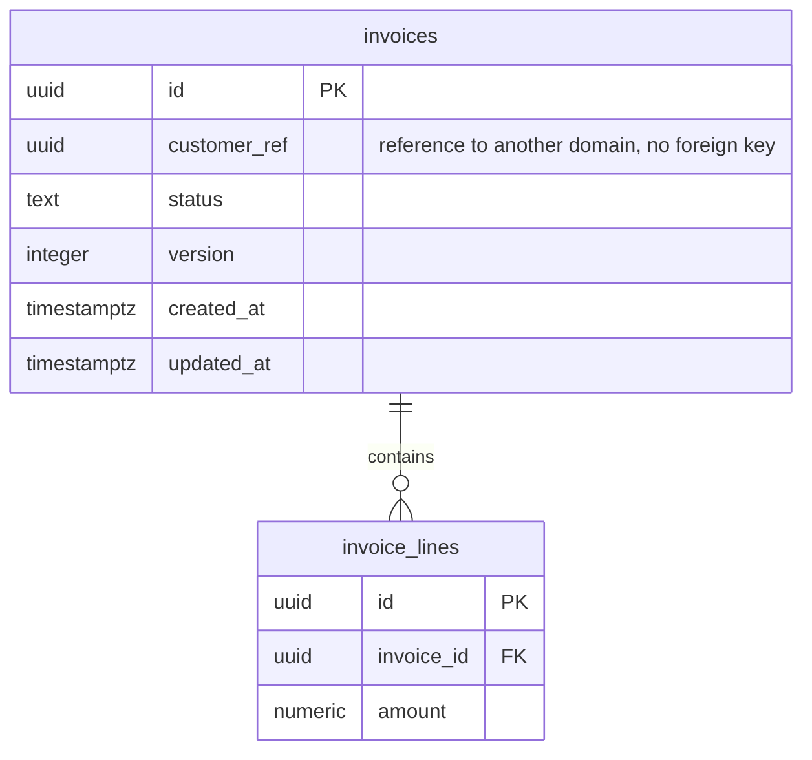

# Database contract

| | |
|---|---|
| Document | `.claude/skills/db/db.md` |
| Version / status | 0.1, draft |
| Purpose | The source of truth for designing, creating, changing, seeding, testing, migrating and operating the relational database of a product built with the contracts of this project. It holds the modelling method, the naming and type rules, the constraints, the migration rules, the data sets, the import of existing data, and the checks that prove the database is correct. |
| Related | `backend.md` (how the backend uses the database: sections 9 and 10), `api.md` (the contract that data serves), `i18n.md` (translated data), `tests.md` (how the database is tested), `ci-cd.md` (migration and seed steps S08, the `migrate` role), `infrastructure.md` (the database host, backups, limits), `workflow.md` (stories, the skeleton, the loop). |
| Owner | Architect (structure), with the Database Engineer for the technical content. Changes follow `workflow.md` 12.6. |
| Not covered | Security of data (roles per domain, row-level policies, encryption, masking, privacy erasure) and observability of the database: no-touch until all project phases are finished (`workflow.md` WFL-080). The places for them are reserved (section 17 and 23). The code of the backend is covered by `backend.md`. |

Normative words: MUST, MUST NOT, SHOULD, MAY. Rule IDs are `DBS-<group>-<nnn>`. The column "Ver." names the way a rule is checked: T test, I inspection (review), A analysis (tool or query), D demonstration. The column "Basis" names where the rule comes from (section 1.3).

## Contents and version

| Section | Content |
|---|---|
| 1 | Scope, definitions, rule classes and sources |
| 2 | The MVP profile: fixed core, simplifications, extension triggers |
| 3 | Architecture: one engine, one schema per domain, ownership |
| 4 | Modelling method |
| 5 | Naming and documentation |
| 6 | Types |
| 7 | Keys and identifiers |
| 8 | Relations and constraints |
| 9 | Standard columns, concurrency and deletion |
| 10 | Statuses and vocabularies |
| 11 | Special data: translations, documents, hierarchies, files, search, time |
| 12 | Indexes |
| 13 | Queries, views, functions and triggers |
| 14 | Transactions, concurrency and side effects |
| 15 | Schema migrations |
| 16 | Data sets and seeds |
| 17 | Access accounts, backup and recovery |
| 18 | Importing and migrating existing data |
| 19 | Performance and capacity |
| 20 | Testing the database |
| 21 | Tools and engines: frameworks, migration tools, type mapping |
| 22 | Documentation of the schema: inventory, dictionary, ER models |
| 23 | Deferred (security, observability, scale) |
| 24 | Edge cases |
| 25 | Restrictions |
| 26 | Quality: review, definition of done, workflows, required checks |
| 27 | Antipatterns |
| 28 | Sources and limits |
| 29 | Parameters and registers |

Version history: 0.1 first version, based on research of database design practice (normalisation, naming, keys, constraints, SQL antipatterns, evolutionary design, modular-monolith data ownership, identifier performance), the database and migration documents of the uploaded project, `backend.md` sections 9 and 10, and the workflow and pipeline of this project.

## 1. Scope, definitions, rule classes and sources

### 1.1 Scope

This contract is for a relational database used as the system of record by a modular monolith (`backend.md`). PostgreSQL is the default engine (DP01). The rules are written so that they hold for another relational engine; section 21 maps the differences. The contract covers one database per environment and one schema per business domain.

### 1.2 Definitions

| Term | Meaning |
|---|---|
| Engine | The database system (default PostgreSQL), in one major version in every environment (DBS-ARC-002). |
| Domain schema | The schema (namespace) that holds the tables of one business domain and only those (DBS-ARC-003). |
| Owner (of a table) | The domain that defines the table, changes its schema, and is the only one that writes its rows. |
| Aggregate | A cluster of rows that is loaded and saved as one unit by one repository (`backend.md` 6). |
| Reference data | Data the application needs to run (statuses with their meaning, locales, roles, categories fixed by the product). Loaded by migrations (DBS-SED-002). |
| Demonstration data | Data that makes the product look alive in non-production environments. Loaded by a seeder (DBS-SED-003). |
| Test data | Data a test creates for itself. |
| Migration | A versioned change of the schema or of data, applied by automation (section 15). |
| Expand and contract | The pattern that changes a structure in steps over several releases so that the old and the new code both work (DBS-MIG-006). |
| Backfill | A batch change of existing rows to fill a new structure (DBS-MIG-012). |
| Published view | A view that a domain publishes as a read contract for other parts (DBS-VWS-001). |
| Read model | A table or view shaped for reading, owned by one domain and rebuildable (`backend.md` BKD-PER-015). |
| Data dictionary | The generated description of all tables, columns, types, constraints and comments (section 22). |
| Import | The loading of data from another system into the database (section 18). |
| Live row | A row that is not marked deleted (when soft deletion is used). |

### 1.3 Rule classes and bases

| Class | Meaning |
|---|---|
| Fixed rule | A rule the product cannot change without a decision of the Architect and the PO (integrity, no destructive migration without a plan). |
| Rule | A MUST or MUST NOT rule that holds in every project. |
| Parameter | A choice with a default and a recorded value (section 29). |
| Default | A rule that holds unless a recorded reason says otherwise. |

| Basis code | Source of the rule |
|---|---|
| NRM | Normalisation and relational design (Codd, Date, Hernandez) |
| INT | Data integrity: keys, constraints, types |
| EVO | Evolutionary database design and migrations (Ambler and Sadalage, Fowler) |
| PRF | Performance, indexing and query design (Winand, engine documentation) |
| REL | Reliability: transactions, concurrency, recovery (Kleppmann) |
| DDD | Domain-driven design and data ownership in a modular monolith |
| ANT | SQL antipatterns (Karwin) |
| ENG | The documentation of the engine |
| PP | Established practice, as in `backend.md` |
| PRJ | Lessons from the uploaded projects |

## 2. The MVP profile

The database of the MVP is the smallest correct relational design: a clear model, integrity in the database, safe migrations, and nothing that waits for a need. Like `backend.md` 2.2, the profile has a fixed core, simplifications, and extension triggers.

### 2.1 Fixed core (always present)

| # | Element | Rule |
|---|---|---|
| 1 | One engine and one major version in every environment | DBS-ARC-001, DBS-ARC-002 |
| 2 | One database per environment, one schema per domain, table ownership | DBS-ARC-003, DBS-ARC-004 |
| 3 | No foreign key, join or query across domain schemas | DBS-ARC-005 |
| 4 | A modelling step before tables: entities, keys, rules, states | DBS-MOD-001 |
| 5 | Primary keys, `NOT NULL`, `UNIQUE`, `CHECK` and foreign keys (inside a domain) in the database | DBS-CON-001 |
| 6 | One naming style, comments on tables and columns | DBS-NAM-001, DBS-NAM-009 |
| 7 | Exact types: UTC instants, exact decimals, text, native keys | DBS-TYP-001 |
| 8 | A version column on every aggregate root | DBS-STD-002 |
| 9 | Migrations only, forward-only, compatible with the previous release | DBS-MIG-001, DBS-MIG-005 |
| 10 | Indexes for foreign keys and for real queries only | DBS-IDX-001 |
| 11 | Reference data and demonstration data kept apart; seeds repeatable | DBS-SED-001, DBS-SED-005 |
| 12 | Two accounts: one that migrates, one that the application uses at runtime | DBS-ACC-001 |
| 13 | Backups where data matters, and one tested restore before production data exists | DBS-ACC-004 |
| 14 | The data dictionary and the ER models generated from the database | DBS-DOC-001 |
| 15 | Tests on the real engine, migrations from empty | DBS-TST-001 |

### 2.2 Simplifications at the MVP

| Topic | Full design | MVP profile |
|---|---|---|
| Soft deletion | Marker, retention, restore | None unless a requirement needs it (DBS-STD-006); then one mechanism |
| Row-level audit trail | Trigger and audit schema | Not built; the columns for created, updated and the acting user exist (DBS-STD-004); the trail is deferred (section 23) |
| Triggers | Lifecycle, search, audit | Only where a trigger is the only way to guarantee an invariant (DBS-FNC-003) |
| Views | Published views for every cross-domain read | Only where a screen or another domain needs a stable read contract (DBS-VWS-001) |
| Read models, materialized views | For slow reads | Not at the MVP; added on a measured need (trigger DX1) |
| Partitioning | By time or tenant | Not at the MVP (DX2) |
| Full-text search | Language configurations, ranking | Engine search on the fields that a requirement names, when a requirement exists |
| Database accounts | One per domain with grants | Two accounts (migrate, runtime) (DBS-ACC-001); the rest is the security phase |
| Replicas, pooler, CDC | For scale and integration | Not at the MVP |
| Extensions | Several | Only those the engine needs for a requirement, each recorded (DBS-ENG-004) |
| JSON columns | For variable shapes | Only where the shape is variable (DBS-JSN-001) |
| Multi-tenancy | Tenant key, row policies | Not at the MVP (DX9) |
| Imports | Staged with gates | Staged only if existing data must be imported (section 18) |
| Stored procedures | Logic in the database | None |

### 2.3 Extension triggers

Each extension is a story with a trigger. The design does not grow ahead of its trigger.

| # | Extension | Trigger |
|---|---|---|
| DX1 | Read model or materialized view | A measured query exceeds its budget (DP12) after the index and the query were reviewed |
| DX2 | Partitioning | A table grows beyond DP13 rows, or retention needs cheap removal by time |
| DX3 | Row-level audit trail | An audit requirement, or the security phase is opened |
| DX4 | Read replica | Read load exceeds one instance after caching and read models |
| DX5 | One database account per domain with grants | The security phase is opened, or a domain is prepared for extraction |
| DX6 | One database per domain | A trigger of `backend.md` 18 (independent scaling, independent restore, noisy neighbour, extraction) |
| DX7 | Search extension or a separate search engine | The language search of the engine is not enough for a requirement |
| DX8 | Change data capture or event streaming | A consumer needs the data stream, and the outbox is not enough |
| DX9 | Multi-tenancy with row policies | A requirement for several tenants in one database |
| DX10 | Encryption of columns, masking, retention scrubbing | The security phase is opened |
| DX11 | A connection pooler | Instances times pool size reach the connection limit (DBS-PRF-005) |
| DX12 | Archival and retention jobs | A retention requirement or a table beyond its size budget |
| DX13 | Extensions of the engine (trigram search, geo types, others) | A requirement that the core engine cannot meet |
| DX14 | Stored functions beyond invariants | A measured need that cannot be met in the application |

### 2.4 Shortcut register

Every deliberate simplification the project keeps is listed in the register of 29.7 with its reason and the trigger that ends it (like `backend.md` 2.2 and `ci-cd.md` 3.4). The Auditor reads it at each epic gate.

| ID | Statement | Ver. | Basis |
|---|---|---|---|
| DBS-MVP-001 | The MVP database follows the fixed core of 2.1 and uses the simplifications of 2.2. A project does not remove an element of the fixed core. | I | PP |
| DBS-MVP-002 | An extension of 2.3 is created only when its trigger holds, by a story that names the trigger and the measurement. | I | PP |
| DBS-MVP-003 | Every simplification the project actually keeps is registered (29.7). An unregistered shortcut is a finding. | I | PP |
| DBS-MVP-004 | The design for later growth is structure only: one schema per domain, no cross-domain keys, identifiers that do not depend on one database, migrations that are compatible with the previous release. It does not add tables, columns or indexes ahead of a requirement. | I | EVO |

## 3. Architecture: one engine, one schema per domain

The database follows the modular monolith of `backend.md` 3 and 4. The research on data isolation in modular monoliths recommends starting with one schema per module and moving to one database per module only when a need appears; the boundary matters more than the physical form.

| Option | Isolation | Cross-module transaction | Operations | Use |
|---|---|---|---|---|
| One schema for everything | None | Free | Simplest | Not allowed: it erases the domain boundary |
| **One database, one schema per domain** | Logical | Possible, discouraged | One database to run | **Default** |
| One database per domain | Physical | Not possible; events or sagas | One database per domain | Extension DX6, on a trigger |

| ID | Statement | Ver. | Basis |
|---|---|---|---|
| DBS-ARC-001 | The system of record is one relational engine. PostgreSQL is the default (DP01). The engine is chosen once, in the decisions record (`architecture.md`), and not per domain. | I | PP |
| DBS-ARC-002 | Every environment, including the developer machine, the pipeline and tests, runs the same engine in the same major version. No logic depends on a substitute engine, and an in-memory or embedded substitute is not used to run tests that the production engine would decide differently (`backend.md` BKD-PER-022). | T | PRJ |
| DBS-ARC-003 | Each domain has one schema, named like the domain (`billing`, `catalog`). A table lives in exactly one schema. Where an engine has no schemas, a name prefix per domain plays the same role. | T | DDD |
| DBS-ARC-004 | The domain that has a table owns it: it defines the structure, changes it through its own migrations (`backend/<domain>/migrations`), and is the only part that writes its rows. Other domains read the data through the published interface of the owner, or through a published view (DBS-VWS-001), never from the table directly. | T | DDD |
| DBS-ARC-005 | A domain MUST NOT join, query or reference a table of another domain, and a foreign key MUST NOT cross a schema boundary (`backend.md` BKD-PER-004). References to another domain's data are stored as identifiers, checked through the owner's published interface when written, and tolerated when the referenced data is gone. | T | DDD |
| DBS-ARC-006 | Data that several domains need and no domain owns (a locale list, units) is owned by one domain that publishes it; the others hold identifiers and copy what they need (the copy rule of `backend.md` 3.4). A shared schema for convenience (`common`, `shared`) is not allowed. | I | DDD |
| DBS-ARC-007 | Cross-domain consistency is reached with application services, integration events and the outbox (`backend.md` 12), not with a distributed transaction or a cross-schema foreign key. A transaction that spans two domains is an exception, recorded with its reason (`backend.md` BKD-APP rules). | I | DDD |
| DBS-ARC-008 | The migration history of each domain is kept in its own schema (a history table per domain). The `migrate` role runs the histories of all domains, and the order between domains does not matter (`backend.md` BKD-MIG-015). | T | EVO |
| DBS-ARC-009 | The schema is shaped so that a domain can be moved to its own database later: no cross-schema keys, no cross-schema views that join, no shared sequences, no stored function that touches two schemas. The MVP only prepares this by structure (DBS-MVP-004). | A | DDD |
| DBS-ARC-010 | One schema per domain, not one table per language, per category or per tenant. Data that differs by value is modelled as rows, not as new tables (DBS-ANT-001). | I | ANT |
| DBS-ARC-011 | A framework's own tables (job queues, session store, framework migration history) are placed in a schema of their own, listed in the schema register (29.2), generated by the framework's tool, and do not carry business data. | I | PRJ |
| DBS-ARC-012 | The database is not a message bus, a cache or a file store. Queues exist as the outbox of a domain (DBS-TXN-005) and files live in object storage with only metadata in the database (`backend.md` BKD-PER-025). | I | PP |

## 4. Modelling method

The model comes from the business, not from screens or old table names. The method follows the classic order: purpose, entities, attributes, keys, relationships, rules, review.

| Step | Output | Owner |
|---|---|---|
| 1. Purpose and rules | The use cases and business rules of the domain (from stories and `requirements.md`), in the ubiquitous language | PO, BA |
| 2. Entities and aggregates | The things the domain keeps, their identity, and the aggregates (`backend.md` 6) | Backend Developer, Architect |
| 3. Attributes | The facts about each entity, each with a meaning, type, null rule and a unit where needed | Database Engineer |
| 4. Keys and relationships | Identity, one-to-many, many-to-many through an association table, the references to other domains (as identifiers only) | Database Engineer, Architect |
| 5. States and rules | The statuses, the allowed transitions (in the application), the rules that are constraints (in the database) and the rules that are services | Backend Developer |
| 6. Normalise | Third normal form, then deliberate exceptions (DBS-MOD-004) | Database Engineer |
| 7. Physical design | Tables, types, constraints, indexes, comments (sections 5 to 13) | Database Engineer |
| 8. Review and generate | A review against this contract; the ER model and the data dictionary generated from the database (section 22) | Reviewer, Auditor |

| ID | Statement | Ver. | Basis |
|---|---|---|---|
| DBS-MOD-001 | Before a table is created, the domain's entities, keys, relationships, states and rules are written down in the domain README or the story (aggregates, tables, rules). A table with no recorded purpose and rule is not created. | I | NRM |
| DBS-MOD-002 | Table and column names come from the ubiquitous language of the domain (`requirements.md` glossary), not from screen labels, files of an old system or technical tools. | I | DDD |
| DBS-MOD-003 | The relational design is normalised to third normal form: each fact is stored once, every non-key column depends on the key, the whole key and nothing but the key. Repeated groups, comma-separated lists and derived duplicates are not stored. | I | NRM |
| DBS-MOD-004 | A denormalised column or table is allowed only for a recorded reason (a measured query, or a business rule such as the price at the time of the order), is marked as derived in its comment, and has a defined way to stay correct (the same transaction, a trigger, an event, or a rebuild). | I | NRM |
| DBS-MOD-005 | A many-to-many relationship is an association table with a key made of the two foreign keys (or its own key and a unique pair), and any attributes of the relationship as columns. A list of identifiers in one column is not allowed (DBS-ANT-002). | T | ANT |
| DBS-MOD-006 | A rule that concerns one row (a range, a combination of columns, an allowed set) is a `CHECK`. A rule that concerns several tables is enforced by the service in one transaction and tested (`backend.md` BKD-PER-005). The database enforces what it can; the service handles the rest. | T | INT |
| DBS-MOD-007 | An attribute that is a single fact is one column. Several columns that hold the same fact under different numbers (`phone1`, `phone2`) are a dependent table (DBS-ANT-003). | I | ANT |
| DBS-MOD-008 | Optional facts (null) are modelled on purpose: a column is nullable only when "unknown" or "not applicable" is a real state, and its comment says which. A column with many nulls that belong together is a sign of a separate table. | I | NRM |
| DBS-MOD-009 | Polymorphic references (a type column plus an identifier that points to different tables) are not used for relations that need integrity. The alternatives are separate association tables, a common parent table, or a typed reference per kind (DBS-ANT-004). | I | ANT |
| DBS-MOD-010 | A generic entity-attribute-value table is not used for ordinary business facts (DBS-ANT-005). | I | ANT |
| DBS-MOD-011 | Temporal facts are modelled on purpose: the instant something happened, the period a fact is valid, and history that must be kept (a revision table or a version per row). The choice is recorded per entity. | I | NRM |
| DBS-MOD-012 | The model is changed through stories and migrations, not by editing tables by hand. The domain README and the data dictionary change in the same change (DBS-JSN-001). | I | EVO |

## 5. Naming and documentation

A name is effectively permanent: a rename touches the application, reports, jobs and every consumer. One convention is chosen and checked by a linter.

| ID | Statement | Ver. | Basis |
|---|---|---|---|
| DBS-NAM-001 | One naming style holds for the whole database (DP03). Default: `snake_case`, lower case, no quotes needed, ASCII letters, digits and underscores only, starting with a letter. Quoted or mixed-case identifiers are not used. | T | ENG |
| DBS-NAM-002 | One language for all identifiers (default English), whatever the language of the content. | I | PP |
| DBS-NAM-003 | Table names are plural nouns of the entity (`invoices`, `invoice_lines`); association tables name both sides (`article_tags`). Column names are singular and say what the value is (`issued_at`, `total_amount`). | I | PP |
| DBS-NAM-004 | Names do not repeat the table name in every column except for the key (`id`) and foreign keys (`invoice_id`). Booleans read as facts (`is_active`, `has_attachment`) or are replaced by a status. Time columns end in `_at` (instants) or `_on` (calendar dates). Amounts carry their unit or currency in a companion column or in the name. | I | PP |
| DBS-NAM-005 | Constraints, indexes and sequences have explicit, stable names that follow a pattern: `pk_<table>`, `uq_<table>_<columns>`, `fk_<table>_<column>`, `ck_<table>_<rule>`, `ix_<table>_<columns>`. The pattern is enforced by the migration linter. Names stay within the engine's length limit (63 bytes for PostgreSQL); a stable abbreviation rule is used when needed. | T | ENG |
| DBS-NAM-006 | Names are not reserved words of the engine or of SQL, and do not contain data (a year, a tenant, a language code) (DBS-ANT-006). | A | ANT |
| DBS-NAM-007 | A name does not carry a type prefix (`tbl_`, `vw_`), except for views that are published and need a marker (`v_<name>`, DBS-VWS-001). | I | PP |
| DBS-NAM-008 | Abbreviations are those of the glossary only. A name is not shortened to save typing. | I | PP |
| DBS-NAM-009 | Every table and every column has a comment (`COMMENT ON`, or the engine's equivalent) that states the meaning, the unit, the null rule and, for derived data, how it is derived. Comments are part of the migration that creates the object. | A | ENG |
| DBS-NAM-010 | The migration files are named by their purpose and version (`V0012__add_status_to_invoice`). The pattern is fixed per project (DP04) and checked by the linter (DBS-MIG-014). | T | EVO |

## 6. Types

| ID | Statement | Ver. | Basis |
|---|---|---|---|
| DBS-TYP-001 | Use the exact native type for each fact: UTC instants as `timestamptz` (zone-aware), calendar dates as `date`, durations as `interval` or an integer with a unit, truth values as `boolean`, identifiers as the native key type (DBS-KEY-001), text as `text`, counts as integer types, exact quantities as `numeric`. | T | INT |
| DBS-TYP-002 | Money and any exact decimal quantity use `numeric(p,s)` (or integer minor units with a currency). `float`, `double` and `real` are not used for money or for values that must add up exactly (DBS-ANT-007). A currency is stored with the amount whenever more than one currency is possible. | T | ANT |
| DBS-TYP-003 | Instants are stored in UTC with a zone-aware type; the database server, the application and the connection operate in UTC. Conversion to a local time zone happens at the boundary of the interface. A local calendar date with no time (a birthday, a due date) is a `date`. A future local event in a named zone stores the instant and the zone name. | T | PP |
| DBS-TYP-004 | `text` is used for character data. A length limit is a `CHECK` or a bounded type only when the domain has a real bound (a code of 3 letters); a limit chosen for habit is not set. In PostgreSQL `varchar(n)` and `text` perform the same. | I | ENG |
| DBS-TYP-005 | Text is stored as UTF-8. The collation and the comparison rules (case, accents) are set once (DP05) and tested with the characters of the supported languages, including umlauts, ß, combining marks and emoji. Searching and sorting do not change what is stored. | T | PP |
| DBS-TYP-006 | Identifiers (a country code, a currency code) use the standard code with a `CHECK` or a reference table, not free text. | I | INT |
| DBS-TYP-007 | Enumerated vocabularies that change with the product are not native enum types. They are `text NOT NULL` with a named `CHECK`, or a reference table (section 10). Native enum types are hard to change in a live database. | I | PRJ |
| DBS-TYP-008 | Booleans are `boolean NOT NULL` with a default. A nullable boolean (three states) is replaced by a status. | I | INT |
| DBS-TYP-009 | Binary content (files, images, documents) is not stored in ordinary columns. The database holds metadata and the key of the object in the storage (`backend.md` BKD-PER-025). A small binary value that is part of the data (a hash, a token digest) uses `bytea` or the engine's equivalent. | I | PP |
| DBS-TYP-010 | A column has one type for one meaning in every table (the same `amount` type, the same identifier type). A type change is a migration with the expand-and-contract steps. | A | EVO |
| DBS-TYP-011 | The value of a column is never a placeholder that means something else (`0`, `''`, `1900-01-01`, `N/A`) for unknown. Unknown is `NULL` where the model allows it (DBS-MOD-008). | I | ANT |
| DBS-TYP-012 | Personal and other sensitive values are typed and named like all other data. Their classification, protection and erasure belong to the security phase (section 23) and are marked in the column comment when known. | I | PP |

## 7. Keys and identifiers

| ID | Statement | Ver. | Basis |
|---|---|---|---|
| DBS-KEY-001 | Every table has a primary key. The default key type is a time-ordered UUID (version 7), created by the application through the injected generator (DP02, `backend.md` BKD-PER-009). Time-ordered keys append at the end of the index, so inserts stay local; random UUIDs scatter inserts, split index pages and bloat the index. | T | PRF |
| DBS-KEY-002 | A `bigint` identity key is allowed for tables that are append-heavy, internal and never exposed (an outbox, an event log, an association table): it is smaller (8 bytes) and the fastest for inserts. The choice is recorded per table. `integer` keys are not used for tables that may grow (the range runs out and changing a key later touches every foreign key). | I | PRF |
| DBS-KEY-003 | Identifiers are opaque. They carry no meaning, are never reused, are never renumbered, and clients and other domains do not compute with them (DBS-ANT-008). A time-ordered UUID carries its creation time; where that is not acceptable, a random UUID or a separate public identifier is used, and the cost in the index is accepted. | I | ANT |
| DBS-KEY-004 | A human-readable business number (an invoice number, a case number) is not the primary key. It comes from a sequence or a counter owned by the domain, is formatted by a rule, has a unique constraint, and may have gaps (`backend.md` BKD-PER-009). Gapless numbering required by law is a separate design with locking, recorded as an exception. | T | PP |
| DBS-KEY-005 | A natural key (a code, a slug, an email) is a `UNIQUE` constraint, not the primary key, unless it is permanent and meaningful by definition (an ISO country code in a reference table). | I | INT |
| DBS-KEY-006 | A composite primary key is used for association tables (the two foreign keys). A table that other tables reference by a composite key needs a clear reason; a single-column key is preferred for referenced tables. | I | NRM |
| DBS-KEY-007 | The application creates identifiers, so that an aggregate has its identity before it is saved, tests control them, and the database has no hidden default that differs between engines. The database MAY keep a default as a safety net for manual inserts in non-production environments. | I | PP |
| DBS-KEY-008 | Sequences and identity columns are not shared between tables or domains, and their values are never reset by hand in a shared environment. | I | DDD |
| DBS-KEY-009 | A key type decision is recorded in the table inventory (29.1) and not changed without the steps of expand and contract. | I | EVO |
| DBS-KEY-010 | An identifier that is visible outside the system (in a URL or a message) is not a guessable counter when guessing would matter. Which identifiers are exposed is decided with `api.md`; the security phase decides the rest. | I | PP |

## 8. Relations and constraints

The database is the last line of defence: application checks give good messages, constraints guarantee integrity under concurrency and for every code path.

| ID | Statement | Ver. | Basis |
|---|---|---|---|
| DBS-CON-001 | Declare in the database every rule it can enforce: primary key, `NOT NULL`, `UNIQUE`, `CHECK` and foreign keys inside a domain. Skipping constraints and leaving them to the application ("keyless entry") is not allowed (DBS-ANT-009). | T | INT |
| DBS-CON-002 | Every foreign key inside a domain is declared with an explicit name. The default action is `ON DELETE RESTRICT` and `ON UPDATE RESTRICT` (or `NO ACTION`). `CASCADE` is used only for rows that are part of the same aggregate and have no meaning alone (the lines of an order), with a recorded reason. `SET NULL` is used only when the column is nullable by design. | I | INT |
| DBS-CON-003 | Every foreign key column has an index that starts with the key column, unless a primary key or a unique index already covers it. Without it, parent deletes and updates scan the child table and hold locks (DBS-IDX-002). | A | PRF |
| DBS-CON-004 | `NOT NULL` is the default for every column. A nullable column has a recorded meaning (DBS-MOD-008). A `CHECK` on a nullable column passes for `NULL`, so a mandatory value needs `NOT NULL` as well. | T | INT |
| DBS-CON-005 | A rule that a combination of columns must be unique is a `UNIQUE` constraint on those columns. A rule that is unique only among some rows (live rows, one active row per parent) is a partial unique index with the condition named in the comment. Uniqueness is never enforced by a check in the application alone. | T | INT |
| DBS-CON-006 | Local row rules are named `CHECK` constraints: ranges, allowed sets, combinations (`end_at > start_at`, `(status = 'deleted') = (deleted_at IS NOT NULL)`). A check does not read other tables. | T | INT |
| DBS-CON-007 | A composite foreign key is used where a child must belong to the same parent as another child (an option that belongs to the same poll as the vote), so that a wrong combination cannot be stored. | T | PRJ |
| DBS-CON-008 | Constraints are not deferred by default. A deferrable constraint is used only when a cycle or a batch load needs it, and is recorded. | I | PP |
| DBS-CON-009 | A rule that a unique value needs a lookup in the application before insert ("check then insert") is replaced by the unique constraint and the handling of its violation, because the check races under concurrency (`backend.md` BKD-PER-005). | T | REL |
| DBS-CON-010 | On a live table with data, a new constraint is added without a long lock: for example add it unvalidated, validate it in a second step, and fix the violating rows first (DBS-MIG-007). | I | EVO |
| DBS-CON-011 | A violated constraint is mapped by the persistence adapter to the documented conflict or validation error, never to a generic failure (`backend.md` BKD-PER-005). The constraint names are the stable keys for this mapping. | T | PP |
| DBS-CON-012 | Constraints are not disabled, dropped or left unvalidated in a shared environment to make a load or a test pass. | I | PRJ |
| DBS-CON-013 | Exclusion constraints (no overlapping periods, no double booking) are used where the engine supports them and the rule is a database invariant; otherwise a service with locking enforces the rule and a test proves it. | T | INT |
| DBS-CON-014 | A reference to another domain's data is a plain identifier column with no foreign key (DBS-ARC-005). Its comment names the owner and the published interface. Integrity of such references is checked when written and tolerated when the target is gone. | I | DDD |

## 9. Standard columns, concurrency and deletion

| ID | Statement | Ver. | Basis |
|---|---|---|---|
| DBS-STD-001 | Every mutable table has these standard columns: `id` (the key), `created_at` and `updated_at` (`timestamptz NOT NULL`). A table that is insert-only (an event log, a revision, an outbox record that is never edited) has `created_at` only and is never updated (DBS-STD-008). | T | PP |
| DBS-STD-002 | Every aggregate root has `version integer NOT NULL` starting at 1. An update is conditional on the expected version, increments it, and a mismatch raises the conflict error. The version is the source of the `ETag` of `api.md` (`backend.md` BKD-PER-007). | T | REL |
| DBS-STD-003 | `created_at` and `updated_at` are set by the application from the injected clock, so that tests control time (`backend.md` BKD-PER-010). A database default (`now()`) MAY exist as a safety net for manual inserts and seeds, and does not replace the application's value. | T | PP |
| DBS-STD-004 | Columns for the acting user (`created_by`, `updated_by`) exist on tables whose changes will need accountability, as nullable identifiers without a foreign key (the user lives in another domain, DBS-CON-014). Until the security phase they stay empty or hold a system value (`backend.md` BKD-PER-023). | I | PP |
| DBS-STD-005 | A table whose rows have a lifecycle has a `status` column (`text NOT NULL`, a named `CHECK`, section 10). A `status_changed_at` instant is added only when a requirement reads it. | T | PP |
| DBS-STD-006 | Soft deletion is used only when a requirement needs it (retention, restore, accountability). When it is, one mechanism is used in every domain: a nullable `deleted_at` instant (and `deleted_by` where needed), a check that ties the marker to the status where a status exists, exclusion of deleted rows by default in every repository query, unique constraints that treat deleted rows deliberately (usually partial unique indexes on live rows), and a retention rule that ends it (`backend.md` BKD-PER-017). | I | PP |
| DBS-STD-007 | When soft deletion is not required, rows are deleted physically by the owning domain's service, and the foreign keys (`RESTRICT`) prevent orphans. Soft deletion is not a habit. | I | PP |
| DBS-STD-008 | An insert-only table (history, events, revisions) is never updated or deleted by the application. The MVP guards this by the repository (no update statement exists) and by a test; grants that make it impossible belong to the security phase (section 23). | T | REL |
| DBS-STD-009 | Entities that need history have a revision table: the aggregate's identifier, a revision number (unique together), a bounded snapshot or a diff, the time and the acting user. A revision is written in the same transaction as the change. Revisions serve restore and review; they are not an audit trail (DBS-STD-010). | T | PP |
| DBS-STD-010 | A revision history, an audit trail and an external event feed are three different things and are kept in three different structures. A revision supports editors, an audit trail supports accountability (deferred, DX3), an event feed reflects what an external provider reported. | I | PRJ |
| DBS-STD-011 | Columns of a table are ordered by habit: the key, the foreign keys, the business columns, the status, the standard columns. The order carries no meaning and is not relied on. | I | PP |
| DBS-STD-012 | Counters and totals that are derived from other rows are either computed on read, or stored as a recorded denormalisation (DBS-MOD-004) that is updated atomically (`UPDATE ... SET n = n + 1`), never by read-modify-write. | T | REL |

## 10. Statuses and vocabularies

| ID | Statement | Ver. | Basis |
|---|---|---|---|
| DBS-VOC-001 | A status vocabulary is specific to its table and named by the domain (`draft`, `in_review`, `published`). Vague universal values reused across tables (`online`, `offline`, `posted`) are not used. The values and their meaning are in the domain README. | I | PRJ |
| DBS-VOC-002 | A closed vocabulary is `text NOT NULL` with a named `CHECK` (`ck_<table>_status`). A vocabulary whose values carry attributes (a label, an order, flags), that the business edits, or that other domains read, is a reference table with a stable text key. Native enum types are not used (DBS-TYP-007). | T | ANT |
| DBS-VOC-003 | There is one source of truth for the allowed values: the domain's type in the code, or the reference table. A test proves that the database check equals the domain type, so that a value cannot be added in one place only (DBS-ANT-010). | T | PRJ |
| DBS-VOC-004 | A status `CHECK` is a structural vocabulary constraint. The allowed transitions between statuses are rules of the domain, enforced in the application and tested, with the version column guarding concurrent changes (`backend.md` 6). | T | PRJ |
| DBS-VOC-005 | Adding a value is a migration (expand). Removing or renaming a value follows expand and contract: the code stops writing the value, the data is converted, then the value is removed from the check. | I | EVO |
| DBS-VOC-006 | A status that has a time of change that matters, or that two instants must be consistent with (`published` needs `published_at`), is protected by a `CHECK` that ties them together. | T | INT |
| DBS-VOC-007 | Display labels of a vocabulary are not stored in the vocabulary column. Labels are language keys (`i18n.md`) or translated rows (11.1). | I | PP |

## 11. Special data

### 11.1 Translations

| ID | Statement | Ver. | Basis |
|---|---|---|---|
| DBS-SPC-001 | Translated content follows the pattern of `i18n.md`: a language-independent parent row and one translation row per locale (`<entity>_translations`) with a unique key on (parent, locale). A table per language, or a column per language, is not used. | T | NRM |
| DBS-SPC-002 | The locale is a code that refers to the owner of the locale list. Inside the owner's domain it is a foreign key; in another domain it is an identifier column (DBS-CON-014). | I | DDD |
| DBS-SPC-003 | The lifecycle of a translation (draft, published) is its own status, independent of the parent and of other locales, when the product publishes languages separately. Publishing one locale does not publish another. | T | PRJ |
| DBS-SPC-004 | A missing translation is a state the application handles with a documented fallback. Missing rows are not filled with copies of another language in the database. | I | PP |
| DBS-SPC-005 | Interface texts (labels, messages) are not stored in the database; they are language keys in the frontend (`i18n.md`). Only content that editors manage lives in translation tables. | I | PP |

### 11.2 Documents (JSON)

| ID | Statement | Ver. | Basis |
|---|---|---|---|
| DBS-JSN-001 | A document column (`jsonb` or the engine's equivalent) holds only data whose shape is really variable (a form definition, a block structure of an article, a bounded snapshot). Data that business rules read, filter, join or constrain is modelled as columns and tables (`backend.md` BKD-PER-014). | I | PP |
| DBS-JSN-002 | A document column has a recorded schema and a `schema_version`, is validated before it is saved, has a size limit, and is never an array of relations (references to other rows as a list in JSON). | T | PRJ |
| DBS-JSN-003 | Fields of a document that are queried often are promoted to columns (or a generated column) and indexed; a document index (GIN) exists only for a query that needs it (DBS-IDX-008). | A | PRF |
| DBS-JSN-004 | The application distinguishes an absent field from a JSON `null`. A document that is compared or hashed is canonicalised first (key order, number format). | T | PRJ |
| DBS-JSN-005 | A derived form of a document (sanitised HTML made from structured blocks) is computed from the source and is not the only stored form unless a requirement says so. When it is stored, it carries the hash of its source. | I | PRJ |

### 11.3 Hierarchies, ordering, files, search and time

| ID | Statement | Ver. | Basis |
|---|---|---|---|
| DBS-SPC-010 | A hierarchy (categories, comments with replies) is an adjacency list (`parent_id`) by default, read with a recursive query, with a depth limit and a check that prevents a cycle (in the service, tested). A closure table or a path column is used when depth and read load are high (a recorded decision); nested sets only for read-mostly data. This avoids the naive-tree trap (DBS-ANT-011). | I | ANT |
| DBS-SPC-011 | The order of items is an explicit `position` column, unique per parent. A change of order is made by a service in one transaction. Order is never inferred from creation time or the key. | T | PP |
| DBS-SPC-012 | A file is a row of metadata: the key in the storage, name, content type, size, hash, status (for processing), and the owner. The row is the source for what exists; the content is in the storage (`backend.md` BKD-PER-025). A row whose object is missing, or an object with no row, is found by a repair job and reported. | I | PP |
| DBS-SPC-013 | Search uses the engine's full-text feature on the fields a requirement names: a stored search column that is kept current by a generated column or a trigger, a language configuration chosen from a fixed allowlist, weights per field, and an index. `LIKE '%text%'` or a regular expression is not a search engine (DBS-ANT-012). | I | ANT |
| DBS-SPC-014 | A period is stored as two instants with a rule: start inclusive, end exclusive, `end > start` as a `CHECK` (or a range type). A period that is open-ended uses a `NULL` end with a documented meaning. | T | INT |
| DBS-SPC-015 | A token, a link or a code that expires has an `expires_at`, an index for cleanup, a one-time-use marker where needed, and a cleanup job that removes or marks expired rows. Expiry is checked on read; it does not wait for the cleanup. | T | PP |
| DBS-SPC-016 | A scheduled time is an unambiguous instant (UTC). A time that depends on a local zone and daylight saving stores the instant and the zone name, and the conversion rule is tested for the ambiguous and the missing hour. | T | PRJ |
| DBS-SPC-017 | A secret value (a password hash, a token) is stored as a digest, not as readable text, and never in a column that is selected by default. The measures that protect it (hashing parameters, rotation) belong to the security phase; the rule that it is never stored readable holds now (DBS-ANT-013). | I | ANT |

## 12. Indexes

| ID | Statement | Ver. | Basis |
|---|---|---|---|
| DBS-IDX-001 | An index exists because a recorded query needs it. Keys and unique constraints create their own indexes. Beyond them, the index is created together with the query that uses it, in the same migration (`backend.md` BKD-PER-013). | I | PRF |
| DBS-IDX-002 | Every foreign key column and every sort key used in a list has an index that starts with it, unless covered by another index. | A | PRF |
| DBS-IDX-003 | A composite index puts the equality columns first, then the range or sort column. The column order follows the query, and the index is checked with the plan (DBS-IDX-006). | I | PRF |
| DBS-IDX-004 | List queries use keyset (cursor) pagination over a stable total order with a unique tie-breaker (`(published_at, id)`), backed by an index with the same order. The maximum page size is enforced in the query (DP08). Offset pagination is allowed only for small, bounded sets (`backend.md` BKD-PER-011). | T | PRF |
| DBS-IDX-005 | A partial index covers a hot subset (the live rows, the pending jobs: `WHERE status = 'pending'`), and the condition of the index equals the condition of the query. | I | PRF |
| DBS-IDX-006 | A new index is accompanied by evidence: the query, the plan before and after (`EXPLAIN (ANALYZE, BUFFERS)` on realistic data), and the expected write cost. An index with no evidence is rejected in review. | I | PRF |
| DBS-IDX-007 | Indexing every column "to be safe" (the index shotgun) is not allowed. Every index costs writes and cache, and slows the migrations (DBS-ANT-014). | I | ANT |
| DBS-IDX-008 | Special indexes (full-text GIN, document GIN, trigram, expression, covering `INCLUDE`) exist for a named query and are recorded in the index register (29.3). | I | PRF |
| DBS-IDX-009 | On a table with data, an index is created without blocking writes (`CREATE INDEX CONCURRENTLY` in PostgreSQL) in its own migration outside a transaction, and an invalid index left by a failure is dropped and recreated (`DBS-MIG-007`). | T | ENG |
| DBS-IDX-010 | Unused and duplicate indexes are found by a query on the engine's statistics at each epic gate and removed by a migration. | A | PRF |
| DBS-IDX-011 | Case-insensitive or normalised uniqueness (an email, a slug) is an index on the normalised expression (`lower(email)`) or a case-insensitive type, and the application normalises the same way before comparing. | T | INT |
| DBS-IDX-012 | Statistics and maintenance (vacuum, analyze, reindex) run by the engine's automatic mechanism. A manual maintenance job is added only on a measured need and recorded. | I | ENG |

## 13. Queries, views, functions and triggers

### 13.1 Queries

| ID | Statement | Ver. | Basis |
|---|---|---|---|
| DBS-QRY-001 | Values reach the database only as bound parameters. A statement is never built by joining input into text. Names of sort columns and filters come from an allowlist. Raw SQL is allowed in persistence adapters when the data-access framework cannot express the query (`backend.md` BKD-PER-018). | T | PP |
| DBS-QRY-002 | Statements name their columns: `INSERT` with a column list and `SELECT` with the needed columns. `SELECT *` and `INSERT` without columns are not used in application code (implicit columns break when the schema changes). | A | ANT |
| DBS-QRY-003 | Every list query has a deterministic order, a bounded size and an index (DBS-IDX-004). A query without `ORDER BY` has no defined order and is not relied on. | T | PRF |
| DBS-QRY-004 | `NULL` is handled as a distinct state (three-valued logic): comparisons with `NULL` use `IS NULL` or `IS DISTINCT FROM`, counts and aggregates account for it, and nullable columns have a recorded meaning (DBS-MOD-008). | T | ANT |
| DBS-QRY-005 | `GROUP BY` queries select only grouped or aggregated columns. A query that is hard to read is split into smaller queries or steps, so that it does not grow into a "spaghetti query" with accidental cartesian products. | I | ANT |
| DBS-QRY-006 | Random selection is not done with `ORDER BY random()` on a large table. A random key, a sampling feature or application-side selection is used. | I | ANT |
| DBS-QRY-007 | The N+1 pattern does not occur. A list loads what it needs with a bounded number of statements, selected explicitly, and the integration test of a list use case asserts the number of statements (`backend.md` BKD-PER-012). | T | PRF |
| DBS-QRY-008 | Business logic is not written in SQL beyond set operations. Rules live in the domain layer (`backend.md` 6). A query returns data; it does not decide business outcomes. | I | DDD |
| DBS-QRY-009 | A statement that runs longer than the limit is stopped (DP06) and a lock that is waited for longer than its limit fails (DP07), with a documented error (`backend.md` BKD-PER-020). | T | REL |
| DBS-QRY-010 | Queries against deleted-by-marker data exclude it by default in the repository; including deleted rows is an explicit, named method (DBS-STD-006). | T | PP |
| DBS-QRY-011 | Database errors are not ignored or swallowed ("see no evil"). They are mapped to documented errors, and their causes are logged with the statement name and identifiers, without values that are personal data (`backend.md` 13). | T | ANT |

### 13.2 Published views

| ID | Statement | Ver. | Basis |
|---|---|---|---|
| DBS-VWS-001 | A view is created when a screen, an export or another domain needs a stable read contract over a domain's data. A published view has the prefix `v_`, an owner (the domain), a documented column list, and is listed in the view register (29.4). | I | DDD |
| DBS-VWS-002 | A view reads only tables of its own domain (DBS-ARC-005). A cross-domain read is composed in the application layer from the published interfaces of the domains, or from a read model that the consuming domain maintains (`backend.md` BKD-PER-016). | A | DDD |
| DBS-VWS-003 | A view is read-only. Rows are changed in the tables through the owner's services. | I | PP |
| DBS-VWS-004 | A public-read view contains the visibility rule in one place (only live, published, in-date rows), so that no query bypasses it, and exposes only the fields that are safe to publish. Staff previews use separate queries, not a flag that switches the view's rule. | T | PRJ |
| DBS-VWS-005 | A view is changed by a migration like a table. Its column list is a contract: removing or renaming a column follows expand and contract. | T | EVO |
| DBS-VWS-006 | A materialized view or another read model is an extension (DX1): it carries the version of the data it reflects, is rebuildable, and is refreshed by a documented mechanism. | I | PP |

### 13.3 Functions and triggers

| ID | Statement | Ver. | Basis |
|---|---|---|---|
| DBS-FNC-001 | The domain layer holds business rules; the database holds integrity. A stored function or a trigger is not a place for workflows, business decisions, external calls or sending messages. | I | DDD |
| DBS-FNC-002 | A trigger or function is allowed only for: an invariant that no constraint can express, a derived column that must stay in step with its source (a search column), or, in the security phase, row-level audit (DX3). Each is recorded with its reason in the function register (29.4). | I | PP |
| DBS-FNC-003 | At the MVP the timestamps, the version and the standard columns are set by the application, not by triggers (DBS-STD-003). A trigger that sets them is a shortcut that needs a recorded reason (for example a table that is also written by an import). | I | PRJ |
| DBS-FNC-004 | A function or trigger lives in the schema of its domain, is created by a migration, has a fixed `search_path`, qualified object names and a test. `SECURITY DEFINER` is not used at the MVP. | T | ENG |
| DBS-FNC-005 | A trigger does not write to another domain's tables, does not call the network, and does not run long. A trigger that fails aborts the write; its failure behaviour is tested. | T | REL |
| DBS-FNC-006 | Extensions of the engine are created by a migration, listed in the extension register (29.6) with their need, and installed in every environment (DBS-ARC-002). | I | PP |

## 14. Transactions, concurrency and side effects

| ID | Statement | Ver. | Basis |
|---|---|---|---|
| DBS-TXN-001 | A use case runs in one transaction over the data of one domain. The boundary is in the application layer (`backend.md` 7), the transaction is short, and nothing slow (a network call, a file operation, a user wait) happens inside it. | T | REL |
| DBS-TXN-002 | The default isolation is the engine's default (read committed for most engines). A stronger level is chosen per use case with a recorded reason. Under repeatable read or serializable the whole transaction is retried on a serialization failure or a deadlock, a bounded number of times, only when the use case is idempotent (`backend.md` BKD-PER-006). | T | REL |
| DBS-TXN-003 | Concurrent changes are guarded by the version column (optimistic concurrency, DBS-STD-002). A pessimistic lock (`FOR UPDATE`, an advisory lock) is used only when optimistic control cannot express the rule, is held briefly, is taken in a documented order, and is recorded (`backend.md` BKD-PER-008). Workers use leases and `SKIP LOCKED`, and recheck the state after taking a lock. | T | REL |
| DBS-TXN-004 | An external effect (an email, a call to another system, an object storage operation) is never made while a transaction is open. The transaction commits an outbox row; a dispatcher performs the effect after the commit (`backend.md` 12). | T | REL |
| DBS-TXN-005 | The outbox of a domain is a table in its schema with: an identifier, the event or message type, a bounded payload, a status (`pending`, `processing`, `sent`, `failed`), `available_at`, an attempt count, a lease time, and `created_at`. It is written in the same transaction as the change, read by the dispatcher with `SKIP LOCKED`, and cleaned up by a retention job. Partial indexes support the pending and the leased rows. | T | REL |
| DBS-TXN-006 | Commands that clients may repeat (`api.md`) are made idempotent: by a unique constraint on the natural identity of the operation, or by an idempotency table holding the key, a hash of the request, the outcome reference and an expiry. A repeated request returns the first result. | T | REL |
| DBS-TXN-007 | The system does not assume exactly-once effects outside the database. An uncertain outcome (a timeout after sending) gets a status such as `uncertain` and is reconciled; consumers of events are idempotent (`backend.md` BKD-EVT-005). | T | REL |
| DBS-TXN-008 | Locks are taken in one documented order, so that two transactions cannot wait for each other. A deadlock is retried only when the use case is idempotent. | T | REL |
| DBS-TXN-009 | Uniqueness and "only one" rules are guaranteed by constraints and not by a read before a write (DBS-CON-009). | T | REL |
| DBS-TXN-010 | Bulk work (backfills, cleanup, exports) runs in batches of bounded size, each in its own transaction, idempotent and resumable, outside a request (`backend.md` BKD-PER-021). | T | REL |
| DBS-TXN-011 | A setting that is local to a transaction (a context value) is set only inside an active transaction and never leaks through the connection pool. | T | PRJ |
| DBS-TXN-012 | A read that must see its own earlier write happens in the same transaction or on the primary. A read from a replica is allowed only where stale data is accepted and recorded (DX4). | I | REL |

## 15. Schema migrations

`backend.md` 10 (BKD-MIG-001 to 015) sets the migration rules for the backend: forward-only, immutable once merged, compatible with the previous release, run once by the `migrate` role. This section is the database view of the same rules and adds the rules that depend on the engine. The pipeline runs them (`ci-cd.md` S08).

| ID | Statement | Ver. | Basis |
|---|---|---|---|
| DBS-MIG-001 | The schema changes only through migrations: versioned, ordered, stored in `backend/<domain>/migrations`, applied by automation. No change is made by hand, in a shared environment or by a tool's automatic schema generation. | T | EVO |
| DBS-MIG-002 | A migration that is merged to the main branch is never edited. A mistake is repaired by a new migration. | T | EVO |
| DBS-MIG-003 | A migration is small, has one purpose, and is named by it (`add_status_to_invoice`). Schema changes and large data changes are separate migrations. | I | EVO |
| DBS-MIG-004 | Migrations are forward-only. A rollback of a release is the deployment of the previous version on the new schema (DBS-MIG-005). A down script is not relied on; undoing a change is a new forward migration. | I | EVO |
| DBS-MIG-005 | Every migration is compatible with the previous release of the application: the old code works on the new schema. A change that breaks the old code is split by expand and contract over several releases. | T | EVO |
| DBS-MIG-006 | Expand and contract (parallel change): (1) expand: add the new structure, nullable or with a default, without removing the old one; (2) migrate: write to both, backfill existing data in batches, and keep them in step (a trigger, a transactional write, or an event); (3) switch reads to the new structure; (4) stop writing the old one; (5) contract: remove the old structure in a later release. Each step is its own release. A rename is never made in place. | I | EVO |
| DBS-MIG-007 | Operations are classified (table below). A migration that needs an exclusive lock on a large table is planned, uses lock and statement timeouts, and is recorded. Constraints on tables with data are added unvalidated and validated afterwards (DBS-CON-010). | I | ENG |
| DBS-MIG-008 | A destructive change (dropping a table or a column, narrowing a type, deleting data) is made only in the contract step, after the code has not used the structure for at least one release, with a backup noted in the change and the approval of the PO and the Architect. | I | EVO |
| DBS-MIG-009 | In shared and production environments, migrations run once, as the `migrate` process role, before the new application version starts, under a lock that prevents concurrent runs, using the migrate account (DBS-ACC-001). Application instances MUST NOT apply migrations at start there (`backend.md` BKD-MIG-009). | T | PP |
| DBS-MIG-010 | A failed migration stops the deployment and leaves the database in a known state: each migration runs in a transaction where the engine supports transactional DDL (PostgreSQL does), and a migration that cannot (`CREATE INDEX CONCURRENTLY`) is alone and idempotent. | T | ENG |
| DBS-MIG-011 | The application checks at start that the schema version equals the one it expects and refuses to start otherwise (validation mode, no schema generation; `backend.md` BKD-MIG-010). Automatic schema generation (`create`, `update`, `create-drop`, `EnsureCreated`, auto-sync) is never enabled outside a throw-away local database. | T | PRJ |
| DBS-MIG-012 | Data migrations and backfills are idempotent, resumable, run in batches (DBS-TXN-010), are tested on realistic data, and are verified by counts or checksums before and after. They report what they changed. | T | EVO |
| DBS-MIG-013 | A migration contains SQL or the migration tool's schema language only. It does not import the application's entities or services, because those change after the migration is written, and the migration would then change meaning. | T | EVO |
| DBS-MIG-014 | A migration linter runs on every change: file naming and order; no edit of a merged file; no change of another domain's tables; names follow DBS-NAM-005; comments exist (DBS-NAM-009); no destructive statement without an approved marker; no blocking statement without a recorded reason; no foreign key across schemas. | T | PP |
| DBS-MIG-015 | Each domain keeps its own migration history in its own schema; no migration depends on the state of another domain's schema (DBS-ARC-008). | T | EVO |
| DBS-MIG-016 | Migrations are tested twice in the pipeline: from an empty database (every run), and as an upgrade from the previous release's schema with data (from the first release on; `ci-cd.md` S08, CIC-259). | T | EVO |
| DBS-MIG-017 | A schema drift check compares the schema produced by the migrations with the live schema of an environment and with the domain README and dictionary. A difference is a defect (DBS-DOC-001). | A | EVO |
| DBS-MIG-018 | Lock timeouts and statement timeouts are set for the migrate session (DP07, DP06) so that a migration waiting behind a long transaction fails quickly instead of blocking traffic. | T | ENG |
| DBS-MIG-019 | Changes to a very large table (a rewrite, a type change, a new `NOT NULL` with a default on an old engine) are planned with the steps of expand and contract, or an online tool, and rehearsed on a copy of realistic size. | I | EVO |
| DBS-MIG-020 | Baselining or squashing old migrations is allowed only before the first release, or with a tested baseline migration, and is recorded as a decision. | I | EVO |
| DBS-MIG-021 | The migration set is documented in the domain README and the data dictionary (DBS-DOC-001); both change in the same change as the migration. | I | PP |

Common operations on PostgreSQL (the rule is the same on other engines; the tool differs):

| Operation | Risk | Safe way |
|---|---|---|
| Add a nullable column | Low (instant) | Allowed in one step |
| Add a column with a constant default | Low on current versions of PostgreSQL (no rewrite), old versions rewrite | Check the engine version; otherwise add nullable, backfill, then set the default |
| Add `NOT NULL` to an existing column | Full scan under a lock | Add a `CHECK ... NOT VALID`, validate it, then set `NOT NULL` |
| Add a foreign key or a check | Scan under a lock | Add `NOT VALID`, then `VALIDATE CONSTRAINT` |
| Create an index | Blocks writes | `CREATE INDEX CONCURRENTLY` in its own migration |
| Drop an index | Brief lock | `DROP INDEX CONCURRENTLY` |
| Rename a column or table | Breaks the running code | Expand and contract (new column, dual write, switch, drop) |
| Change a column type | Rewrite and lock | Add a new column, backfill in batches, switch, drop the old one |
| Drop a column or table | Breaks the running code, loses data | After one release without use, with a backup and approval |
| Backfill data | Long transaction, lock contention | Batches, one transaction each, resumable |
| Add a value to a status check | Low | Replace the check (add validated), allowed in one step |
| Remove a value from a status check | Data may still use it | Convert the data first (contract) |

## 16. Data sets and seeds

| ID | Statement | Ver. | Basis |
|---|---|---|---|
| DBS-SED-001 | Three kinds of data are kept apart: reference data (needed to run), demonstration data (to look at), and test data (made by a test). They live in different places and never mix. | I | PP |
| DBS-SED-002 | Reference data (statuses with attributes, locales, fixed categories, roles when they exist) is loaded by versioned or repeatable migrations with idempotent upserts keyed by a stable key, and is present in every environment including production (`backend.md` BKD-MIG-012). | T | PP |
| DBS-SED-003 | Demonstration data is loaded by a separate seeder and only in ephemeral, local, dev and test environments, selected by `SEED_SET` (`ci-cd.md` 8, CIC-115). Production receives reference data only. | T | PP |
| DBS-SED-004 | Test data is created by the test with builders and removed by the test or by the rebuild of the environment. It is never taken from a production dump. | T | PP |
| DBS-SED-005 | A seed is idempotent: running it twice changes nothing (`workflow.md` WFL-182). It uses stable keys (fixed identifiers or natural keys), upserts, and does not depend on random values, the current time or the order of rows. | T | PRJ |
| DBS-SED-006 | A seed is run once, by the migrate or seed step of the pipeline before the application instances start. It is never run by every application instance at start, because concurrent instances race on the same rows. | T | PRJ |
| DBS-SED-007 | Seeds are small, reviewed like code, and documented in the seed register (29.5): what they create, for which environments, and what depends on them. | I | PP |
| DBS-SED-008 | No real personal data and no production dump enters a non-production environment. Demonstration data is invented. | I | PP |
| DBS-SED-009 | The first account or other bootstrap data that makes a system usable is a separate, controlled step, defined with the security phase. The MVP has no accounts (`workflow.md` WFL-120). | I | PRJ |
| DBS-SED-010 | The skeleton page of Epic 0 has its seed: one row (a greeting and a version) created by migration and filled by the seed, so that `workflow.md` WFL-182 can be tested from empty (`workflow.md` 9.2). | T | PRJ |
| DBS-SED-011 | Seed content that has a legal or product meaning (a fixed list of categories with names) is approved by the PO and recorded in `requirements.md`; the seed does not invent business content. | I | PRJ |

## 17. Access accounts, backup and recovery

The security of data (grants per domain, row policies, no-delete rights, encryption, masking, audit schema) is deferred to the security phase (section 23). The MVP needs two accounts and a safe way to recover.

| ID | Statement | Ver. | Basis |
|---|---|---|---|
| DBS-ACC-001 | Two database accounts exist: the **migrate account** (may create and change objects in the domain schemas) and the **runtime account** (reads and writes rows in the domain schemas, cannot change the schema). The application uses the runtime account. The migrate account is used only by the `migrate` role of the pipeline (`backend.md` BKD-MIG-009). Neither is a superuser. | T | PP |
| DBS-ACC-002 | The credentials of both accounts come from the environment or the secret store, never from the repository, an image, a log or a report (`ci-cd.md` CIC-111). | I | PP |
| DBS-ACC-003 | The search path of each account lists the domain schemas explicitly. Migrations and queries use qualified names. | A | ENG |
| DBS-ACC-004 | Backups are made for every environment that holds data that matters (production always; test and dev when `infrastructure.md` says so). The method (logical dump or physical backup), the frequency, the place (away from the database host) and the retention are set in `infrastructure.md` against the recovery targets (RPO and RTO, DP10, DP11). | I | REL |
| DBS-ACC-005 | A backup counts only when a restore has been tested. A restore is rehearsed on a copy, with counts and checks after it, before production data exists, at each release of the MVP, and after a change of backup method (DP14). | D | REL |
| DBS-ACC-006 | A backup is taken and checked before a production deployment that contains a migration (`ci-cd.md` CIC-135). | T | REL |
| DBS-ACC-007 | The number of connections of all instances stays below the database limit: pool size per instance times the instances, plus the migrate session and the tools. The formula and the limit are in the parameters (DP09, `backend.md` BKD-PER-019). | T | REL |
| DBS-ACC-008 | A recovery runbook lists the steps to restore the database and to bring the application back (`infrastructure.md`). It is tested together with the restore. | D | REL |
| DBS-ACC-009 | A volume that holds database data is never removed by a deployment or a clean-up on a remote host (`ci-cd.md` CIC-258). | I | PRJ |

## 18. Importing and migrating existing data

Data from another system (an old database, files, an export) is loaded into the new database only through a staged, verified import. The method comes from the uploaded two-stage migration: inspect the real source, copy it faithfully into a staging area, verify the copy, transform it into the new model by approved mappings, reconcile all three, and release separately. An import is its own set of stories (a technical epic inside goal G-02 or a goal of its own) under `workflow.md`.

```text
source (read-only) ──► staging copy (faithful) ──► Gate A: copy equals source
                                                     │
                       approved mapping manifest ────┤
                                                     ▼
                              transform ──► target database (through the domains)
                                                     │
                              Gate B: source, staging and target reconciled
                                                     ▼
                              approved release and cutover
```

| ID | Statement | Ver. | Basis |
|---|---|---|---|
| DBS-IMP-001 | An import is planned as stories with an owner, an approved mapping manifest and acceptance criteria. Nobody loads data into a shared environment by an ad hoc script. | I | PRJ |
| DBS-IMP-002 | The real source is inspected read-only, both its schema and its data, before any mapping is written. Remembered or documented names are leads, not facts. An agent does not claim to know the source from diagrams. | I | PRJ |
| DBS-IMP-003 | Staging is separate from the domain schemas: its own schema or database (`import_<source>`), with the source's structure copied faithfully (identifiers may be translated to the project's language and style, values are not changed). Staging belongs to no domain, is never read by the application, and is removed after the cutover and its retention period. | I | PRJ |
| DBS-IMP-004 | Stage A (source to staging) is verified before Stage B starts (Gate A): row counts, checksums or hashes per table, key and null statistics, and sampled values equal. A failure is debugged, the script is corrected and rerun until Gate A passes. | T | PRJ |
| DBS-IMP-005 | Stage B (staging to target) is driven by the approved mapping manifest: for each source entity and field the target entity and field, the transformation, and the disposition (mapped, dropped with a reason, quarantined). The manifest is versioned and approved by the PO and the Architect before a run. | I | PRJ |
| DBS-IMP-006 | Target writes go through the owning domain's application services or import adapters that apply the domain's rules and constraints. Bulk SQL straight into a domain's tables is allowed only for very large volumes, when it is reviewed, runs on the migrate account in a rehearsal first, and still satisfies every constraint of the domain. Constraints, triggers and checks are never disabled to load data (DBS-CON-012). | I | PRJ |
| DBS-IMP-007 | Lineage is recorded: for each imported row the source system, the source identifier, the target identifier, a hash of the source content, the mapping version and the run. The lineage table lives in staging (or a documented place) and is the basis of idempotency and reconciliation. | T | PRJ |
| DBS-IMP-008 | The import is idempotent. Replaying a run creates no duplicate rows, links, revisions, routes or messages. Before an update, the current target state is compared with the last imported hash, and newer edits made in the target are never overwritten. | T | PRJ |
| DBS-IMP-009 | Load order follows the dependencies: reference data, then independent parents, then dependents, then relations. Each aggregate is loaded in one bounded transaction in a documented lock order (DBS-TXN-001, DBS-TXN-008). | T | PRJ |
| DBS-IMP-010 | Dry run, rehearsal, production apply and release are separate operations. A dry run writes no target business data and calls no external system. A rehearsal runs on an isolated copy with delivery of messages disabled. Every command checks the environment and database fingerprint and the approved manifest before it writes. | T | PRJ |
| DBS-IMP-011 | An import causes no external effect by accident: no emails, no webhooks, no notifications. Outbox intents are created only where the import policy says so, and a dispatcher is off in rehearsals (DBS-TXN-004). | T | PRJ |
| DBS-IMP-012 | Reconciliation (Gate B) compares the source, the staging copy and the target: required-field coverage, row and link counts per entity, referential integrity, hashes of the semantic content (not of formatting), dates, categories, languages, and identities, plus a sample reviewed by a human. Unexplained differences are zero before release. | T | PRJ |
| DBS-IMP-013 | Rows that cannot be mapped are quarantined with a reason in a quarantine table; they are not dropped or guessed. A nonzero count of unexplained quarantine blocks the release unless the PO approves a reduced scope in writing. A green exit code or equal counts alone do not prove completeness. | T | PRJ |
| DBS-IMP-014 | The control store (the ledger) and the target database are not assumed to commit together. The run writes its intent, commits the target change with known identifiers, then finalises the ledger. After a crash or a timeout, the target is inspected before a retry. A missing checkpoint does not mean a rollback. | T | PRJ |
| DBS-IMP-015 | Personal data in an import is handled with the approval of the data owner. Raw dumps, personal values and credentials do not appear in chat, logs, reports or test fixtures. The measures for protection belong to the security phase; the rule not to leak data holds now. | I | PRJ |
| DBS-IMP-016 | The cutover is a separate, approved operation: freeze or mark the source read-only, run the final delta, reconcile, switch, and keep the source for the rollback period. The PO approves it in writing (`workflow.md` WFL-260). | I | PRJ |
| DBS-IMP-017 | After the same unresolved failure appears twice without a new verified hypothesis, the work stops and goes to human review (`workflow.md` WFL-064, WFL-145). There is no unbounded retry loop on a destructive operation. | I | PRJ |
| DBS-IMP-018 | The import code is tested in the pipeline on a small synthetic source (a rehearsal), including the replay, the quarantine and the reconciliation. Production data is not used in tests (DBS-SED-004). | T | PP |
| DBS-IMP-019 | The import code and its manifests live in the place that `architecture.md` records, are reviewed like application code, and are removed or archived after the cutover and the retention period. | I | PP |

## 19. Performance and capacity

| ID | Statement | Ver. | Basis |
|---|---|---|---|
| DBS-PRF-001 | Performance is stated as budgets per use case (DP12) and checked with measurements on realistic data volumes, not guessed. A query is judged with `EXPLAIN (ANALYZE, BUFFERS)` on data of the size the requirement expects. | A | PRF |
| DBS-PRF-002 | The order of remedies for a slow query is: the query itself, the index, the data model, a read model (DX1), a cache (`backend.md` BKD-PER-024), then more hardware. | I | PRF |
| DBS-PRF-003 | Lists are paginated by keyset (DBS-IDX-004). Reads fetch only the needed columns and rows; counting all rows of a big table on every request is avoided. | T | PRF |
| DBS-PRF-004 | The N+1 pattern, lazy loading across the adapter boundary, and unbounded result sets do not occur (DBS-QRY-007, `backend.md` BKD-PER-003). | T | PRF |
| DBS-PRF-005 | The connection pool is small and bounded and its size is confirmed by a load test. The pooled connections of all instances stay below the database limit. When instances times pool size reach the limit, a connection pooler is added (DX11) (`backend.md` BKD-PER-019). | T | REL |
| DBS-PRF-006 | Long transactions are avoided: they hold locks, block vacuum and grow bloat. A job that needs long work uses batches (DBS-TXN-010). | A | PRF |
| DBS-PRF-007 | Table sizes and row counts are recorded at each epic gate. A table that grows without a retention rule (outbox, tokens, events, logs of jobs) gets one (DP16). | A | REL |
| DBS-PRF-008 | Partitioning, replicas and caches are extensions with triggers (DX2, DX4); they are not added in advance (DBS-MVP-002). | I | PP |
| DBS-PRF-009 | A requirement with a performance number is tested by a load or volume test in the pipeline or the verification epic, on data of the stated size (`tests.md`). | T | PRF |
| DBS-PRF-010 | A statement that exceeds its limit fails with a documented error and is logged with its name; it is not left to run (DBS-QRY-009). | T | REL |
| DBS-PRF-011 | The statistics of the engine (slow statements, index use, table sizes) are used for the checks of the epic gate. A permanent monitoring stack is part of the dormant observability phase (section 23). | A | PP |

## 20. Testing the database

The test kinds and the rules for running them are in `tests.md`. This section lists what the database must have tested. The tests run against the real engine in the pipeline (`ci-cd.md` S08, S09).

| ID | Statement | Ver. | Basis |
|---|---|---|---|
| DBS-TST-001 | Database tests run on the production engine and major version, in a container started by the pipeline. No substitute engine is used (DBS-ARC-002). | T | PRJ |
| DBS-TST-002 | Migrations are tested from an empty database on every run, and as an upgrade from the previous release with data from the first release on (DBS-MIG-016). A run that applies a migration twice, or in a different order between domains, still ends in the same schema. | T | EVO |
| DBS-TST-003 | Each constraint is tested: a primary key, a unique constraint (also under two concurrent inserts), each foreign key rejects an invalid target, each check rejects an invalid row, a composite key rejects a cross-parent combination. The constraint name maps to the documented error (DBS-CON-011). | T | INT |
| DBS-TST-004 | The status vocabulary of each table equals the domain type (DBS-VOC-003), and the transitions are tested at the domain level (DBS-VOC-004). | T | PRJ |
| DBS-TST-005 | Repository tests cover: save and load of a whole aggregate, the version conflict, the exclusion of deleted rows, and the mapping of constraint violations. | T | PP |
| DBS-TST-006 | List use cases are tested for the number of statements, the stable order with the tie-breaker, the page size limit, and the absence of lazy loading outside the adapter. | T | PRF |
| DBS-TST-007 | Seeds are tested: they run from empty, run a second time without a change (`workflow.md` WFL-182), and produce the data the skeleton and the stories depend on. | T | PRJ |
| DBS-TST-008 | Schema checks run as tests or as the `check` step: names follow the pattern, tables and columns have comments, every foreign key has an index, no foreign key crosses a schema, the extension register equals the installed extensions, no table without a primary key. | A | PP |
| DBS-TST-009 | Concurrency is tested for the rules that depend on it: two updates of the same aggregate produce one conflict, a unique rule holds under a race, a job queue hands a row to one worker only, a retried command is idempotent. | T | REL |
| DBS-TST-010 | The compatibility with the previous release is tested: the previous release's integration tests run on the new schema (`DBS-MIG-005`). | T | EVO |
| DBS-TST-011 | Tests control time with the injected clock; time-zone, daylight-saving and end-of-period cases are tested (DBS-SPC-016). | T | PRJ |
| DBS-TST-012 | Text is tested with the characters of the supported languages (DBS-TYP-005). | T | PRJ |
| DBS-TST-013 | A restore drill is performed and recorded (DBS-ACC-005). | D | REL |
| DBS-TST-014 | The data dictionary and the ER models are generated from the migrated database in the pipeline and compared with the documents (DBS-DOC-001). | A | PRJ |
| DBS-TST-015 | Test data comes from builders, is independent between tests, and is created through the same constraints the application meets. A test does not disable a constraint (`workflow.md` WFL-045). | T | PP |

## 21. Tools and engines

### 21.1 Migration tools and data access by stack

The stack contract (`backend.md` 19) decides the data-access framework. The table shows common choices; whichever is chosen follows the rules of this contract.

| Stack | Migration tool | Data access | Notes |
|---|---|---|---|
| Java (Spring) | Flyway or Liquibase, SQL migrations by preference | JPA and Hibernate, jOOQ, or JDBC templates, inside the persistence adapter | Schema validation mode at start; never `ddl-auto` create or update; entities stay in the adapter |
| C# (.NET) | EF Core migrations (a migration bundle run by the `migrate` role), or DbUp or Flyway | EF Core, or Dapper | One context and one history table per domain schema; review every generated migration |
| PHP (Laravel) | Laravel migrations (`migrate --force` by the `migrate` role) | Eloquent in the adapter | One migration folder per domain; no `forceDelete`, no destructive sync unless approved |
| Node and TypeScript | Prisma Migrate, Knex, node-pg-migrate, TypeORM or Drizzle migrations | The same ORM or a query builder | Review generated SQL; migrations in SQL when the tool cannot express a safe change |
| Python | Alembic with SQLAlchemy, or Django migrations | SQLAlchemy, Django ORM | Autogenerated migrations are reviewed and edited before commit |
| Go | golang-migrate or goose | sqlc, pgx, or a query builder | SQL migrations and plain SQL queries |
| Ruby | ActiveRecord migrations | ActiveRecord | Strong-migrations style checks in the linter |

| ID | Statement | Ver. | Basis |
|---|---|---|---|
| DBS-ENG-001 | The migration tool and the data-access tool of the project are recorded in `architecture.md` and `ci/README.md`. One migration tool is used for the whole database. | I | PP |
| DBS-ENG-002 | A migration that the tool generates (from the models) is reviewed and edited before it is committed. It is not committed as generated, and it is not accepted when it only mirrors the model without the safety steps of section 15. | I | EVO |
| DBS-ENG-003 | The model of the data-access tool is checked against the real schema (a validation mode, or a test that maps every entity). A mismatch is a defect. | T | PRJ |
| DBS-ENG-004 | Engine-specific features (partial indexes, exclusion constraints, `jsonb` operators, full-text) are used deliberately, only in the persistence adapters and migrations, and are recorded (`backend.md` BKD-PER-022). | I | PP |
| DBS-ENG-005 | The engine and its major version are pinned in the container definition and the infrastructure description, and an upgrade is a story with a rehearsal on a copy and a restore test (DBS-ACC-005). | T | REL |
| DBS-ENG-006 | The configuration of the engine that the application depends on (time zone UTC, encoding, collation, default isolation, timeouts, connection limit) is part of the container or host definition and is checked at start. | T | PP |

### 21.2 Mapping of concepts across engines

PostgreSQL is the default. The table shows how the same design concepts appear in other engines; version-specific behaviour is to be verified in the engine's documentation before use.

| Concept | PostgreSQL | MySQL and MariaDB | SQL Server | Oracle |
|---|---|---|---|---|
| UTC instant | `timestamptz` | `DATETIME(6)` with UTC by convention (`TIMESTAMP` has a range limit) | `datetimeoffset` | `TIMESTAMP WITH TIME ZONE` |
| Text | `text` | `TEXT`, `VARCHAR`, `utf8mb4` | `nvarchar` | `VARCHAR2`, `CLOB` |
| Exact decimal | `numeric(p,s)` | `DECIMAL(p,s)` | `decimal(p,s)` | `NUMBER(p,s)` |
| Document | `jsonb` | `JSON` | `nvarchar` with JSON functions, or `json` where available | `JSON` or `CLOB` with `IS JSON` |
| UUID | `uuid` | `BINARY(16)` or `CHAR(36)` | `uniqueidentifier` | `RAW(16)` |
| Identity | `GENERATED ... AS IDENTITY` | `AUTO_INCREMENT` | `IDENTITY` | `GENERATED AS IDENTITY` |
| Namespace per domain | Schema | Database (or a name prefix) | Schema | Schema (user) |
| Partial unique index | Yes | No (use a generated column) | Filtered index | Function-based index |
| Index without blocking writes | `CONCURRENTLY` | Online DDL (InnoDB) | `ONLINE = ON` (edition dependent) | `ONLINE` |
| Transactional DDL | Yes | No (implicit commit) | Largely yes | No (implicit commit) |
| Check constraint | Yes | Enforced from 8.0.16 | Yes | Yes |
| Exclusion constraint | Yes | No | No | No |
| Queue-friendly locking | `FOR UPDATE SKIP LOCKED` | `SKIP LOCKED` (8.0+) | `READPAST` | `SKIP LOCKED` |
| Full-text search | `tsvector` and GIN | `FULLTEXT` | Full-Text Search | Oracle Text |
| Validate a constraint later | `NOT VALID` then `VALIDATE` | Limited | `WITH NOCHECK` then check | `ENABLE NOVALIDATE` |

An engine with no transactional DDL (MySQL, Oracle) needs smaller, idempotent migrations and a check at start that no migration is half-applied (DBS-MIG-010).

## 22. Documentation of the schema

The schema is documented by generation from the database, so that documents and database cannot differ in silence.

| ID | Statement | Ver. | Basis |
|---|---|---|---|
| DBS-DOC-001 | The data dictionary (tables, columns, types, null rules, defaults, constraints, indexes, comments, owners) and the ER models are generated from the migrated database in the pipeline at each release and compared with the contract and the domain READMEs. A difference is a defect. A second, hand-drawn set of diagrams is not maintained (`DBS-MIG-017`). | A | PRJ |
| DBS-DOC-002 | The database part of each domain README lists: the tables and their meaning, the aggregates, the status vocabularies, the invariants that are constraints and those that are services, the published views, the events, the seed and the retention rules. It changes in the same change as the migration (DBS-MIG-021). | I | PP |
| DBS-DOC-003 | One ER model per domain is generated, with the relations inside the domain drawn as keys and the references to other domains drawn as dotted "reference by identifier" lines. A cross-domain relation is never drawn as a foreign key. | A | DDD |
| DBS-DOC-004 | The table inventory, schema register, index register, view and function register, seed register, extension register and shortcut register of section 29 are kept current by the Database Engineer and read by the Auditor at every epic gate. | I | PP |
| DBS-DOC-005 | Decisions about the engine, key type, naming, the migration tool and deviations from this contract are recorded in `architecture.md` (`architecture.md` ARC-060). | I | PP |
| DBS-DOC-006 | The comments in the database (DBS-NAM-009) are the source of the dictionary's descriptions. A column whose purpose is not written is not accepted. | A | PP |

Template of an ER model per domain (Mermaid; generated):



## 23. Deferred: security, observability and scale

The topics below are not part of the MVP. They are listed so that the design leaves room for them and no agent starts them early (`workflow.md` WFL-080, WFL-120).

| Topic | What it would contain | Reserved place in the MVP design | Trigger |
|---|---|---|---|
| Row-level audit trail | A protected audit schema, a generic trigger with a policy table, capture of changed fields with privacy filtering, an action identifier that groups multi-table changes, transaction-local context for the actor | The `created_by` and `updated_by` columns (DBS-STD-004); the schema name `audit` is reserved | The security phase (DX3) |
| Accounts and grants | One account per domain, grants per schema, no `DELETE`, `TRUNCATE` or DDL for the runtime account on domain tables | Two accounts (DBS-ACC-001), schema per domain (DBS-ARC-003) | The security phase (DX5) |
| Row policies and multi-tenancy | A tenant key and row-level security | None (not added in advance) | A requirement (DX9) |
| Protection of data | Encryption of columns, masking in non-production, classification, retention scrubbing and erasure of personal data (soft deletion is not erasure) | Column comments may carry a classification (DBS-TYP-012) | The security phase (DX10) |
| Database observability | Slow statement logs, metrics, alerts, runbooks, statement-level audit logging | The engine statistics used at epic gates (DBS-PRF-011) | The observability phase |
| Scale | Partitioning, replicas, a pooler, change data capture, a database per domain | Schema per domain, identifiers independent of the database, outbox (DBS-ARC-009) | Their triggers (DX2, DX4, DX6, DX8, DX11) |

| ID | Statement | Ver. | Basis |
|---|---|---|---|
| DBS-DEF-001 | No agent implements a deferred topic before the phase is opened by the PO and the Architect in writing (`workflow.md` WFL-082). Their documents `security.md` and `observability.md` are not created in the MVP and their creation is recorded in `architecture.md` (`workflow.md` WFL-080). | I | PRJ |
| DBS-DEF-002 | The correctness rules of this contract still hold in the MVP: constraints, types, migrations, no secrets in the repository, no readable secret values (DBS-SPC-017), no personal data in logs. They are not security features. | I | PP |
| DBS-DEF-003 | When a deferred phase opens, each topic becomes a story with the same rules (migrations, tests, dictionary, register) and a section of the contract is added by the Architect. | I | PP |

## 24. Edge cases

| ID | Situation | Handling | Rules |
|---|---|---|---|
| DBS-EDG-001 | Two users change the same aggregate at the same time. | The second update fails on the version; the conflict error is returned; nothing is overwritten. | DBS-STD-002, DBS-TXN-003 |
| DBS-EDG-002 | Two requests insert the same unique value at once. | The unique constraint rejects one; the adapter maps it to the documented conflict. | DBS-CON-005, DBS-CON-009 |
| DBS-EDG-003 | A parent is deleted while a child is being created. | The foreign key (`RESTRICT`) rejects the child or the delete; the service retries or reports. | DBS-CON-002 |
| DBS-EDG-004 | A foreign key column has no index and a parent delete is slow. | Found by the schema check; an index is added by a migration. | DBS-CON-003, DBS-TST-008 |
| DBS-EDG-005 | A status value exists in the data but not in the check, or the code and the check differ. | The consistency test fails (the code and the check must be equal); the fix is a migration or a code change. | DBS-VOC-003 |
| DBS-EDG-006 | A reference to another domain points to data that no longer exists. | Tolerated: the reader treats the reference as missing; there is no foreign key; the owner publishes a "gone" outcome. | DBS-ARC-005, DBS-CON-014 |
| DBS-EDG-007 | A new column must be `NOT NULL` on a populated table. | Add nullable, backfill in batches, add a not valid check, validate, then set `NOT NULL`. | DBS-MIG-006, DBS-MIG-007 |
| DBS-EDG-008 | A column must be renamed. | Expand and contract: new column, dual write, backfill, switch, remove the old one in a later release. | DBS-MIG-006 |
| DBS-EDG-009 | A migration works on a small test database and blocks on production size. | Rehearse on a copy of realistic size; use online operations and timeouts; plan the window. | DBS-MIG-019, DBS-MIG-018 |
| DBS-EDG-010 | A merged migration contains a mistake. | A new migration repairs it; the old file is not edited. | DBS-MIG-002 |
| DBS-EDG-011 | Two domains' migrations run in a different order in two environments. | They must give the same result: no migration depends on another domain's schema state. | DBS-MIG-015, DBS-TST-002 |
| DBS-EDG-012 | The application starts while the schema is older or newer than expected. | It refuses to start; the deployment stops. | DBS-MIG-011 |
| DBS-EDG-013 | A rollback of the application is needed after a migration. | The previous version runs on the new schema because the migration was compatible; no down script is used. | DBS-MIG-004, DBS-MIG-005 |
| DBS-EDG-014 | A migration fails halfway. | On PostgreSQL the transaction rolls back; on engines without transactional DDL the migration was written idempotent and small, and the start check finds a half-applied state. | DBS-MIG-010 |
| DBS-EDG-015 | An index build was cancelled and left an invalid index. | Drop and recreate it by a migration; the schema check finds invalid indexes. | DBS-IDX-009 |
| DBS-EDG-016 | Seeds run in parallel in several instances and race. | Not allowed: seeds run once before instances start; an upsert with stable keys is the second line of defence. | DBS-SED-006, DBS-SED-005 |
| DBS-EDG-017 | The seed creates different rows on the second run. | The idempotence test fails; the seed is changed to stable keys and no random values. | DBS-SED-005, DBS-TST-007 |
| DBS-EDG-018 | Demonstration data reaches production. | Prevented by `SEED_SET`; if found, a story removes it with a backup and an approval. | DBS-SED-003 |
| DBS-EDG-019 | A float value was used for an amount and sums differ by a cent. | Replace the type by `numeric` by expand and contract; add tests for sums. | DBS-TYP-002 |
| DBS-EDG-020 | A timestamp is stored without a zone and shifts with the server settings. | Use `timestamptz` in UTC; convert existing data in a verified migration. | DBS-TYP-003 |
| DBS-EDG-021 | A local-time event crosses a daylight saving change. | Store the instant and the zone name; test the ambiguous and the missing hour. | DBS-SPC-016, DBS-TST-011 |
| DBS-EDG-022 | A text contains emoji, combining marks or umlauts and breaks a column or a sort. | UTF-8 and the chosen collation are tested with such text; limits count characters, not bytes. | DBS-TYP-005, DBS-TST-012 |
| DBS-EDG-023 | An empty string and `NULL` are both used for "no value". | One meaning is chosen and checked (usually `NULL`); a check rejects the empty string. | DBS-TYP-011, DBS-MOD-008 |
| DBS-EDG-024 | A unique rule must ignore deleted rows (a slug reused after deletion). | A partial unique index on live rows; documented; tested. | DBS-CON-005, DBS-STD-006 |
| DBS-EDG-025 | A restored deleted row collides with a live row. | The restore checks uniqueness and the parent state first and fails clearly. | DBS-STD-006 |
| DBS-EDG-026 | A required reference is optional in the database but mandatory in the rule. | Make the column `NOT NULL`, or document the state in which it is allowed to be empty. | DBS-CON-004, DBS-MOD-008 |
| DBS-EDG-027 | A JSON document changes shape between versions. | `schema_version` in the document; the reader handles old versions; a migration converts data in batches. | DBS-JSN-002 |
| DBS-EDG-028 | A query on a JSON field is slow. | Promote the field to a column or a generated column and index it. | DBS-JSN-003 |
| DBS-EDG-029 | A hierarchy contains a cycle after a concurrent move. | The service locks and checks in one transaction; a test with two concurrent moves. | DBS-SPC-010 |
| DBS-EDG-030 | Position values collide when two users reorder. | A unique key per parent; the service reorders in one transaction; the second gets a conflict. | DBS-SPC-011 |
| DBS-EDG-031 | A list is paged while rows are inserted. | Keyset pagination with a tie-breaker gives a stable, gap-free result for the cursor. | DBS-IDX-004 |
| DBS-EDG-032 | A sort key has many equal values. | The unique tie-breaker (`id`) is part of the order and the index. | DBS-IDX-004, DBS-QRY-003 |
| DBS-EDG-033 | A page size above the maximum is requested. | The query caps it (DP08); the API returns the documented error or the cap. | DBS-IDX-004 |
| DBS-EDG-034 | A request runs a long statement and holds a connection. | The statement timeout stops it; the documented error is returned. | DBS-QRY-009 |
| DBS-EDG-035 | The pool is exhausted. | Wait with a timeout, then fail clearly; the sizing formula is checked; the pooler trigger is considered. | DBS-PRF-005, DBS-ACC-007 |
| DBS-EDG-036 | A transaction wraps an email send and the commit fails. | Not allowed: the email is sent after the commit from the outbox; a duplicate is possible and handled by idempotency. | DBS-TXN-004, DBS-TXN-007 |
| DBS-EDG-037 | The dispatcher crashes after sending but before marking the row. | The row is retried; the receiver is idempotent; an uncertain status exists for ambiguous cases. | DBS-TXN-005, DBS-TXN-007 |
| DBS-EDG-038 | A client repeats a command because of a timeout. | The idempotency key returns the first result; no second change. | DBS-TXN-006 |
| DBS-EDG-039 | Two workers pick the same job. | `SKIP LOCKED` and leases; the state is rechecked after the lock. | DBS-TXN-003 |
| DBS-EDG-040 | A deadlock occurs. | Consistent lock order; a bounded retry only for idempotent use cases. | DBS-TXN-008, DBS-TXN-002 |
| DBS-EDG-041 | The same counter is updated by many requests. | An atomic `UPDATE ... SET n = n + 1`; no read-modify-write. | DBS-STD-012 |
| DBS-EDG-042 | A business number must have no gaps. | A separate locked counter design recorded as an exception; sequences have gaps by design. | DBS-KEY-004 |
| DBS-EDG-043 | A sequence or identity value is reset or reused after a restore. | Sequences are advanced past the maximum after a restore; the restore runbook includes the check. | DBS-KEY-008, DBS-ACC-008 |
| DBS-EDG-044 | The restore from backup is slow or incomplete. | The drill finds it before production data exists; the method or the schedule is changed. | DBS-ACC-005 |
| DBS-EDG-045 | A backup exists but was never restored. | Counts as no backup (DBS-ACC-005); a drill is scheduled. | DBS-ACC-005 |
| DBS-EDG-046 | The database volume is lost by a clean-up command. | Forbidden; restore from backup; the command is removed from all scripts. | DBS-ACC-009 |
| DBS-EDG-047 | The disk of the database host is full. | Alert by the pipeline's host check (target check); retention jobs, outbox cleanup and log limits; the cause is a finding. | DBS-PRF-007, DBS-TXN-005 |
| DBS-EDG-048 | A table grows without bound (outbox, tokens). | A retention rule and a cleanup job (DP16); checked at the epic gate. | DBS-PRF-007, DBS-SPC-015 |
| DBS-EDG-049 | A new index slows writes. | The write cost is part of the evidence; an index with no measured gain is dropped. | DBS-IDX-006, DBS-IDX-010 |
| DBS-EDG-050 | A query ignores the index. | Compare the plan; fix the query, the statistics or the index; the evidence is in the pull request. | DBS-IDX-006 |
| DBS-EDG-051 | A search returns nothing for a word with an accent or another language. | The language configuration and the accent rule are tested; the fallback configuration is documented. | DBS-SPC-013, DBS-TYP-005 |
| DBS-EDG-052 | A file row exists but the object is missing, or the reverse. | A repair job finds both; the state is reported; no silent delete. | DBS-SPC-012 |
| DBS-EDG-053 | A token is used twice or after expiry. | One-time-use marker and `expires_at` are checked in one atomic update. | DBS-SPC-015 |
| DBS-EDG-054 | A migration needs data from another domain. | Not allowed in a migration. The domain gets the data through its published interface in a service; a one-time import is a story. | DBS-ARC-005, DBS-MIG-015 |
| DBS-EDG-055 | A report needs a join across domains. | Compose in the application from published queries, or build a read model owned by the consuming domain from events. | DBS-VWS-002 |
| DBS-EDG-056 | An import row cannot be mapped. | Quarantined with a reason; not guessed; the release is blocked until explained or scope reduced by the PO. | DBS-IMP-013 |
| DBS-EDG-057 | An import is run twice. | Idempotent: no duplicates; newer target edits are not overwritten. | DBS-IMP-008 |
| DBS-EDG-058 | An import crashes after the target commit but before the ledger update. | Inspect the target by lineage before a retry; the run is not assumed rolled back. | DBS-IMP-014 |
| DBS-EDG-059 | The source changes during the import. | Use a consistent snapshot or freeze; a final delta run at the cutover. | DBS-IMP-004, DBS-IMP-016 |
| DBS-EDG-060 | An import would send emails. | Delivery is off in rehearsals; intents follow the import policy. | DBS-IMP-011 |
| DBS-EDG-061 | A column holds personal data and a log shows it. | The log omits values; the fix is the logging code; the measures belong to the security phase. | DBS-DEF-002, DBS-IMP-015 |
| DBS-EDG-062 | The engine version is upgraded. | A story with a rehearsal on a copy, the migration tests and a restore test. | DBS-ENG-005 |
| DBS-EDG-063 | A tool's autogenerated migration drops a column the code still uses. | The review rejects it; the change is split by expand and contract. | DBS-ENG-002, DBS-MIG-008 |
| DBS-EDG-064 | A developer wants a quick manual fix in a shared database. | Not allowed; a migration or a data-fix story with a review (WFL-092). | DBS-MIG-001 |
| DBS-EDG-065 | The framework creates tables of its own (jobs, sessions). | They go in a schema of their own, listed in the register, and carry no business data. | DBS-ARC-011 |
| DBS-EDG-066 | A domain wants to be split into its own database. | Check the readiness (DBS-ARC-009), then the trigger DX6 and a story: data path, events for cross-domain consistency, separate migration history. | DBS-ARC-009, DX6 |
| DBS-EDG-067 | An environment drifts from the migrations (a manual change). | The drift check finds it; the environment is rebuilt from the migrations; the cause is a finding. | DBS-MIG-017 |
| DBS-EDG-068 | The test passes on the substitute engine and fails on the real one. | The substitute is removed from the tests; the real engine is used (DBS-ARC-002). | DBS-ARC-002, DBS-TST-001 |
| DBS-EDG-069 | A native enum type was used and a value must be removed. | Convert to text with a check by expand and contract. | DBS-TYP-007 |
| DBS-EDG-070 | A table has `deleted_at` and a status that disagree. | The check that ties them together rejects the row; the service sets both. | DBS-STD-006, DBS-VOC-006 |

## 25. Restrictions

| ID | Restriction |
|---|---|
| DBS-RST-001 | No table without a primary key. |
| DBS-RST-002 | No foreign key, join, query or view across a domain schema (DBS-ARC-005, DBS-VWS-002). |
| DBS-RST-003 | No shared schema for convenience (`common`, `shared`), and no table that no domain owns (DBS-ARC-006). |
| DBS-RST-004 | No change of the schema by hand or by a tool's automatic schema generation in a shared environment (DBS-MIG-001, DBS-MIG-011). |
| DBS-RST-005 | No edit of a merged migration (DBS-MIG-002). |
| DBS-RST-006 | No migration that breaks the previous release (DBS-MIG-005). |
| DBS-RST-007 | No rename, type change or drop in place; expand and contract only (DBS-MIG-006, DBS-MIG-008). |
| DBS-RST-008 | No migration that imports application entities or services (DBS-MIG-013). |
| DBS-RST-009 | No application instance that runs migrations at start in a shared environment (DBS-MIG-009). |
| DBS-RST-010 | No float or double for money or exact values (DBS-TYP-002). |
| DBS-RST-011 | No timestamp without a zone for instants (DBS-TYP-003). |
| DBS-RST-012 | No native enum type for evolving vocabularies (DBS-TYP-007). |
| DBS-RST-013 | No comma-separated values, repeated numbered columns, or a table or column per language, year or tenant (DBS-MOD-005, DBS-MOD-007, DBS-ARC-010). |
| DBS-RST-014 | No polymorphic reference for relations that need integrity, and no entity-attribute-value table for ordinary facts (DBS-MOD-009, DBS-MOD-010). |
| DBS-RST-015 | No key that carries meaning, is reused or is renumbered (DBS-KEY-003). |
| DBS-RST-016 | No cascading delete across aggregates (DBS-CON-002). |
| DBS-RST-017 | No disabled, dropped or unvalidated constraint in a shared environment to make a load or test pass (DBS-CON-012). |
| DBS-RST-018 | No `SELECT *`, no `INSERT` without a column list, no string-built SQL (DBS-QRY-001, DBS-QRY-002). |
| DBS-RST-019 | No list without a deterministic order and a bounded size (DBS-QRY-003). |
| DBS-RST-020 | No N+1 queries and no lazy loading beyond the adapter (DBS-QRY-007). |
| DBS-RST-021 | No index without a recorded query and evidence, and no index on every column (DBS-IDX-006, DBS-IDX-007). |
| DBS-RST-022 | No blocking index build or constraint validation on a live table without the safe way (DBS-IDX-009, DBS-CON-010). |
| DBS-RST-023 | No business logic in stored procedures or triggers; no trigger that calls out of the database (DBS-FNC-001, DBS-FNC-005). |
| DBS-RST-024 | No `SECURITY DEFINER` function at the MVP (DBS-FNC-004). |
| DBS-RST-025 | No external call (email, HTTP, storage) inside a transaction (DBS-TXN-004). |
| DBS-RST-026 | No read-then-insert for uniqueness (DBS-CON-009). |
| DBS-RST-027 | No seed run by every instance, no non-idempotent seed, no demonstration data in production (DBS-SED-003, DBS-SED-005, DBS-SED-006). |
| DBS-RST-028 | No production dump or real personal data in a non-production environment or a test (DBS-SED-008, DBS-SED-004). |
| DBS-RST-029 | No substitute engine for tests or development of shared behaviour (DBS-ARC-002). |
| DBS-RST-030 | No binary content in ordinary columns (DBS-TYP-009). |
| DBS-RST-031 | No document column for data that rules read or constrain, and no array of relations in JSON (DBS-JSN-001, DBS-JSN-002). |
| DBS-RST-032 | No soft deletion as a habit; no mixed mechanisms between domains (DBS-STD-006, DBS-STD-007). |
| DBS-RST-033 | No update or delete of an insert-only table by the application (DBS-STD-008). |
| DBS-RST-034 | No readable secret value in a column (DBS-SPC-017). |
| DBS-RST-035 | No deletion of a database volume or removal of data by a deployment or clean-up on a remote host (DBS-ACC-009). |
| DBS-RST-036 | No backup that was never restored counted as a backup (DBS-ACC-005). |
| DBS-RST-037 | No import into a shared environment that bypasses the staging, the manifest and the two gates (DBS-IMP-001 to DBS-IMP-013). |
| DBS-RST-038 | No import that sends messages or changes the source (DBS-IMP-011, DBS-IMP-002). |
| DBS-RST-039 | No security, audit trail, row policy, encryption, masking or database monitoring work before the phase is opened (DBS-DEF-001). |
| DBS-RST-040 | No new table, column, index, extension or trigger without a recorded need, an owner, a migration, a dictionary update and a test (DBS-MVP-002, DBS-DOC-002). |
| DBS-RST-041 | No creation of `security.md` or `observability.md` before the phase is opened (`workflow.md` WFL-080). |

## 26. Quality

### 26.1 Review checklist

A change that touches the database is reviewed against these questions (`workflow.md` stage 11).

| # | Question |
|---|---|
| 1 | Does the change belong to one domain and touch only its schema? |
| 2 | Is the model written down (entities, keys, states, rules) and in the ubiquitous language? |
| 3 | Are keys, types, nullability and constraints exact, and are the foreign keys indexed? |
| 4 | Are names, constraint names and comments according to the contract? |
| 5 | Is the migration small, compatible with the previous release, and safe on a large table? |
| 6 | Does a destructive step have its release, backup and approval? |
| 7 | Is every index justified by a query and evidence? |
| 8 | Are transactions short, free of external calls, and guarded against concurrency (version, constraints)? |
| 9 | Are seeds idempotent, and is reference data separate from demonstration data? |
| 10 | Are the tests of section 20 present (constraints, migration, repository, seed, concurrency)? |
| 11 | Are the README, the dictionary, the registers and `architecture.md` updated? |
| 12 | Is any deferred topic (security, observability, scale) touched? |

### 26.2 Definition of done (database part of a story)

- [ ] The model is recorded; the tables follow sections 4 to 11
- [ ] The migration passes the linter and the tests from empty and as an upgrade
- [ ] Constraints, indexes and comments exist; the dictionary and ER model are regenerated and equal the contract
- [ ] Seeds run twice without change; the skeleton data still works
- [ ] The repository tests, the concurrency tests and the status tests pass
- [ ] The registers (29) are updated; shortcuts are registered
- [ ] The Reviewer and the Database Engineer verdicts are recorded (`workflow.md` 5.1)

### 26.3 Workflows

| ID | Workflow | Steps |
|---|---|---|
| DBS-WRK-001 | Create the schema of a new domain | (1) Record the model; (2) create the schema and the migration history in the domain's migration folder; (3) create the tables with keys, constraints, comments and indexes; (4) add reference data by migration; (5) update the README and registers; (6) tests of section 20; (7) pipeline run |
| DBS-WRK-002 | Add a table | Record the rule and the key; create it by migration with comments, constraints, indexes for foreign keys; test; update the dictionary and the README |
| DBS-WRK-003 | Add a column | Nullable or constant default; backfill in batches if needed; `NOT NULL` through the safe sequence; use it in the code after the migration is deployed |
| DBS-WRK-004 | Change or remove a column | Expand and contract over releases (DBS-MIG-006); the destructive step with a backup and approval |
| DBS-WRK-005 | Add an index | Record the query; plan before and after; concurrent creation in its own migration; update the index register |
| DBS-WRK-006 | Add a status value | Add to the check (validated) and the domain type together; the consistency test passes; the README is updated |
| DBS-WRK-007 | Backfill data | A batch job, idempotent, resumable, outside a request, verified by counts |
| DBS-WRK-008 | Import existing data | Section 18 end to end |
| DBS-WRK-009 | Upgrade the engine | Rehearsal on a copy, migration tests, restore test, then the upgrade by a story (DBS-ENG-005) |
| DBS-WRK-010 | Restore drill | Restore to a copy, run the checks, record the time against the RTO (DBS-ACC-005) |
| DBS-WRK-011 | Prepare a domain for its own database | Check DBS-ARC-009, then trigger DX6 and a story |

### 26.4 Required checks

| ID | Check | Runs in | Where |
|---|---|---|---|
| DBS-QGT-001 | Naming, comments, key, foreign key index and cross-schema checks (DBS-TST-008) | `check` (S04) | `ci-cd.md` |
| DBS-QGT-002 | Migration linter (DBS-MIG-014) | `check` (S04) | `ci-cd.md` |
| DBS-QGT-003 | Migrations from empty; upgrade from the previous release | `migrate` (S08) | `ci-cd.md` |
| DBS-QGT-004 | Seeds twice without change | `seed` (S08) | `ci-cd.md` |
| DBS-QGT-005 | Constraint, repository, status and concurrency tests | `test-integration` (S09) | `tests.md` |
| DBS-QGT-006 | Dictionary and ER generated and compared | `check` (S04) at release | `ci-cd.md` |
| DBS-QGT-007 | Registers current; shortcuts registered | Review and epic gate | `workflow.md` |
| DBS-QGT-008 | Restore drill recorded | Before first production data and at each release | `infrastructure.md` |

### 26.5 Recommendations

| ID | Recommendation |
|---|---|
| DBS-REC-001 | Prefer SQL in migrations over the tool's DSL when the safe sequence of a change needs engine-specific statements. |
| DBS-REC-002 | Keep one small, realistic data generator for volume tests so that plans are judged on the right size. |
| DBS-REC-003 | Write the invariants of each aggregate next to its table in the README; they are the best test list. |
| DBS-REC-004 | Review the index and the unused-index report at every epic gate. |
| DBS-REC-005 | Record the reason for each denormalised column at the moment it is created. |
| DBS-REC-006 | Keep migrations free of data decisions where possible: structure first, data in a later migration. |

## 27. Antipatterns

The catalogue follows the SQL antipatterns of Bill Karwin and the lessons of the uploaded projects. Each has a rule in this contract.

| ID | Antipattern | Problem | Alternative | Rule |
|---|---|---|---|---|
| DBS-ANT-001 | Metadata tribbles | A table or column per value (`sales_2024`, a table per language) | Rows with a key, or partitioning | DBS-ARC-010 |
| DBS-ANT-002 | Jaywalking | Comma-separated identifiers in one column | An association table | DBS-MOD-005 |
| DBS-ANT-003 | Multicolumn attributes | `phone1`, `phone2` | A dependent table | DBS-MOD-007 |
| DBS-ANT-004 | Polymorphic associations | A type column and an identifier that point to different tables | Separate association tables or a common parent | DBS-MOD-009 |
| DBS-ANT-005 | Entity-attribute-value | Generic attribute tables lose types and integrity | Concrete columns; documents for truly variable data | DBS-MOD-010 |
| DBS-ANT-006 | Mixing data with metadata | Data in names | Rows and keys | DBS-NAM-006 |
| DBS-ANT-007 | Rounding errors | Float for exact values | `numeric` or minor units | DBS-TYP-002 |
| DBS-ANT-008 | ID required, pseudokey neat-freak | Keys with meaning, renumbering, filling gaps | Opaque keys; unique constraints for business numbers | DBS-KEY-003, DBS-KEY-004 |
| DBS-ANT-009 | Keyless entry | No constraints, trusting the application | Constraints in the database | DBS-CON-001 |
| DBS-ANT-010 | 31 flavors | Allowed values written into several places | One source: a check tested against the type, or a reference table | DBS-VOC-002, DBS-VOC-003 |
| DBS-ANT-011 | Naive trees | An adjacency list read with many queries | Recursive queries, closure table or path | DBS-SPC-010 |
| DBS-ANT-012 | Poor man's search engine | `LIKE '%x%'` | The engine's full-text search | DBS-SPC-013 |
| DBS-ANT-013 | Readable passwords | Secrets stored readable | Digests; protection in the security phase | DBS-SPC-017 |
| DBS-ANT-014 | Index shotgun | Indexes on everything | Measured, targeted indexes | DBS-IDX-006, DBS-IDX-007 |
| DBS-ANT-015 | Fear of the unknown | `NULL` treated as a normal value | `NULL` as a state; `NOT NULL` by default | DBS-QRY-004, DBS-CON-004 |
| DBS-ANT-016 | Ambiguous groups, spaghetti query | Unclear or huge queries | Smaller queries with clear grouping | DBS-QRY-005 |
| DBS-ANT-017 | Random selection | `ORDER BY random()` | Sampling or keys | DBS-QRY-006 |
| DBS-ANT-018 | SQL injection | String-built statements | Bound parameters | DBS-QRY-001 |
| DBS-ANT-019 | Implicit columns | `SELECT *`, `INSERT` without columns | Named columns | DBS-QRY-002 |
| DBS-ANT-020 | See no evil | Ignoring database errors | Mapped, logged errors | DBS-QRY-011 |
| DBS-ANT-021 | Diplomatic immunity | SQL treated as second-class code | Version control, review, tests, migrations | Sections 15, 20, 26 |
| DBS-ANT-022 | Phantom files | Files outside any management | Metadata rows, a repair job | DBS-SPC-012 |
| DBS-ANT-023 | Magic beans | Business logic tangled with the data model | A domain model and services | DBS-FNC-001, DBS-QRY-008 |

## 28. Sources and limits

| Source | Used for |
|---|---|
| [Top database schema design best practices](https://www.bytebase.com/blog/top-database-schema-design-best-practices/) | Keys, types, normalisation, foreign keys, constraints with `NOT VALID`, indexes, expand and contract, comments, early audit |
| [An overview of SQL antipatterns](https://hackernoon.com/an-overview-of-sql-antipatterns) (a summary of Bill Karwin, *SQL Antipatterns*) | The antipattern catalogue (section 27) |
| [Schema-per-module vs database-per-module](https://milanjovanovic.tech/blog/schema-per-module-vs-database-per-module) | One schema per domain by default, separate migration history per module, cross-module data through events and the outbox |
| [Zero-downtime database migrations](https://www.harness.io/blog/zero-downtime-database-migrations-safe-schema-changes) | Expand, migrate, contract; safe and unsafe changes; backfills in small batches |
| [UUID v4, v7 and bigint in PostgreSQL](https://betterstack.com/community/guides/databases/postgresql-18-uuid/) | The key decision (time-ordered UUID by default, bigint for internal append-heavy tables) |
| The uploaded database requirements and migration documents | The conventions (text plus check for vocabularies, soft deletion with a check, `RESTRICT` foreign keys, partial unique indexes, published views, lifecycle and search triggers, outbox with leases, seeds, audit design, the two-stage import with gates), and the lessons about seeds, schema generation and diagrams |
| `backend.md` sections 9, 10, 12 and `ci-cd.md` S08 | The rules this contract must agree with |
| Engine documentation (PostgreSQL) | Constraint, index, locking and transaction behaviour |

Books considered as the basis of the practices: Bill Karwin, *SQL Antipatterns*; Michael J. Hernandez, *Database Design for Mere Mortals*; Scott W. Ambler and Pramod J. Sadalage, *Refactoring Databases*; Martin Kleppmann, *Designing Data-Intensive Applications*; Markus Winand, *SQL Performance Explained* (Use The Index, Luke); Anthony DeBarros, *Practical SQL*.

**Limits.** I read web summaries, excerpts and the documents above; I did not read the books in full, and I do not claim that they prescribe this exact design. The engine-specific statements (section 15, 21.2) describe PostgreSQL with the common differences of other engines and have to be checked against the engine version in use. No SQL in this document was executed against a database.

## 29. Parameters and registers

### 29.1 Parameters

| ID | Parameter | Default | Meaning |
|---|---|---|---|
| DP01 | Engine and version | PostgreSQL, a current supported major version (recorded in `architecture.md`) | DBS-ARC-001 |
| DP02 | Key type | Time-ordered UUID created by the application; `bigint` identity for internal append-heavy tables | DBS-KEY-001, DBS-KEY-002 |
| DP03 | Naming style | `snake_case`, English, plural tables, singular columns | DBS-NAM-001 |
| DP04 | Migration file pattern | `V<number>__<purpose>` | DBS-NAM-010 |
| DP05 | Encoding and collation | UTF-8; one collation chosen once | DBS-TYP-005 |
| DP06 | Statement timeout | 10 seconds for requests; 5 minutes for the migrate session and batches | DBS-QRY-009 |
| DP07 | Lock timeout | 3 seconds for requests; 5 seconds for migrations | DBS-QRY-009, DBS-MIG-018 |
| DP08 | Page size | Default 20, maximum 100 | DBS-IDX-004 |
| DP09 | Connection pool | Per instance as in `backend.md` 24; the total stays below the limit | DBS-ACC-007 |
| DP10 | Recovery point objective (RPO) | Set in `infrastructure.md` (MVP default: 24 hours) | DBS-ACC-004 |
| DP11 | Recovery time objective (RTO) | Set in `infrastructure.md` (MVP default: 4 hours) | DBS-ACC-004 |
| DP12 | Query budget | A read use case at the expected volume: 200 ms at the 95th percentile; a write: 500 ms | DBS-PRF-001, DX1 |
| DP13 | Partitioning threshold | 100 million rows in one table | DX2 |
| DP14 | Restore drill | Before first production data, at each release, after a change of backup method | DBS-ACC-005 |
| DP15 | Batch size | 1000 rows, adjusted by measurement | DBS-TXN-010 |
| DP16 | Retention of operational rows | Sent outbox rows 14 days; expired tokens 1 day after expiry | DBS-PRF-007, DBS-SPC-015 |
| DP17 | Document size limit | 256 KB per document column | DBS-JSN-002 |

### 29.2 Schema register

| Schema | Domain or purpose | Owner | Migration history table |
|---|---|---|---|
| *(to be filled per project)* | | | |

### 29.3 Table inventory and index register

| Domain | Table | Meaning | Key type | Status vocabulary | Soft deletion | Indexes (query reason) | Retention |
|---|---|---|---|---|---|---|---|
| *(to be filled per domain)* | | | | | | | |

### 29.4 View and function register

| Domain | Object | Kind (view, function, trigger) | Reason (DBS-VWS-001, DBS-FNC-002) | Tests |
|---|---|---|---|---|
| *(to be filled)* | | | | |

### 29.5 Seed register

| Seed | Kind (reference, demonstration) | Environments | Depends on | Owner |
|---|---|---|---|---|
| Skeleton row (greeting, version) | Reference and demonstration | All | Skeleton table | Database Engineer |

### 29.6 Extension register

| Extension | Need | Requirement | Installed in |
|---|---|---|---|
| *(none at the MVP unless a requirement needs one)* | | | |

### 29.7 Shortcut register

| ID | Simplification kept (section 2.2) | Reason | Trigger that ends it | Date |
|---|---|---|---|---|
| *(to be filled)* | | | | |

### 29.8 Open decisions

| # | Decision | Owner | Default until decided |
|---|---|---|---|
| 1 | Engine and major version | Architect | PostgreSQL, current supported version |
| 2 | Key type for each internal table | Database Engineer | Time-ordered UUID |
| 3 | Soft deletion needed by any requirement | PO | No |
| 4 | Recovery targets and backup method | DevOps, PO | RPO 24 hours, RTO 4 hours, logical dump |
| 5 | Search languages and configurations | PO, Architect | None until a requirement exists |
| 6 | Import of existing data needed | PO | No |
