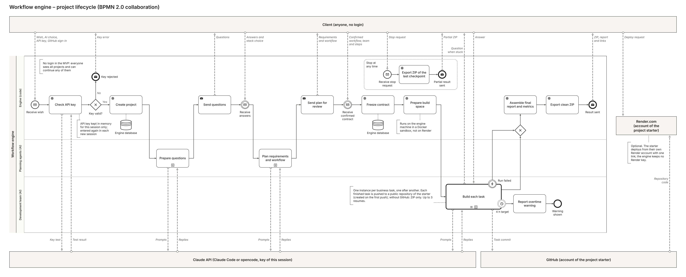
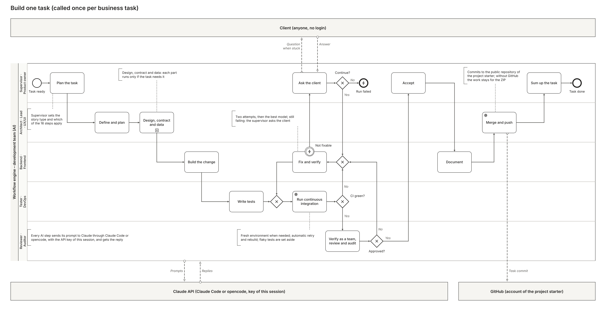

# ai-docs: the documents of the workflow engine

Version 3.0, 14 November 2026. The index of the documents, the product decisions on one page, the UI mockup and the BPMN model. How we work and what holds: [`../CLAUDE.md`](../CLAUDE.md). The plan: [`plan.md`](plan.md).

## 1. The product in five lines

The **workflow engine** is a web application (Java 21 / Spring Boot backend, SvelteKit frontend, PostgreSQL, one monorepo, Docker). A client writes a wish. AI planning agents research it, ask questions, and write requirements and a BPMN-like business workflow. The client edits and confirms the workflow, the AI team and the development steps (the contract). On Run, an AI team (Claude through Claude Code or opencode) builds the client's software task by task in a Docker sandbox, with 16 development steps per task. The client gets a ZIP, optionally a public GitHub repository and a "Deploy to Render" link.

Course: Hochschule Campus Wien, SDE, Advanced Software Development. Assignment #1 (= Epic 0) is due 20 November 2026. Build time: about 3 hours a day for 5 days.

## 2. Product decisions on one page

| Topic | Decision | Recorded in |
|---|---|---|
| Users | No login in the MVP. Everyone who opens the engine sees all projects and can open, change and continue any of them. Accepted risk. | ADR-020, ADR-034; `audit/deferred-risks.md` |
| AI | Claude only, through Claude Code or opencode. No local models, no other provider. | ADR-032; FR-AI-02 |
| API key | The user enters an Anthropic key on screen 1. It is tested with one call, kept in engine memory for the session and its runs, never stored, and entered again in every new session and after an engine restart. | ADR-033; FR-AI-06, FR-AI-07, QR-SEC-01 |
| GitHub (optional) | The person who starts a project signs in at the start (device flow, scope `public_repo`). Every finished task is committed and pushed to a public repository in that account, created on the first push. Without GitHub: ZIP only. The token is never stored. | ADR-035; FR-STK-08, FR-EXP-09, IR-EXT-05 |
| Render.com (optional) | The engine adds `render.yaml` to the generated repository and shows a "Deploy to Render" link. The starter deploys in their own Render account. The engine keeps no Render key and calls no Render API. | ADR-036; IR-EXT-07 |
| Where builds run | On the machine where the engine runs: one sandbox per run (runner container, Docker-in-Docker, workspace). The Claude API only answers prompts. The engine itself is not hosted on Render (no privileged Docker there). | ADR-037; `engine-architecture.md` 7 |
| The run | One business task after another. Per task the 16 development steps of `workflow.md` 5.2 (story types: 5.3) with the members of `team.md`; steps that do not apply are skipped and shown so. The team and the steps are editable before Run. | ADR-039; screens 6, 7, 11 |
| Errors | Automatic retry and rebuild; a defect gets two fix attempts, then the best model; if still not fixable the development supervisor asks the client one question with short answers. | ADR-038; screen 12 |
| Stop and time | Stop at any time exports the ZIP of the last finished task. 4 hours is a target: a warning, then the run continues and reports overtime. A run resumes up to 3 times after a restart (the key is asked for again). | ADR-027, ADR-028 |
| Result | A ZIP cleaned of agent files, a final report with metrics, the repository link and the Render link. | ADR-029; FR-EXP |
| Generated projects | Backend Java, C# or Python × frontend Angular, Svelte or Nuxt; PostgreSQL fixed; from prepared templates in `templates/`. | ADR-025, ADR-030 |
| App wording | The app never shows configuration file names ("Reset to initial", "recommended"). English and German. | Section 4 of this page |
| Security, observability | Not built in the MVP. Correctness rules stay: validation, error handling, no secrets in code, logs or Git. | ADR-020 to ADR-022 |
| Environments | Everything runs on the local machine with Docker until the presentation: local, and dev, test, prod as compose projects; stories deploy to dev, finished epics are promoted to test and prod. No remote host; a later name may be amberneurons-engine. | ADR-041 |
| Documents | Product documents in `ai-docs/`. Markdown is what agents read; the Word files in `word/` are the masters for human review. | ADR-040 |

## 3. Where everything is

| Path | Content |
|---|---|
| `requirements.md` | Requirements of the engine (BR, FR, QR, TR, IR), open issues |
| `engine-architecture.md` | Architecture of the engine (arc42, E-ADR) |
| `software-elements.md` | Screen element → component → API operation → class → table → AI agent |
| `plan.md`, `epics/` | Milestones M0 to M7 and the backlog per domain |
| `ui-mockup/` | The 14 screens: images, static pages, design source (section 4) |
| `bpmn/` | BPMN 2.0 model of the engine (section 5) |
| `skeleton/` | Tables, domain records, AI output records and frontend models to start from |
| `audit/deferred-risks.md` | Risks accepted by deferring security and observability |
| `reference/` | Documents of the earlier setup: the decision register (`architecture.md` 5) and the 16 development steps and team that generated projects are built with (`workflow.md` 5.2, `team.md`). They cite rule documents that were removed on 14 November 2026 |
| `word/` | Word masters of the requirements and the architecture for human review |

## 4. UI mockup of the MVP (`ui-mockup/`)

The reference for the screens: what each page shows, in which order, and how the pages link. Use it together with `software-elements.md`, which maps every element on these screens to its Svelte component, API operation, backend class, table and AI agent.

| Folder | Content | For |
|---|---|---|
| `ui-mockup/images/` | One full-page PNG per screen (1280 px wide at 2× resolution) | Humans and AI agents: look at a screen before building it |
| `ui-mockup/pages/` + `ui-mockup/index.html` | Static HTML copies; open `index.html` in a browser. Links between screens work; buttons and fields do nothing | Clicking through the flow |
| `ui-mockup/source/` | The design files of the canvas: one `.dc.html` per screen and `canvas.json` (layout and titles) | Editing the mockup later on the design canvas; exact text, colours and spacing |

The live, editable canvas is the Claude design artifact "Workflow Engine – MVP screens" (owner's account). If the canvas and these files differ, the canvas is newer; export again. The image, page and source of a screen share its number: `images/NN-name.png`, `pages/NN-name.html`.

| Screen | Name (image and page) | Source | Content |
|---|---|---|---|
| 0 All projects | `00-all-projects` | `Projects.dc.html` | Start page without login: all projects with status, GitHub account of the starter and last change; open or continue any project; new project. |
| 1 Wish and AI | `01-wish-and-ai` | `Main.dc.html` | Project name, language of the documents, wish, links, files; agent (Claude Code or opencode), Claude model, Anthropic API key for this session with Test; optional GitHub sign-in of the project starter. |
| 2 Questions and technology | `02-questions-and-technology` | `Questions.dc.html` | AI questions (one choice, several, text, feature) with progress; technology choice; PostgreSQL fixed. |
| 3 Requirements | `03-requirements` | `Requirements.dc.html` | Requirements grouped by epic with ID, priority and source; downloads of the requirements and the project plan. |
| 4 Workflow (BPMN-like) | `04-workflow-bpmn-like` | `Workflow.dc.html` | BPMN-like workflow with lanes, start and end events, tasks and arrows; every task is clickable. |
| 5 Edit a task | `05-edit-a-task` | `StepEdit.dc.html` | Edit a task: name, what happens, lane, type, story type, criteria, AI test scenarios, links; add before or after; delete. |
| 6 AI team (editable) | `06-ai-team-editable` | `Team.dc.html` | AI team: team size (Starter, Standard, Full, Custom), model per member, on or off, edit instructions and write areas. |
| 7 Development workflow (editable) | `07-development-workflow-editable` | `DevWorkflow.dc.html` | Development workflow: 16 steps per task, reorder, edit step; rules (fix loops, best-model try, recovery by error type, CI stages); lessons. |
| 8 Ready to run (with GitHub) | `08-ready-to-run-with-github` | `Ready.dc.html` | Summary before the run; cost limit; time rules; public GitHub repository of the starter with push after every finished task; optional Deploy to Render link; confirm and Run. |
| 9 Workflow in process | `09-workflow-in-process` | `Running.dc.html` | The run: time, tasks, cost, GitHub, restarts; the workflow with task states; latest activity; Stop and ZIP. |
| 10 Run details | `10-run-details` | `RunDetails.dc.html` | Epics and stories with type and GitHub commit; agent team; decisions; time and cost; audit report; metrics. |
| 11 Task details during the run | `11-task-details-during-the-run` | `StepRun.dc.html` | One task during the run: business task, 16 development steps with members, CI by test level, errors with type, evidence, console. |
| 12 Human action required | `12-human-action-required` | `StepHelp.dc.html` | Human action required: question with expected, what happened, requirement, what was tried and cause; answer options. |
| 13 Dialogs and states | `13-dialogs-and-states` | `States.dc.html` | Confirm dialogs (stop, delete, reset), empty, loading and error states, edit conflict from another tab. |

The four figures `images/mockup-1-wish.png` … `mockup-4-execution.png` are the earlier four-page sketches used as figures in `requirements.md` 8.1; the 14 screens above replace them for building.

**Flow**

```text
1 Wish and AI → 2 Questions and technology → 3 Requirements → 4 Workflow (→ 5 Edit a task)
→ 6 AI team → 7 Development workflow → 8 Ready to run (GitHub) → Run
→ 9 Workflow in process → 10 Run details / 11 Task details (→ 12 Human action required)
Pages 6 and 7 are also opened from 10 and 11 during a run (read the running contract; changes apply to the next run).
13 shows the shared dialogs and page states used on several pages.
```

**Rules for building from these screens**

- The screens are a reference for content, order and states, not a pixel specification. The design source in `ui-mockup/source/` decides the final look.
- Every text on a screen comes from the translation resource (English and German message files); the header has a language switch.
- The app never shows file names of the engine's own setup; it says "Reset to initial" and "recommended".
- The example data (canteen pre-order, "Pay", times, costs, commits) is invented demo content, not test data.
- Each screen element is built in the story of its domain (see `software-elements.md` 3). Check the matching image before the story starts and attach it to the story card.

The BPMN 2.0 diagrams of the engine itself are on the same design canvas (`ui-mockup/source/canvas.json` lists them) and in `bpmn/` (section 5).

## 5. BPMN 2.0 model of the engine (`bpmn/`)

How the workflow engine itself runs one client project, end to end, and how its AI team builds one task. Version 1.0, final for the MVP. Related: `requirements.md`, `engine-architecture.md` 6.8, `architecture.md` 4.1 (ADR-032 to ADR-039), `workflow.md` (the 16 development steps), `team.md`.

| File | Content |
|---|---|
| `bpmn/workflow-engine-lifecycle.bpmn`, `bpmn/workflow-engine-lifecycle.png` | Level 1: collaboration "Run a client project": client, engine (3 lanes), Claude API, GitHub and Render.com of the project starter |
| `bpmn/build-one-task.bpmn`, `bpmn/build-one-task.png` | Level 2: called process "Build one task", run once per business task (sequential multi-instance) |

The `.bpmn` files are BPMN 2.0 XML with diagram interchange (positions of every shape and every line). They open in any BPMN 2.0 tool, for example bpmn.io / Camunda Modeler. Both diagrams are descriptive (`isExecutable="false"`): the engine is a Spring Boot application, not a BPMN engine. The diagrams are the contract for its states and transitions. The decisions they show are those of section 2 (users, AI, GitHub, Render, where builds run, stop at any time with the ZIP of the last checkpoint, 4-hour target with a non-interrupting timer).

### Level 1: Run a client project



| Element | Meaning | Screen |
|---|---|---|
| Receive wish | Wish, choice of Claude Code or opencode, API key, optional GitHub sign-in | 1 Wish and AI |
| Check API key / Key valid? | Test call to Claude; on failure the client gets "Key error" and nothing is stored | 1, 13 |
| Create project | Project row in the engine database | 1 |
| Prepare questions (planning agents) | Brief and questions with technology choice | 2 |
| Receive answers | Answers and stack choice | 2 |
| Plan requirements and workflow | Requirements, BPMN-like business workflow, tasks | 3, 4, 5 |
| Receive confirmed contract | Workflow, AI team and development steps confirmed | 6, 7, 8 |
| Freeze contract | Version of the contract that the run uses | 8 |
| Prepare build space | Sandbox on the engine machine | 9 |
| Build each task | Calls level 2 once per business task, one after another | 9, 10, 11, 12 |
| Run failed (error) | A task ended with "Run failed" (client chose to stop when asked); the report is still produced | 10, 13 |
| 4 h target (timer) | Overtime warning, the run continues | 9 |
| Assemble final report and metrics / Export clean ZIP | Report, metrics, ZIP, links to the repository and the Render link | 9, 10 |
| Stop at any time | Event subprocess: ZIP of the last checkpoint | 9, 13 |

### Level 2: Build one task



The steps are the 16 steps of `workflow.md` section 5.2 (story types in 5.3) and the members of `team.md`:

| BPMN activity | Development steps | Members |
|---|---|---|
| Plan the task | 1 Plan the task | Development supervisor |
| Define and plan | 2 Define and plan | PO, Architect, Lead, Tester |
| Design, contract and data (collapsed) | 3 Design, 4 Contract, 5 Data, each only if needed | UX/UI, Architect, Backend |
| Build the change | 6 Build | Backend, Frontend |
| Write tests | 8 Test | Tester |
| Run continuous integration | 7 Environment (if needed), 9 Continuous integration | DevOps |
| Verify as a team, review and audit | 10 Team verification, 11 Review and audit | all active members, then Reviewer and Auditor |
| Fix and verify | 12 Fix and verify (only on a finding) | the member who owns the failing part |
| Ask the client | Human action required: question with short answer options | Development supervisor |
| Accept | 13 Accept | PO |
| Document | 14 Document | Backend, Frontend |
| Merge and push | 15 Merge and push: commit to the starter's public repository | Lead |
| Sum up the task | 16 Sum up | Development supervisor |

Every AI step sends its prompt to Claude through Claude Code or opencode with the key of this session (message flows "Prompts" and "Replies" at the pool border, the same as on level 1).

### Modelling rules used

The model follows the BPMN 2.0.2 specification (OMG), Bruce Silver's Method and Style rules and the Seven Process Modeling Guidelines (7PMG) of Mendling, Reijers and van der Aalst:

- External parties are black-box pools; message flows carry nouns ("Questions", "Task commit") and are repeated on both levels.
- Activities are verb–object; no more than about ten activities per level; detail goes to a called process (hierarchy instead of one large diagram, 7PMG G7).
- One none start per process; every end state is named when there is more than one.
- Exclusive gateways only (no OR, 7PMG G5); a splitting gateway asks a question and its gates are labelled; merges are not labelled.
- Structured loops: CI red and "Approved? No" both return to one merge before "Fix and verify".
- Errors are interrupting boundary events; the time target is a non-interrupting timer (dashed).
- No crossing lines; every node lies on a path from a start to an end.

Checks that were run on both files (script in the starter kit history, not part of the product): XML parses, every reference resolves, every element has diagram interchange, incoming/outgoing lists match the sequence flows, every node is in exactly one lane, every node reachable from a start and able to reach an end, no line passes through a shape, no lines cross, no label overlaps a shape, line or other label. Then three rounds of rendering and visual inspection.

Sources: OMG, BPMN 2.0.2, formal/13-12-09; B. Silver, BPMN Method and Style, 2nd ed., Cody-Cassidy Press; J. Mendling, H. A. Reijers, W. M. P. van der Aalst, Seven Process Modeling Guidelines (7PMG), Information and Software Technology 52 (2010); M. Dumas, M. La Rosa, J. Mendling, H. A. Reijers, Fundamentals of Business Process Management, 2nd ed., Springer 2018; W. J. Hopp, M. L. Spearman, Factory Physics (Little's law, work-in-progress limits: one task at a time).
