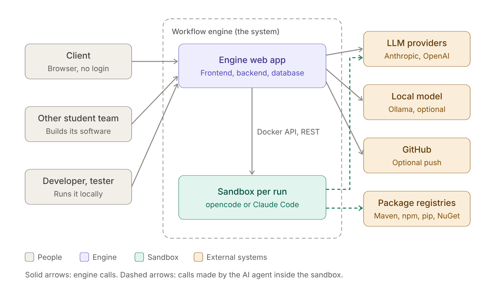
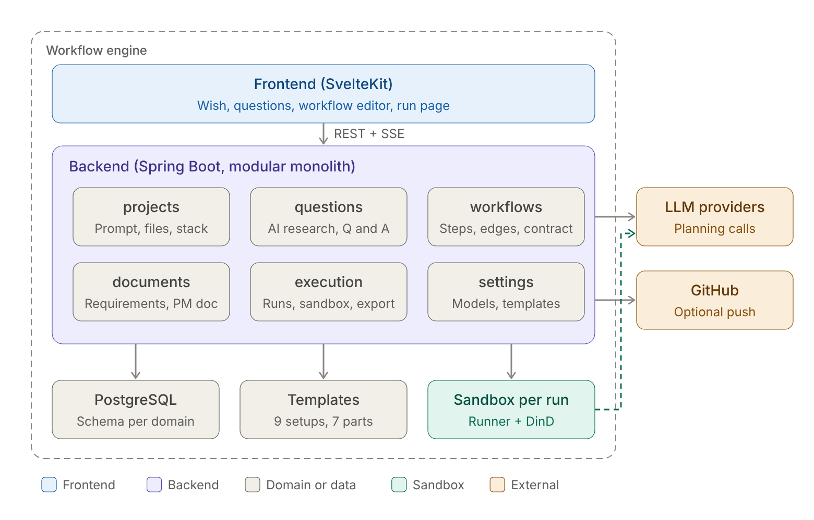
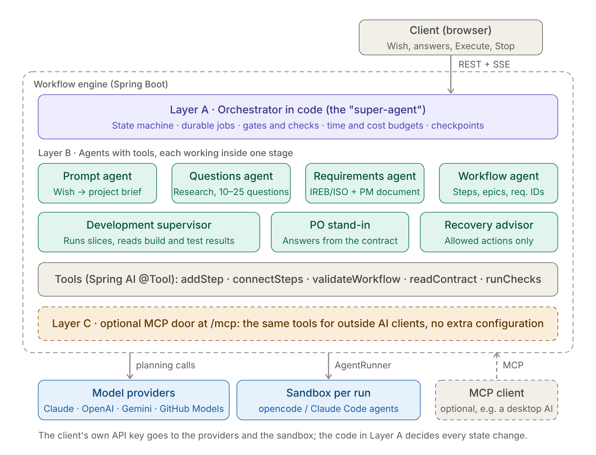
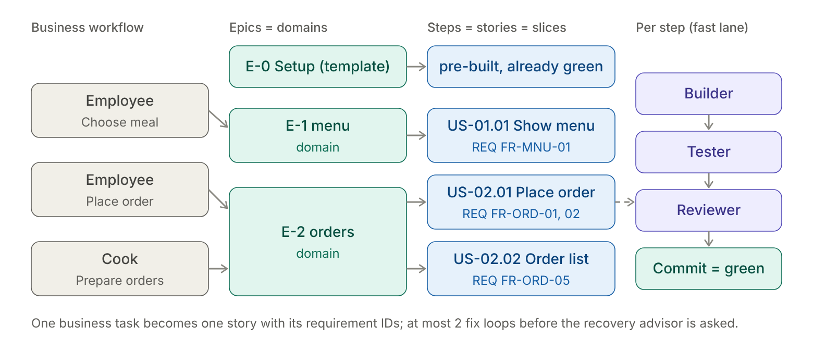
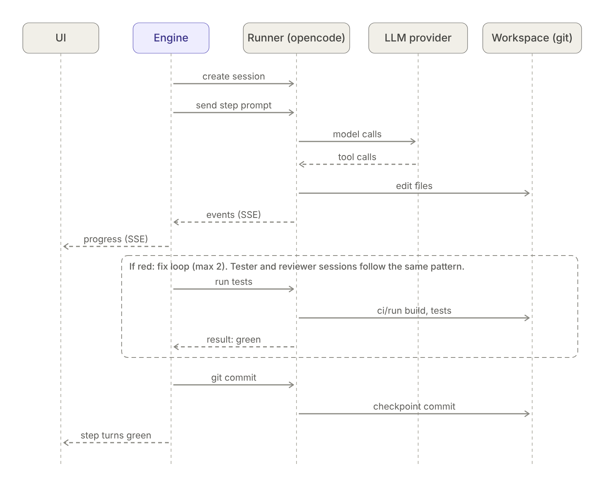
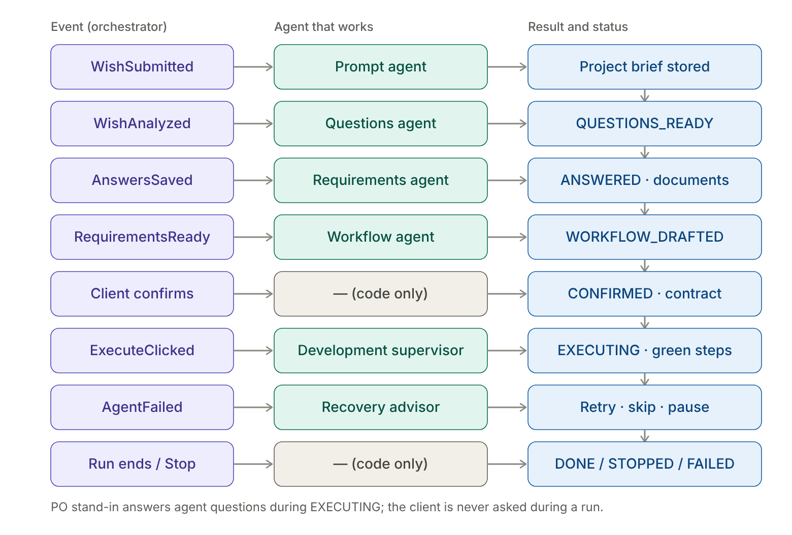
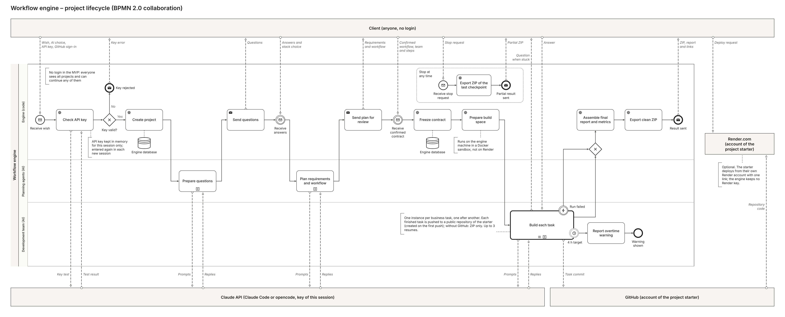
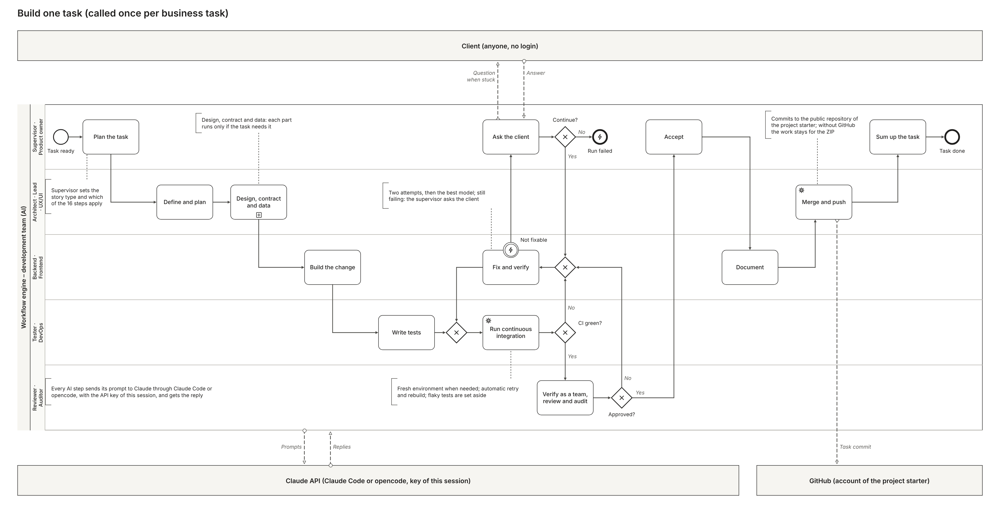
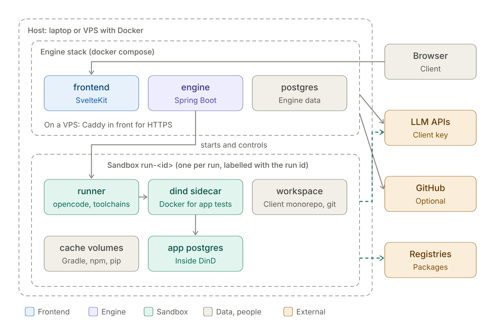

# Workflow Engine: Architecture documentation (arc42)

> Version 0.4, 14 November 2026. Generated from the Word document of the same name (the Word file is the edited master until the review is finished; afterwards this Markdown file is the source). Owner: Architect.

## About this document

This document describes the architecture of the workflow engine using the arc42 template (version 8). Each of the twelve arc42 sections is filled; requirements are referenced by the IDs of the requirements specification (for example FR-EXE-04, QR-REL-01). Decisions of the team's own engineering documents are cited by their rule IDs (for example ADR-007, ARC-026).

## 1. Introduction and goals

### 1.1 Requirements overview

The workflow engine turns a client's business idea into a small, working software project. The client describes the idea, chooses the AI and the technology, answers AI-generated questions and confirms a simple business workflow. AI agents then build one feature per business step in an isolated sandbox. The client follows the progress, can stop at any time and downloads a clean project.

| **Area**  | **Main functions**                                                                                                                 | **Requirements**                                   |
|-----------|------------------------------------------------------------------------------------------------------------------------------------|----------------------------------------------------|
| Planning  | Wish with links and files; AI selection; research; 10–25 questions; stack selection; business workflow editor; contract; documents | FR-PRJ, FR-AI, FR-Q, FR-STK, FR-WF, FR-CON, FR-DOC |
| Execution | Sandbox per run; build plan; 16 development steps per task; checkpoints; time handling; resume; status display; stop                         | FR-EXE, FR-TIME, FR-RES, FR-STAT, FR-STOP          |
| Delivery  | Clean ZIP of the last green state; optional GitHub push; next steps                                                                | FR-EXP                                             |

### 1.2 Quality goals

| **Priority** | **Quality goal**                         | **Motivation**                                                                       |
|--------------|------------------------------------------|--------------------------------------------------------------------------------------|
| 1            | Reliability: finished work is never lost | Builds take hours; another team depends on the engine (QR-REL-01, QR-REL-02)         |
| 2            | Isolation and secret hygiene             | AI agents run arbitrary commands; client keys must never leak (QR-SEC-01, QR-SEC-02) |
| 3            | Time efficiency                          | A project should be finished in about 4 hours (QR-PERF-01)                           |
| 4            | Usability for non-technical clients      | The client must not need technical knowledge (QR-USE-01)                             |
| 5            | Changeability of AI and technology       | Models, harnesses and stacks change quickly (QR-MNT-02, QR-MNT-03)                   |

### 1.3 Stakeholders

| **Role**                 | **Expectations towards the architecture**                                                    |
|--------------------------|----------------------------------------------------------------------------------------------|
| Client                   | Simple, transparent process; a working result; no lost work; control over AI choice and cost |
| Other student team       | One-command start; stable behaviour; clear documentation                                     |
| Product Owner            | Scope traceable to requirements; MVP limits respected                                        |
| Architect and developers | Clear building blocks, contract-first API, testable components, replaceable AI harness       |
| Course lecturer          | A real workflow engine that executes a workflow and builds software; justified decisions     |

## 2. Architecture constraints

### 2.1 Technical constraints

| **ID** | **Constraint**                                                                  | **Background**         |
|--------|---------------------------------------------------------------------------------|------------------------|
| TC-1   | Engine backend in Java 21 with Spring Boot 3                                    | Team decision (TR-01)  |
| TC-2   | Engine frontend in Svelte (SvelteKit)                                           | Team decision (TR-02)  |
| TC-3   | PostgreSQL for engine data and generated apps                                   | BRU-08, TR-03, ADR-004 |
| TC-4   | Runs in Docker with Docker Compose, locally and on one server                   | QR-PORT-01, QR-PORT-02 |
| TC-5   | AI agents through existing harnesses (opencode, Claude Code); no own agent loop | TR-07                  |
| TC-6   | Anthropic models only with API keys, no claude.ai login                         | CON-04                 |
| TC-7   | Network access needed for model APIs and package registries                     | CON-07                 |

### 2.2 Organisational constraints

| **ID** | **Constraint**                                                       | **Background**                    |
|--------|----------------------------------------------------------------------|-----------------------------------|
| OC-1   | Assignment \#1 due 20 November 2026                                  | CON-01                            |
| OC-2   | University team of 3–4 people                                        | CON-02                            |
| OC-3   | Engine built with the team's own agent setup, Starter profile        | CON-06, TEAM-003                  |
| OC-4   | Changes must be justified in writing                                 | CON-05                            |
| OC-5   | No security or observability features in the MVP; hygiene rules stay | CON-03, ADR-020, ADR-021, ADR-022 |

### 2.3 Conventions

- The team's documents apply: modular monolith with domains (ADR-003), contract-first REST API (ADR-007), forward-only migrations (ADR-006), configuration from the environment (ARC-026), tests L1 to L7 (ADR-010), one command for the local pipeline (ci/run all-local).

- Rule IDs are cited in code reviews, decisions and commits.

- All user-visible text comes from the translation resource (ARC-022).

## 3. Context and scope

### 3.1 Business context



*Figure 1: Business context*

| **Partner**                                 | **Input to the engine**                                                                          | **Output of the engine**                                       |
|---------------------------------------------|--------------------------------------------------------------------------------------------------|----------------------------------------------------------------|
| Client                                      | Wish, links, files, AI choice and key, stack choice, answers, workflow edits, confirmation, stop | Questions, workflow, documents, progress, ZIP, next steps      |
| Other team, developers, testers             | Same as the client; operate their own instance                                                   | Same as the client                                             |
| LLM providers                               | Research results, questions, workflow, document text, agent responses                            | Prompts with context (paid with the client's key)              |
| Render.com (account of the project starter) | Deploy request by the starter through a Blueprint link                                           | Deployed generated app (optional)                              |
| GitHub (account of the project starter)     | Sign-in of the starter, repository URL                                                           | One commit per finished task to a public repository (optional) |
| Package registries                          | Libraries for the generated app                                                                  | Download requests from the sandbox                             |

### 3.2 Technical context

| **Channel**             | **Protocol and format**                                                                           | **Used by**                     |
|-------------------------|---------------------------------------------------------------------------------------------------|---------------------------------|
| Browser to engine       | HTTPS (Caddy on a server, HTTP locally); REST with JSON; SSE for live events                      | Frontend                        |
| Engine to LLM providers | HTTPS REST through Spring AI; structured JSON output                                              | questions, workflows, documents |
| Engine to Docker        | Docker Engine API through docker-java (socket on the engine container only)                       | execution                       |
| Engine to opencode      | HTTP REST and SSE inside the sandbox network; basic auth                                          | execution (opencode adapter)    |
| Engine to Claude Code   | CLI in the runner (non-interactive, streamed JSON) through docker exec                            | execution (Claude Code adapter) |
| Agent to LLM providers  | HTTPS from the runner with the client's key as environment variable                               | runner                          |
| Agent to registries     | HTTPS (Maven Central, npm, PyPI, NuGet)                                                           | runner, DinD                    |
| Engine to GitHub        | HTTPS REST and git over HTTPS with the starter's token (device flow, public_repo), held in memory | execution (export)              |

## 4. Solution strategy

| **Goal or constraint**        | **Approach**                                                                                                                                                       | **Details**  |
|-------------------------------|--------------------------------------------------------------------------------------------------------------------------------------------------------------------|--------------|
| Workflow engine, not a script | The engine walks a graph: the confirmed business workflow becomes a build plan whose steps are executed in order, each with defined status, retries and checkpoint | 5.2, 6.3     |
| Client stays in control       | Planning as a state machine; an immutable contract snapshot is the only input of a run                                                                             | 8.1, 8.2     |
| Never lose finished work      | A git commit per green step; stop, failure and resume all return to the last checkpoint; run state in the database                                                 | 8.7, 6.5     |
| 4-hour target                 | Pre-built templates (Epic 0 done), fixed stacks, bounded fix loops, time awareness in prompts, warnings instead of hard stop                                     | 5.2, 8.8     |
| Isolation and hygiene         | One throwaway sandbox per run (runner, DinD, workspace); key only as environment variable; manifest-based export cleaning                                          | 7, 8.6, 8.10 |
| Replaceable AI                | Spring AI for planning calls; AgentRunner interface with opencode and Claude Code adapters; version pinned                                                         | 5.2, 8.5     |
| Simple, maintainable engine   | Modular monolith with six domains, contract-first API, PostgreSQL schema per domain, SSE instead of a broker                                                       | 5.1, 9       |
| Same code everywhere          | Docker Compose, configuration from environment, engine works without keys                                                                                          | 7            |

## 5. Building block view

### 5.1 Level 1: the engine



*Figure 2: Building blocks, level 1*

#### Contained building blocks

| **Building block**   | **Responsibility**                                                                                                                 | **Interfaces**                                                       |
|----------------------|------------------------------------------------------------------------------------------------------------------------------------|----------------------------------------------------------------------|
| Frontend (SvelteKit) | The 14 screens of `README.md` 4 behind six steps (wish and AI, questions and stack, requirements, workflow, team and steps, run), project list, documents, next steps; workflow editor with Svelte Flow | Uses the engine REST API and SSE; client generated from the contract |
| projects             | Projects, wish, links, files, stack choice, AI choice                                                                              | REST /api/projects, /attachments, /stack                             |
| questions            | Research, question generation, answers; LLM gateway (Spring AI) with schema validation                                             | REST /questions; events to workflows                                 |
| workflows            | Business workflow (steps, edges), validation, status machine of the planning phase, contract snapshot                              | REST /workflow, /confirmations                                       |
| documents            | Requirements and project management documents from the snapshot                                                                    | REST /documents                                                      |
| execution            | Runs, build plan, sandbox control, agent adapters, time handling, resume, stop, export, GitHub push, run events                    | REST /runs, SSE /runs/{id}/events; Docker API; agent harness APIs    |
| settings             | Model providers and models, template manifest                                                                                      | REST /templates, /settings/models                                    |
| PostgreSQL           | Engine data, one schema per domain                                                                                                 | JDBC                                                                 |
| Templates            | 9 assembled setups (tarballs) and manifest.json, built into the engine image                                                       | File system of the engine image                                      |
| Sandbox per run      | Runner (agent harness, toolchains), Docker-in-Docker sidecar, workspace and cache volumes                                          | opencode HTTP or Claude Code CLI; shell; git                         |

#### Source structure

Each backend domain follows the layers of the team's backend contract: domain (entities, rules, no framework), application (use cases), adapters (persistence, external systems), interfaces (REST controllers, event listeners). Domains use each other only through published interfaces or events (ARC-020).

```text
backend/

app/ composition root, configuration

shared/ ids, time, errors (problem details)

projects/ questions/ workflows/ documents/ execution/ settings/

domain/ application/ adapters/ interfaces/

frontend/ the same domains; pages in routes/

api/openapi.yaml the engine contract

templates/ base, backend-java|csharp|python, frontend-angular|svelte|nuxt

runner/ Dockerfile of the runner image
```

### 5.2 Level 2: execution

The execution domain is the workflow engine in the narrow sense: it turns a contract snapshot into a build plan and executes it step by step.

| **Component**           | **Responsibility**                                                                                                                                      |
|-------------------------|---------------------------------------------------------------------------------------------------------------------------------------------------------|
| RunService              | Creates runs from a confirmed snapshot, queues them, starts at most N in parallel (default 1), owns the run status                                      |
| BuildPlanner            | Derives the build plan: prepare, one slice per software task in workflow order, integration test, audit, packaging                                      |
| StepExecutor            | Executes one step: builder, tester and reviewer sessions; checks; fix loop (max 2); retry (1); checkpoint                                               |
| PromptComposer          | Builds each step prompt: task spec, context packet, contract extract, role prompt, engine profile rules, elapsed and remaining time                     |
| AgentRunner (interface) | createSession, sendPrompt (async), streamEvents, runShell, abort                                                                                        |
| OpencodeAgentRunner     | Adapter for the opencode HTTP server (default)                                                                                                          |
| ClaudeCodeAgentRunner   | Adapter for the Claude Code CLI with streamed JSON output                                                                                               |
| SandboxManager          | Creates, finds (by run-id label), stops and removes the runner, DinD sidecar and volumes through docker-java                                            |
| CheckpointService       | Runs build and tests, commits a green step, resets to the last checkpoint, verifies a checkpoint                                                        |
| GuardrailChecker        | After each step: checks the git diff for files outside the step scope, disabled tests, secrets and rule IDs in comments                                 |
| TimeKeeper              | Elapsed time, estimate, warning and overtime phases, per-step inactivity timeout, ceiling, cost limit                                                   |
| ResumeService           | On engine start: finds interrupted runs, increases the resume counter, resumes or fails them                                                            |
| ExportService           | Builds the ZIP from the last checkpoint: manifest and pattern cleaning, fresh repository, customer pipeline mode, final check, README                   |
| GitHubPublisher         | Creates the public repository in the starter's account on the first push and pushes every finished task; adds render.yaml and the Deploy to Render link |
| RunEventPublisher       | Stores run events and pushes them to SSE subscribers                                                                                                    |

### 5.3 Level 2: planning domains

| **Domain** | **Components**                                                                                                                                                                                                                                           |
|------------|----------------------------------------------------------------------------------------------------------------------------------------------------------------------------------------------------------------------------------------------------------|
| questions  | ResearchService (web search if offered by the provider, else trained knowledge); QuestionGenerator; LlmGateway (Spring AI, model selection, JSON schema, one retry); ContentSanitizer (wraps uploaded content as data)                                   |
| workflows  | WorkflowGenerator (AI draft from answers); WorkflowEditor (add before or after, connect, delete with reconnect); WorkflowValidator (one start, one end, reachability, no cycles); PlanningStateMachine; ContractService (snapshot with template version) |
| documents  | DocumentGenerator with fixed outlines (requirements, project management); DocumentRenderer (DOCX, PDF)                                                                                                                                                   |

### 5.4 Level 2: templates and runner image

- **Template parts:** base (ci/run, infrastructure, skeleton contract, L6 end-to-end package, engineering documents copied from the engine, agent files under neutral names) plus three backend parts and three frontend parts.

- **Assembler** (build step of the engine image): combines base, one backend and one frontend into 9 setups, fills the stack sections, renames agent files and writes manifest.json with stack, template version and CI result.

- **Runner image:** one image with all toolchains (JDK, .NET SDK, Python, Node, Playwright browsers, git), opencode (pinned) and the Claude Code CLI; built for amd64 and arm64.

### 5.5 Level 2: AI agents and orchestration (added in 0.2)

The AI is part of the engine in three layers. Layer A is code and owns every state change; layer B are agents (a model with a role prompt, a JSON schema and tools) that work inside one stage; layer C is an optional MCP server that publishes the same tools.



*Figure 5.5: Layers A, B and C*

| **Component**      | **Responsibility**                                                                                                                                                                                                      |
|--------------------|-------------------------------------------------------------------------------------------------------------------------------------------------------------------------------------------------------------------------|
| Orchestrator (A)   | Spring event listeners per event (WishSubmitted, WishAnalyzed, AnswersSaved, RequirementsReady, ExecuteClicked, AgentFailed); loads the input, starts exactly one agent, publishes the next event                       |
| JobStore (A)       | Durable job table in PostgreSQL; unfinished jobs are picked up after a restart (FR-AGT-02)                                                                                                                              |
| AiTaskRunner (A)   | Runs one agent task: model call through Spring AI ChatClient, structured output into a Java record, schema validation, one retry, tool-call limit, ai_call record                                                       |
| Agent\<I, O\> (B)  | Interface of every engine agent: name() and run(input, context); implementations: PromptAgent, QuestionsAgent, RequirementsAgent, WorkflowAgent, DevelopmentSupervisor, PoStandIn, RecoveryAdvisor                      |
| Tools (B)          | Spring AI @Tool methods per domain (WorkflowTools: addStep, connectSteps, validateWorkflow; ContractTools: readContract; CheckTools: runChecks, readLog); they call the domain services, so the REST validation applies |
| AllowedActions (A) | The list of actions the recovery advisor may choose; executes and counts them                                                                                                                                           |
| McpServer (C)      | Spring AI MCP server starter (Streamable HTTP at /mcp); publishes the @Tool methods; off by default                                                                                                                     |
| ProviderRegistry   | Builds a ChatClient per session from the model and the session key (Anthropic only); SessionSecrets holds keys and GitHub tokens in memory, never in the database                                                       |

- The coding agents (builder, tester, reviewer) stay in the sandbox behind the AgentRunner (5.2); the development supervisor only writes their prompts and reads their results.

- Mapping: epic = domain of the generated app; step = story = feature slice with requirement IDs; Epic 0 is the template.



*Figure 5.6: From business tasks to epics, stories and the fast lane*

## 6. Runtime view

### 6.1 From wish to questions

1.  The client enters name, wish, links, files, agent, model and API key and selects Send.

2.  projects stores the project (DRAFT) and the attachments; the key stays in memory for the session (never stored).

3.  questions calls ResearchService: web search if the provider offers it, otherwise trained knowledge.

4.  QuestionGenerator sends wish, attachments (wrapped as data), research and internal documents to the LLM through LlmGateway and requests JSON matching the question schema.

5.  LlmGateway validates the response and retries once if invalid.

6.  Questions are stored; the project moves to QUESTIONS_READY; the page shows one input per question.

### 6.2 From answers to contract

1.  The client selects Save answers; status ANSWERED.

2.  WorkflowGenerator asks the LLM for a business workflow (start, tasks with actor and kind, end, edges) as JSON; status WORKFLOW_DRAFTED.

3.  The client edits the diagram; on Save, WorkflowValidator checks the rules and stores steps and edges.

4.  The client selects Ready to execute; ContractService stores the immutable snapshot with the template version; status CONFIRMED.

5.  DocumentGenerator creates the requirements and project management documents from the snapshot.

6.  Any later edit moves the status back (FR-CON-04); a new confirmation creates a new snapshot.

### 6.3 Executing one feature slice



*Figure 3: Runtime of one feature slice (opencode adapter)*

1.  StepExecutor marks the step RUNNING and creates a builder session (POST /session).

2.  PromptComposer builds the step prompt; the adapter sends it asynchronously with model, agent and system prompt.

3.  The agent works with the LLM and edits files in the workspace; opencode events are forwarded as run events to the UI.

4.  CheckpointService runs ci/run build and tests through the shell; GuardrailChecker inspects the diff.

5.  Red: a fix session (max 2 loops), then one try with the best model; still red: the run pauses and asks the client one question (ADR-038, FR-EXE-08). The run ends FAILED only when the client chooses to stop (FR-EXE-07).

6.  Green: tester and reviewer sessions follow the same pattern; then a git commit is the checkpoint and the business step turns green.

### 6.4 Stop and export

1.  The client selects Stop and confirms.

2.  StepExecutor aborts the session (POST /session/:id/abort); CheckpointService resets the workspace to the last checkpoint; status STOPPED; the stored key is deleted.

3.  ExportService copies the checkpoint, removes manifest files and pattern matches, creates a fresh repository with one commit, switches the pipeline to customer mode and writes the README with the step status.

4.  The final check unpacks the ZIP and searches for internal files and rule IDs; only a clean ZIP is offered.

### 6.5 Resume after an engine restart

1.  On start, ResumeService loads runs in EXECUTING or RESUMING.

2.  It increases and saves resume_count before anything else; above 3 the run becomes FAILED and the partial ZIP stays available.

3.  SandboxManager finds the sandbox by its run-id label or starts a new one on the same workspace volume.

4.  CheckpointService discards uncommitted changes and verifies the last checkpoint; if red, it goes back one more.

5.  The interrupted step is marked INTERRUPTED and executed again in a fresh session; the UI shows "Resumed (n of 3)".

### 6.6 Time phases

| **Phase**    | **Trigger**                              | **Behaviour**                                                             |
|--------------|------------------------------------------|---------------------------------------------------------------------------|
| Normal       | 0 to 3 h                                 | Elapsed and remaining time in every step prompt                           |
| Warning      | From 3 h or estimate above 4 h           | Prompts require finishing the current slice without extras; yellow banner |
| Overtime     | After 4 h                                | Run continues; overtime shown and reported                                |
| Pause        | Cost limit or ceiling (8 h)              | Sandbox stopped, workspace kept; Continue resumes from the checkpoint     |
| Step timeout | No events and no file changes for 30 min | Abort, retry once, then FAILED                                            |

### 6.7 Agent lifecycle (added in 0.2)



*Figure 6.7: Each orchestrator event starts one agent; its result moves the status on*

1.  The orchestrator receives an event and writes a job (status QUEUED).

2.  A worker takes the job, loads the input and calls AiTaskRunner with the agent of the stage.

3.  The agent may call its tools up to 20 times; the result is mapped into a Java record and validated.

4.  On invalid output: one retry with the validation error; then the job fails and the client sees a retry button.

5.  On success: the result is stored, an ai_call record written, the job closed and the next event published.

6.  During execution, AgentFailed starts the recovery advisor; the chosen action is checked against AllowedActions and executed by code.

### 6.8 The engine process in BPMN 2.0 (added in 0.3)

The two diagrams are the reference for the states, messages and error paths of the engine. Level 1 shows one client project from the wish to the result with the external parties: the client (anyone, no login), the Claude API, and GitHub and Render.com of the person who started the project. Level 2 is the called process "Build one task", run once per business task with the 16 development steps. The BPMN 2.0 files with diagram interchange are in ai-docs/bpmn.



*Figure 6.8a: Project lifecycle (BPMN 2.0 collaboration)*



*Figure 6.8b: Build one task (called process)*

- The API key is checked with one test call and kept in memory for the session only; a new session or an engine restart asks for it again.

- Every finished task is committed to a public repository of the project starter, created on the first push; without GitHub the result is the ZIP only.

- Render.com is optional: the starter deploys with a Blueprint link in their own account; the engine keeps no Render key and is itself not hosted on Render.

- A defect that is not fixable after two attempts and the best model becomes one question to the client; "stop" at any time exports the ZIP of the last checkpoint.

## 7. Deployment view



*Figure 4: Deployment on one Docker host*

### 7.1 Infrastructure

| **Environment**             | **Host**                             | **Start**                                          | **Notes**                                                                                            |
|-----------------------------|--------------------------------------|----------------------------------------------------|------------------------------------------------------------------------------------------------------|
| Local (team)                | Developer laptop with Docker         | docker compose up                                  | Runs happen on the laptop                                                                            |
| Local (other team, testers) | Their laptop with Docker             | git clone, cp .env.example .env, docker compose up | No key or token needed to start                                                                      |
| Presentation                | The local machine with Docker (ADR-041: no remote host until the Product Owner wants one) | The same compose file | Queue with 1–2 parallel runs; no login (accepted risk); not on Render: builds need privileged Docker |

### 7.2 Mapping of building blocks to containers

| **Container**  | **Contents**                                                                                        | **Lifetime**                                            |
|----------------|-----------------------------------------------------------------------------------------------------|---------------------------------------------------------|
| frontend       | SvelteKit app; entry point, passes /api to the engine                                               | Permanent                                               |
| engine         | Spring Boot backend, templates, Docker socket                                                       | Permanent                                               |
| postgres       | Engine database with volume                                                                         | Permanent                                               |
| runner-\<run\> | Agent harness and toolchains; workspace mounted; key as environment variable; CPU and memory limits | One run                                                 |
| dind-\<run\>   | Own Docker daemon for ci/run, compose and Testcontainers of the generated app (privileged sidecar)  | One run                                                 |
| volumes        | workspace-\<run\>; shared caches for Gradle, NuGet, npm and pip                                     | Workspace: until export and clean-up; caches: permanent |

### 7.3 Configuration

| **Variable**                                   | **Purpose**                                                  | **Required**              |
|------------------------------------------------|--------------------------------------------------------------|---------------------------|
| GITHUB_OAUTH_CLIENT_ID                         | Public client id of the GitHub OAuth app for the device flow | No (without it: ZIP only) |
| DATABASE_URL, DATABASE_USER, DATABASE_PASSWORD | Engine database                                              | Yes (defaults in compose) |
| MAX_PARALLEL_RUNS                              | Run queue                                                    | No (default 1)            |
| RUN_CEILING_HOURS, STEP_TIMEOUT_MINUTES        | Time handling                                                | No (defaults 8 and 30)    |
| OPENCODE_VERSION                               | Pinned harness version of the runner image (build argument)  | Build time                |

### 7.4 Platform notes

- Images are built for amd64 and arm64 (Apple Silicon).

- On Windows, docker-java reaches Docker through DOCKER_HOST.

- The sandbox never receives the host Docker socket; only the engine container has it (documented limitation).

## 8. Crosscutting concepts

### 8.1 Domain model

| **Entity**                                 | **Belongs to** | **Key relations**                                                              |
|--------------------------------------------|----------------|--------------------------------------------------------------------------------|
| Project                                    | projects       | Has attachments, a stack choice, an AI choice; 1:1 workflow                    |
| Question                                   | questions      | Belongs to a project (by ID)                                                   |
| Workflow, WorkflowStep, WorkflowEdge       | workflows      | Steps of type START, TASK, END; edges from step to step                        |
| ContractSnapshot                           | workflows      | Immutable JSON of all confirmed data plus template version                     |
| GeneratedDocument                          | documents      | Belongs to a snapshot                                                          |
| ExecutionRun, StepRun, BuildTask, RunEvent | execution      | Run refers to a snapshot; step runs refer to business steps or technical steps |

#### Status models

| **Object** | **Statuses**                                                                                              |
|------------|-----------------------------------------------------------------------------------------------------------|
| Project    | DRAFT → QUESTIONS_READY → ANSWERED → REQUIREMENTS_READY → WORKFLOW_DRAFTED → CONFIRMED → EXECUTING → DONE \| STOPPED \| FAILED |
| Run        | QUEUED → PREPARING → EXECUTING ⇄ PAUSED; RESUMING; WAITING_FOR_KEY; DONE \| STOPPED \| FAILED             |
| Step run   | PENDING → RUNNING → DONE \| FAILED; INTERRUPTED; STOPPED; MANUAL                                          |

### 8.2 Persistence

- PostgreSQL, one schema per domain, Flyway migrations, forward-only and compatible with the previous release (ADR-004, ADR-006).

- No cross-domain foreign keys or joins; references by ID (DR-01).

- Application-generated time-ordered UUIDs; timestamps in UTC (DR-02).

- The contract snapshot is stored as JSON and protected against updates.

### 8.3 API and contract first

- One OpenAPI file (api/openapi.yaml) is the single source; the frontend client is generated from it (ADR-007).

- Errors are problem-detail responses with stable error codes; no user-visible text from the backend.

- Writes are idempotent where possible (Save answers, Save workflow, Ready to execute use idempotency keys).

### 8.4 Events and live updates

- Every status change and log line of a run is stored as a RunEvent and then pushed over SSE.

- A reconnecting client sends the last event ID and receives the missed events from the database (QR-REL-03).

- No message broker in the MVP (ADR-018); domain events inside the monolith use the outbox table.

### 8.5 AI integration

#### Planning calls

- All planning calls go through LlmGateway (Spring AI), which selects provider and model from the project's AI choice.

- Each call has a fixed prompt template and a JSON schema; invalid output is retried once, then reported (FR-Q-08).

- Uploaded content and web pages are wrapped and labelled as data; instructions inside them are ignored (FR-Q-09, AGT-047).

#### Agent harnesses

- The AgentRunner interface hides the harness. opencode is the default; Claude Code is the second adapter; the harness spike decides the default per model.

- opencode runs with permission: allow inside the sandbox and is protected with a server password; its version is pinned in the runner image.

- The engine orchestrates the roles itself (builder, tester, reviewer) as separate sessions; it does not depend on harness-internal sub-agents.

### 8.6 Agent instructions and the engine profile

- The workspace contains the team's engineering documents, CLAUDE.md or AGENTS.md (opencode uses CLAUDE.md only when no AGENTS.md exists), the contract, the generated documents, story cards and task specs.

- The engine profile (ADR-023 to ADR-031 of the team documents) adapts the process to unattended runs: the contract is the PO approval, a question to the client only when a defect is not fixable (ADR-038), the 16 development steps per task (ADR-039), Epic 0 pre-built, goals G-03 and G-04 closed with a reason.

- Each prompt contains a context packet: only the documents and rule IDs the step needs (AGT-054).

- Guardrails that Claude Code would enforce with hooks are checked by the engine after each step (GuardrailChecker), so they hold for every harness.

### 8.7 Checkpoints and version control

- The workspace is a git repository. One commit per green step is the checkpoint.

- Stop, failure, pause and resume always return to the last checkpoint; uncommitted work is discarded.

- The delivered repository is new and has one commit; the internal history never leaves the sandbox.

### 8.8 Time handling

- TimeKeeper measures wall-clock time per run and per step; engine downtime is recorded separately.

- Estimated finish = average step duration × remaining steps.

- Agents cannot see a clock: the remaining time is part of every prompt.

- No hard stop at 4 hours; the safety nets are the step timeout, the cost limit and the ceiling, which pause instead of kill.

### 8.9 Secrets

- API keys and GitHub tokens live in engine memory for the session and its runs only; never stored, never returned by the API, never logged; asked for again after a restart.

- In the sandbox the key exists only as an environment variable of the runner.

- Keys are deleted when a run is DONE, STOPPED or FAILED; Continue asks again.

### 8.10 Export cleaning

- Every injected file is recorded in the export manifest; the export removes these files and everything matching the pattern list.

- The pipeline of the delivered project switches to customer mode (no story-id checks).

- The final check refuses a ZIP with internal files or rule IDs.

### 8.11 Templates

- Seven parts in templates/; the assembler builds the 9 setups at image build; a CI matrix runs ci/run all-local on each.

- All versions are pinned per part; the template version is part of every snapshot; renewal every 6 months is one epic.

### 8.12 Language and accessibility

- English UI; all texts from the translation resource (ARC-022); German can be added without code change.

- Keyboard operation, contrast 4.5:1, every screen state designed (ARC-023).

### 8.13 Testing

| **Level**           | **Engine**                                                                                               |
|---------------------|----------------------------------------------------------------------------------------------------------|
| Unit (L1)           | Domain rules: workflow validation, state machines, build planner, time phases, cleaning rules            |
| Integration (L2–L4) | Persistence with Testcontainers; API contract tests; LlmGateway with stubbed providers                   |
| Harness (L5)        | AgentRunner adapters against a stub harness and, in a nightly job, against real opencode and Claude Code |
| End-to-end (L6)     | Playwright: the journey through the six steps with a stub AI; one real reference run per release                            |
| Templates           | CI matrix of the 9 setups                                                                                |

### 8.14 Logging

Container logs with size limits and the run event log; no metrics, tracing or alerting in the MVP (ADR-021).

### 8.15 AI layers and agent control (added in 0.2)

- **Bounded autonomy:** agents are free inside their stage and their tools; order, gates, limits and status changes are code (FR-AGT-01).

- **No training:** cloud models with role prompts, JSON schemas and tools; prompts are versioned files in the repository and tested with a stub model.

- **Limits:** 20 tool calls per task, 1 schema retry, 2 fix loops per step, 3 resumes per run, time and cost budgets (QR-REL-05).

- **PO stand-in:** answers only from the contract snapshot; otherwise the smallest reasonable option, logged in DECISIONS.md (ADR-023).

- **Provider:** Anthropic Claude only, through Claude Code or opencode; no local models and no other providers in the MVP (E-ADR-20).

- **MCP door:** the @Tool methods are published through the MCP server starter only when ENGINE_MCP_ENABLED=true; same validation as REST (QR-SEC-06).

- **Testing agents:** unit tests with a stub ChatModel that returns recorded JSON; contract tests of every schema; one real reference run per release.

```text
record QuestionSet(List<Question> questions) {}

QuestionSet qs = chatClient.prompt()

.system(prompts.load("questions-agent"))

.user(brief.toPromptText())

.tools(researchTools)

.call()

.entity(QuestionSet.class); // validated, retried once by AiTaskRunner
```

## 9. Architecture decisions

Engine decisions (E-ADR) are recorded here. The engine profile for the team's documents is recorded as ADR-023 to ADR-031 in architecture.md.

| **ID**   | **Decision**                                                                                                                                                                                                      | **Reason**                                                                            | **Alternatives considered**                                     |
|----------|-------------------------------------------------------------------------------------------------------------------------------------------------------------------------------------------------------------------|---------------------------------------------------------------------------------------|-----------------------------------------------------------------|
| E-ADR-01 | Modular monolith in Java and Spring Boot, frontend in SvelteKit                                                                                                                                                   | Team skills; simplest deployable with clear boundaries                                | Microservices; Python backend                                   |
| E-ADR-02 | Business workflow as steps plus edges tables                                                                                                                                                                      | Add before or after is edge rewiring; arrows come from data; branching possible later | Linked list with previous and next                              |
| E-ADR-03 | Svelte Flow for the diagram                                                                                                                                                                                       | Light, custom BPMN-like nodes                                                         | bpmn-js (full BPMN, heavy)                                      |
| E-ADR-04 | Immutable contract snapshot as the only run input                                                                                                                                                                 | Edits cannot change a running build; traceability                                     | Read live project data during the run                           |
| E-ADR-05 | Spring AI for planning calls with JSON schema                                                                                                                                                                     | One interface, structured output; other providers can be added later                  | Direct SDKs; LangChain4j                                        |
| E-ADR-06 | AgentRunner interface; opencode default, Claude Code second adapter                                                                                                                                               | Model choice for the client; harness replaceable                                      | Own agent loop; one harness only                                |
| E-ADR-07 | One sandbox per run: runner, DinD sidecar, workspace volume                                                                                                                                                       | Isolation, per-run key, hard stop possible, app tests need Docker                     | Shared runner; host socket in the sandbox                       |
| E-ADR-08 | Templates in the engine repository, assembled into the image                                                                                                                                                      | One version, offline start, no token                                                  | Clone from GitHub per run                                       |
| E-ADR-09 | Replaced by E-ADR-23 (0.3): a run uses the 16 development steps per task. Was: fast lane per slice (builder, tester, reviewer) | Was: the 16-stage process does not fit 4 hours. This reason is checked again by the reference run (ADR-039 reopen trigger) | Full 16 stages per story (now chosen) |
| E-ADR-10 | 4 hours as target with warnings; pause on cost limit or ceiling                                                                                                                                                   | Finished work is worth more than a hard stop                                          | Kill at 4 hours                                                 |
| E-ADR-11 | Resume up to 3 times after an engine restart                                                                                                                                                                      | Builds take hours; restarts happen                                                    | Fail on restart                                                 |
| E-ADR-12 | Git commit per green step; export from the last checkpoint                                                                                                                                                        | Simple, reliable checkpoints; partial ZIP always works                                | Snapshots of the volume                                         |
| E-ADR-13 | SSE for live updates, events stored in the database                                                                                                                                                               | Simple, replayable, no broker                                                         | WebSockets; message broker                                      |
| E-ADR-14 | PostgreSQL fixed for generated apps                                                                                                                                                                               | Matches the db contract; halves template testing                                      | Selectable databases                                            |
| E-ADR-15 | No login in the MVP; key hygiene instead                                                                                                                                                                          | Security phase deferred (ADR-020)                                                     | Simple login                                                    |
| E-ADR-16 | Three AI layers: orchestrator in code (A), agents with tools per stage (B), optional MCP door (C)                                                                                                                 | Predictable order and limits, testable transitions, flexibility where text is needed  | One autonomous super-agent; code only without agents            |
| E-ADR-17 | Event-driven orchestrator with durable jobs, one agent per event                                                                                                                                                  | Survives restarts; easy to test and to log                                            | Synchronous chain; external workflow engine (Temporal, Camunda) |
| E-ADR-18 | Recovery advisor limited to an allowed action list executed by code                                                                                                                                               | No uncontrolled loops or costs                                                        | Agent decides freely; no advisor (fixed rules only)             |
| E-ADR-19 | Replaced by E-ADR-20 for providers. MCP door through the Spring AI MCP server starter, off by default                                                                                                             | One integration style                                                                 | Own MCP server                                                  |
| E-ADR-20 | Claude only (Claude Code or opencode); the API key and the GitHub token are session secrets in memory, never stored                                                                                               | No login and no secret store in the MVP; the safest key is one that is never stored   | Encrypted storage; several providers; local models              |
| E-ADR-21 | GitHub and Render belong to the project starter: public repository created on the first push, one commit per finished task; Render through a Blueprint link, no Render key in the engine; without GitHub ZIP only | No engine account and no client accounts needed                                       | One engine-wide GitHub account; Render API                      |
| E-ADR-22 | No login: all projects visible and changeable by everyone; builds run on the engine machine in a Docker sandbox, so the engine is not hosted on Render                                                            | MVP scope; Render forbids privileged Docker                                           | Simple login; hosted runner                                     |
| E-ADR-23 | The engine process is modelled in BPMN 2.0 on two levels (project lifecycle, build one task); a run uses the 16 development steps and may ask the client when a defect is not fixable                             | One picture of states, messages and error paths for people and agents                 | Text only; fast lane without questions                          |

## 10. Quality requirements

### 10.1 Quality tree

| **Characteristic**     | **Sub-characteristic** | **Scenario** |
|------------------------|------------------------|--------------|
| Reliability            | Recoverability         | Q1, Q2       |
| Reliability            | Fault tolerance        | Q3           |
| Security hygiene       | Confidentiality        | Q4           |
| Security hygiene       | Isolation              | Q5           |
| Performance efficiency | Time behaviour         | Q6, Q7       |
| Usability              | Learnability           | Q8           |
| Maintainability        | Modifiability          | Q9, Q10      |
| Portability            | Installability         | Q11          |

### 10.2 Quality scenarios

| **ID** | **Stimulus**                                                     | **Expected response**                                                              |
|--------|------------------------------------------------------------------|------------------------------------------------------------------------------------|
| Q1     | The client stops a run after 3 green steps                       | The ZIP contains the 3 steps, builds and passes its tests                          |
| Q2     | The engine crashes during step 5                                 | After restart the run continues from step 5 in a fresh session; "Resumed (1 of 3)" |
| Q3     | An agent session hangs without events                            | After 30 min the step is aborted and retried once                                  |
| Q4     | Someone searches logs, API responses and the ZIP for the API key | The key is not found                                                               |
| Q5     | An agent runs a command that tries to reach the host Docker      | It fails: the host socket is not in the sandbox                                    |
| Q6     | The reference project is executed                                | Finished within about 4 hours; otherwise overtime is shown and reported            |
| Q7     | The client saves the workflow                                    | Response within 1 second                                                           |
| Q8     | A person without IT background plans a project                   | Done without help within 30 minutes                                                |
| Q9     | A new agent harness is added                                     | Only a new adapter class; execution logic unchanged                                |
| Q10    | Templates are renewed after 6 months                             | One epic: versions raised, matrix green, new image                                 |
| Q11    | The other team clones the repository                             | Engine running within 30 minutes with one command                                  |

## 11. Risks and technical debt

| **Risk or debt**                                                                    | **Effect**                                                                                                                                                      | **Measure**                                                                                              |
|-------------------------------------------------------------------------------------|-----------------------------------------------------------------------------------------------------------------------------------------------------------------|----------------------------------------------------------------------------------------------------------|
| Harness bugs in headless mode (opencode regressions, stuck sessions, memory growth) | Runs hang or fail                                                                                                                                               | Pinned version, step timeout, fresh session per step, one sandbox per run, harness spike, second adapter |
| 4-hour target missed                                                                | Client waits longer                                                                                                                                             | Templates, fast lane, warnings, estimate; small scope                                                    |
| Non-deterministic AI results                                                        | Varying quality                                                                                                                                                 | Tests and reviewer per step, schema validation, decision log                                             |
| Docker socket on the engine container                                               | Engine compromise means host compromise                                                                                                                         | Documented; sandbox never gets the socket; deferred security phase                                       |
| Privileged DinD sidecar                                                             | Larger attack surface                                                                                                                                           | Per-run, limited resources, removed after the run                                                        |
| No login on the presentation server                                                 | All projects, ZIPs and links visible to and changeable by anyone who opens the engine; anyone can continue a run that pushes to the starter's public repository | Accepted risk (ARC-043); key hygiene; open question on access protection                                 |
| Maintenance of 7 template parts                                                     | Setups become red                                                                                                                                               | CI matrix; start with Java and Svelte; "coming soon" for the rest                                        |
| Agent network access                                                                | Data could leave the sandbox                                                                                                                                    | Out of scope for the MVP; recorded                                                                       |
| Agent loops or runaway costs                                                        | Run hangs, client pays too much                                                                                                                                 | Limits in code (QR-REL-05), cost limit with pause, allowed actions only                                  |
| Provider differences in structured output and tool calling                          | Schema failures with some models                                                                                                                                | Schema retry, stub tests per provider, supported model list                                              |
| Technical debt: no observability                                                    | Diagnosis only through logs and run events                                                                                                                      | Deferred phase (ADR-021)                                                                                 |

## 12. Glossary

| **Term**          | **Definition**                                                                                      |
|-------------------|-----------------------------------------------------------------------------------------------------|
| Agent harness     | Software that lets a model edit files and run commands: opencode, Claude Code                       |
| Build plan        | The ordered technical steps derived from the business workflow                                      |
| Business task     | One step of the client's business process, with an actor                                            |
| Checkpoint        | The git commit after a green step                                                                   |
| Contract snapshot | Immutable copy of everything the client confirmed                                                   |
| DinD              | Docker-in-Docker: a Docker daemon inside a container                                                |
| Engine profile    | The decisions that adapt the team's process to unattended runs                                      |
| Fast lane         | Replaced by the 16 development steps per task (E-ADR-23). Was: builder, tester and reviewer per slice, with at most 2 fix loops |
| Feature slice     | Data, API, backend, frontend and tests for one business task                                        |
| Run               | One execution of a confirmed project                                                                |
| Sandbox           | Runner, DinD sidecar and workspace volume of one run                                                |
| Setup / template  | A prepared monorepo for one backend and frontend combination                                        |
| SSE               | Server-sent events                                                                                  |
| Engine agent      | A model with role prompt, JSON schema and tools that works inside one stage of the engine (layer B) |
| MCP               | Model Context Protocol: a standard way for AI clients to discover and call the tools of a server    |
| Orchestrator      | The code that owns all state changes and starts the agents (layer A)                                |

## Change history

| **Version** | **Date**         | **Change**                                                                                                                                                                                                             |
|-------------|------------------|------------------------------------------------------------------------------------------------------------------------------------------------------------------------------------------------------------------------|
| 0.1         | 11 November 2026 | First version, based on the requirements specification 0.1 and the project concept 0.1                                                                                                                                 |
| 0.2         | 13 November 2026 | AI agents and orchestration (5.5), agent lifecycle (6.7), AI layers (8.15), E-ADR-16 to E-ADR-19, two new risks, glossary; based on requirements specification 0.2 and project concept 0.2                             |
| 0.3         | 13 November 2026 | Claude only, session secrets in memory, GitHub and Render of the project starter, no login, builds on the engine machine (E-ADR-20 to E-ADR-23); BPMN 2.0 model of the engine (6.8); context and configuration updated |
| 0.4         | 14 November 2026 | Aligned with ADR-038, ADR-039 and ADR-041: E-ADR-09 and the fast lane marked as replaced by E-ADR-23; a red step asks the client instead of failing the run (6.3); no remote presentation host (7.1); 14 screens behind six steps instead of four pages; project status REQUIREMENTS_READY (8.1). Figures 3 and 5.6 still show the fast lane. The Word master does not contain these changes yet |
