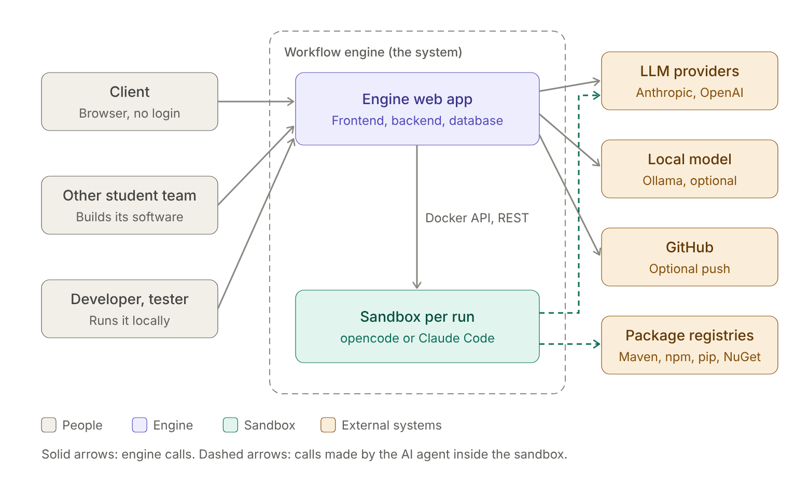
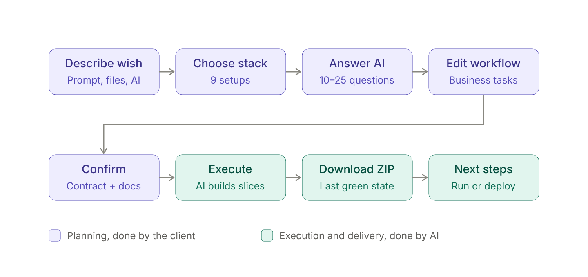
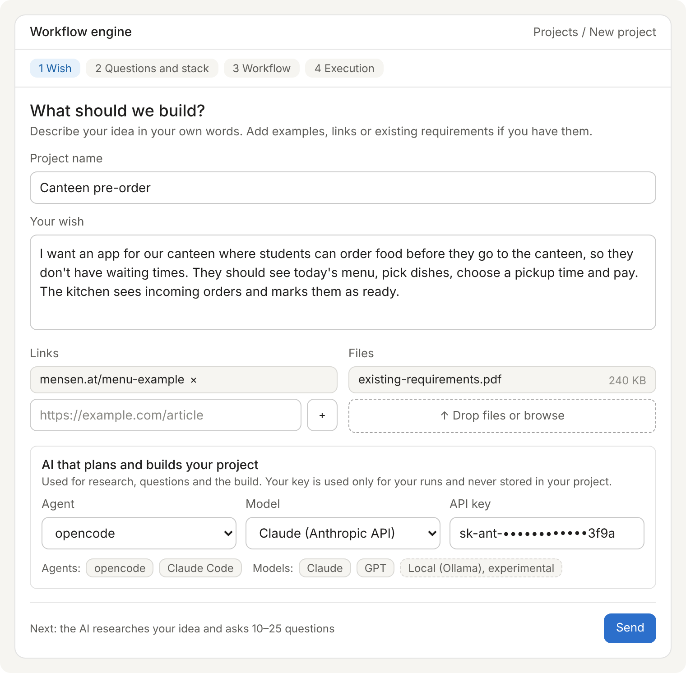
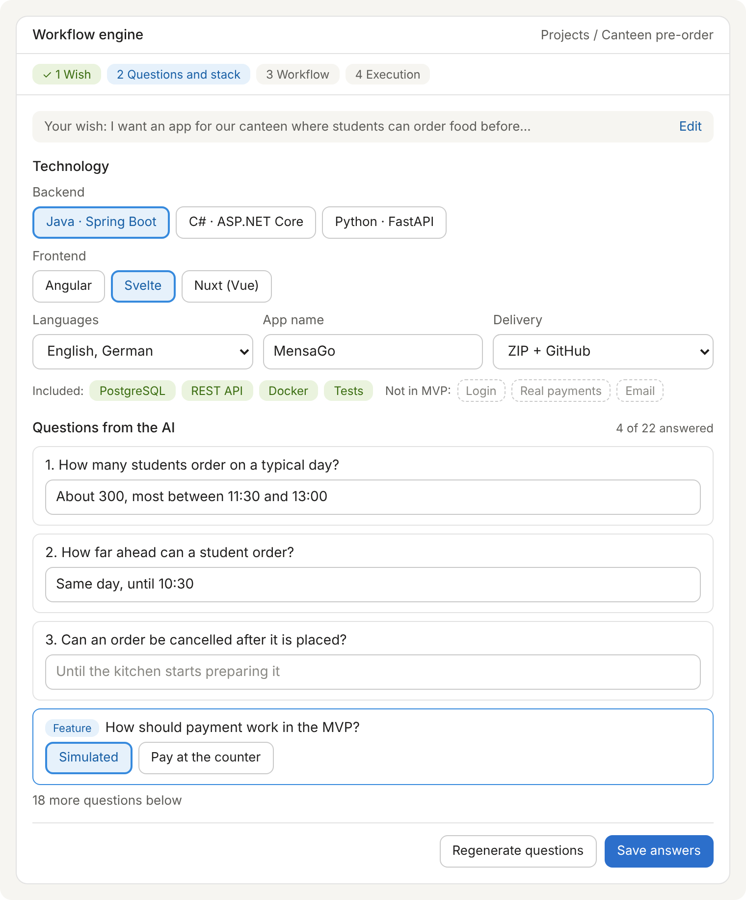
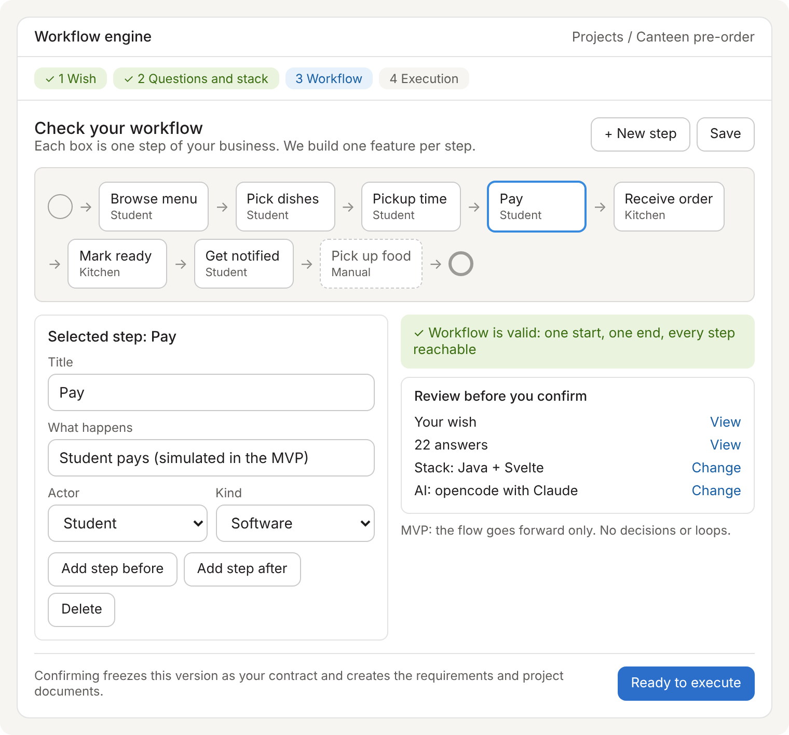
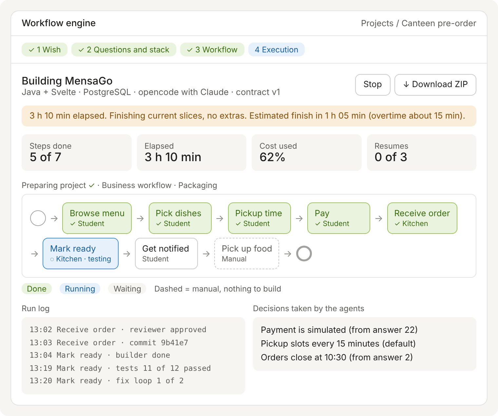

# Workflow Engine: Requirements specification

> Version 0.5, 14 November 2026. Generated from the Word document of the same name (the Word file is the edited master until the review is finished; afterwards this Markdown file is the source). Owner: Product Owner.

## 1. Introduction

### 1.1 Purpose

This document specifies the requirements for the workflow engine: a web application that turns a client's business idea into a small, working software project built by AI agents. It contains the business requirements, the stakeholder and user requirements, and the system requirements (functional, quality and technical), together with constraints, interfaces and acceptance criteria.

The structure follows ISO/IEC/IEEE 29148:2018 (business, stakeholder and system requirements specification). Requirement wording, attributes and quality criteria follow the IREB Certified Professional for Requirements Engineering (CPRE) foundation level. Quality requirements are grouped by the ISO/IEC 25010 product quality model.

### 1.2 Scope

In scope is the workflow engine itself: the planning phase (wish, AI questions, stack and AI selection, business workflow, contract, documents), the execution phase (sandbox, AI agents, progress, time handling, stop, resume) and the delivery (ZIP, GitHub, next steps). Out of scope are the business functions of the software that the engine generates for a client; those are specified per client project in the generated requirements document.

### 1.3 Intended readers

| **Reader**                                                   | **Uses this document to**                                   |
|--------------------------------------------------------------|-------------------------------------------------------------|
| Project team (Product Owner, Architect, developers, testers) | Build, test and accept the engine                           |
| Course lecturer                                              | Assess scope, quality and progress of the project           |
| The other student team                                       | Understand what the engine does and how to use it           |
| AI agents of the team                                        | Find requirements by ID when they implement or test a story |

### 1.4 Document conventions

#### Requirement syntax

Requirements use the IREB sentence template: "The system shall \| should \| may \<process verb\> \<object\> \<additional details\>." The modal verb states the legal obligation:

| **Word**              | **Meaning**                                                | **Priority** |
|-----------------------|------------------------------------------------------------|--------------|
| shall                 | Mandatory. The requirement must be met for acceptance.     | M (Must)     |
| should                | Strongly desired. Not meeting it needs a written reason.   | S (Should)   |
| may                   | Optional. Built if time allows.                            | C (Could)    |
| will not (in the MVP) | Explicitly excluded from this release; recorded for later. | W (Won't)    |

#### Requirement attributes

| **Attribute**        | **Content**                                                                                             |
|----------------------|---------------------------------------------------------------------------------------------------------|
| ID                   | Unique, stable identifier with a prefix per type and area (for example FR-WF-04). IDs are never reused. |
| Requirement          | One requirement per row, singular, unambiguous, verifiable.                                             |
| P                    | Priority by MoSCoW: M, S, C, W.                                                                         |
| Acceptance criterion | How the requirement is verified (test, demonstration, inspection, analysis).                            |
| Source               | Where the requirement comes from (see 1.5).                                                             |
| Status               | All requirements in version 0.1 are "proposed"; they become "agreed" after the review.                  |

#### Requirement types and prefixes

| **Prefix** | **Type (ISO/IEC/IEEE 29148, IREB)**                                         |
|------------|-----------------------------------------------------------------------------|
| BR         | Business requirement: what the organisation wants to achieve                |
| BRU        | Business rule: a rule of the domain that the system must respect            |
| UR         | User requirement (user story): what a stakeholder needs to do               |
| FR         | Functional system requirement                                               |
| QR         | Quality requirement (ISO/IEC 25010)                                         |
| TR         | Technical requirement: a required technology or technical solution property |
| CON        | Constraint: a limit on the project or the solution                          |
| IR         | Interface requirement                                                       |
| DR         | Data requirement                                                            |

### 1.5 Sources and references

| **Code** | **Source**                                                                                                                                         |
|----------|----------------------------------------------------------------------------------------------------------------------------------------------------|
| WS       | Requirements workshop of 11 November 2026 (Product Owner and team)                                                                                 |
| SL       | Course assignment \#1, slide 20, Hochschule Campus Wien, SDE, Advanced Software Development                                                        |
| CON      | Workflow Engine: Project Concept, version 0.1 (11 November 2026) and 0.2 (13 November 2026)                                                        |
| DOC      | The team's agent setup documents (architecture.md, workflow.md, team.md, agents.md and area contracts), cited by rule ID                           |
| STD      | ISO/IEC/IEEE 29148:2018; ISO/IEC 25010:2023; IREB CPRE Foundation Level syllabus                                                                   |
| EXT      | Documentation of external products (opencode, Anthropic)                                                                                           |
| AGT      | Agent architecture discussion of 12 and 13 November 2026 (layers A, B, C; providers; MCP), recorded in the project concept version 0.2, chapter 14 |

## 2. Business context and goals

### 2.1 Business purpose

Clients who are not software developers want working software for a business need, quickly and at low cost. The team already builds software with a team of AI agents and a written engineering process, using a terminal. The workflow engine makes this capability available through a web interface: the client describes, answers and confirms; AI agents build.

### 2.2 Stakeholders

| **Stakeholder**                  | **Role and interest**                                                                                                | **Influence** |
|----------------------------------|----------------------------------------------------------------------------------------------------------------------|---------------|
| Client                           | Describes the wish, answers questions, confirms the workflow, receives the software. No technical knowledge assumed. | High          |
| Other student team               | First real users: build their own software with the engine; depend on its reliability.                               | High          |
| Product Owner (team)             | Owns scope and priorities; accepts the engine.                                                                       | High          |
| Architect and developers (team)  | Design, build and operate the engine.                                                                                | High          |
| Course lecturer                  | Sets the assignments and assesses the result.                                                                        | High          |
| Developers of generated projects | Open, run and extend the delivered code.                                                                             | Medium        |
| AI provider (Anthropic)          | Provides the Claude models and terms of use the engine must respect.                                                 | Medium        |

### 2.3 Business goals

| **ID** | **Goal**                                           | **Measure of success**                                                                  |
|--------|----------------------------------------------------|-----------------------------------------------------------------------------------------|
| G1     | Software from an idea, without technical knowledge | A client completes a project from wish to download without editing a technical file     |
| G2     | Fast delivery                                      | Reference project finished within about 4 hours after Execute                           |
| G3     | Client control and transparency                    | Nothing is built before confirmation; every step and AI decision is visible             |
| G4     | Reliability for another team                       | The other team runs the engine from GitHub and completes a project without help from us |
| G5     | Course success                                     | Assignment \#1 delivered on 20 November 2026; later assignments build on it             |

### 2.4 Business requirements

| **ID** | **Requirement**                                                                                                                | **P** | **Acceptance criterion**                                                                                | **Source** |
|--------|--------------------------------------------------------------------------------------------------------------------------------|-------|---------------------------------------------------------------------------------------------------------|------------|
| BR-01  | The engine shall enable a client without technical knowledge to obtain a small, working software project from a business idea. | M     | Usability test: 3 people without IT background complete wish to download without help from the team.    | WS         |
| BR-02  | The engine shall deliver the software project within about 4 hours after Execute for a project with up to 8 business tasks.    | M     | Reference run (canteen example) finishes in ≤ 4 h in at least 2 of 3 runs; overtime reported otherwise. | WS         |
| BR-03  | The engine shall build nothing before the client has confirmed the workflow as a contract.                                     | M     | Execute is not available before confirmation (demonstration).                                           | WS         |
| BR-04  | The engine shall make the progress of the build and every decision taken by the AI visible to the client.                      | M     | Run page shows step status, time and the decision log (demonstration).                                  | WS         |
| BR-05  | The engine shall hand over all finished work even when the build is stopped or fails.                                          | M     | ZIP downloadable after stop and after failure (test).                                                   | WS         |
| BR-06  | The engine shall be usable by another team with documented steps only.                                                         | M     | Other team starts it from GitHub in ≤ 30 min and completes one run.                                     | WS         |
| BR-07  | The engine shall demonstrate a workflow that is executed and builds software.                                                  | M     | Demonstration at the course deadline.                                                                   | SL         |
| BR-08  | The engine shall let the client choose the AI agent and model and pay the AI provider directly.                                | M     | Agent, model and own API key selectable; no costs for the team (inspection).                            | WS         |
| BR-09  | The engine shall produce a requirements document and a project management document for each confirmed project.                 | M     | Both documents downloadable after confirmation.                                                         | WS         |
| BR-10  | The engine shall tell the client clearly what the MVP includes and what it does not.                                           | M     | Limits shown on the stack page, at confirmation and in every README (inspection).                       | WS         |

### 2.5 Business rules

| **ID** | **Requirement**                                                                                                                         | **P** | **Acceptance criterion**                                    | **Source** |
|--------|-----------------------------------------------------------------------------------------------------------------------------------------|-------|-------------------------------------------------------------|------------|
| BRU-01 | A project has exactly one workflow.                                                                                                     | M     | Data model enforces 1:1 (test).                             | WS         |
| BRU-02 | A workflow has exactly one start event and one end event; the flow goes forward only (no gateways, loops or parallel paths in the MVP). | M     | Validation rejects other shapes (test).                     | WS         |
| BRU-03 | A business task does one thing. Each software task becomes exactly one feature slice; a manual task is not built.                       | M     | Build plan has one slice per software task (test).          | WS         |
| BRU-04 | A confirmed contract snapshot never changes. A later edit creates a new version that must be confirmed again.                           | M     | Snapshot immutable in database (test).                      | WS         |
| BRU-05 | An edit of the prompt, the answers or the workflow invalidates every later stage, which must be completed again.                        | M     | Status falls back as specified in FR-CON-04 (test).         | WS         |
| BRU-06 | During execution the AI decides from the contract or takes a reasonable default and records it. The client is asked only when a defect is not fixable (FR-EXE-08, ADR-038). | M     | A run without an unfixable defect has no client interaction; DECISIONS.md filled (test). | WS         |
| BRU-07 | A delivered ZIP contains only work that built and passed its tests (last green checkpoint).                                             | M     | ZIP of a stopped run builds and passes tests (test).        | WS         |
| BRU-08 | The database of a generated project is PostgreSQL.                                                                                      | M     | All templates use PostgreSQL (inspection).                  | WS         |
| BRU-09 | The client's API key is never part of a generated project or a ZIP.                                                                     | M     | Key search in ZIP finds nothing (test).                     | WS         |

## 3. System context and boundary

The system is the workflow engine with its sandboxes. Everything outside the dashed boundary is context: people use the engine, external systems are used by it.



*Figure 1: System context of the workflow engine*

| **Context element**                     | **Interaction with the system**                                                                                                                  |
|-----------------------------------------|--------------------------------------------------------------------------------------------------------------------------------------------------|
| Client (browser)                        | Uses the web interface: wish, AI choice, questions, stack, workflow, confirmation, execution, download                                           |
| Other student team, developers, testers | Run the engine locally from GitHub, or use the deployed instance                                                                                 |
| Claude API (Anthropic)                  | Answers planning calls of the engine and model calls of the AI team (Claude Code or opencode); paid with the key the user enters for the session |
| Render.com                              | Optional: the project starter deploys the generated app from the public repository in their own Render account                                   |
| GitHub                                  | Optional: account of the person who starts the project; every finished task is pushed to a public repository there                               |
| Package registries                      | Provide dependencies to the agent during the build                                                                                               |

### 3.1 System boundary

- **Inside:** engine web app (frontend, backend, database), templates, sandbox per run (runner with agent harness, Docker-in-Docker sidecar, workspace).

- **Outside:** the browser, model providers, GitHub, package registries, the host's Docker installation.

- **Not part of the system:** the generated software after delivery; it is the client's product.

### 3.2 Overall process



*Figure 2: The process from the wish to running software*

## 4. User requirements

User requirements describe what stakeholders need to do with the engine, written as user stories with acceptance criteria (IREB). They are refined into system requirements in chapter 5.

| **ID** | **Requirement**                                                                                                                   | **P** | **Acceptance criterion**                                          | **Source** |
|--------|-----------------------------------------------------------------------------------------------------------------------------------|-------|-------------------------------------------------------------------|------------|
| UR-01  | As a client, I want to describe my idea in my own words and add links and files, so that the AI understands what I need.          | M     | Wish, links and files saved in a project; refined in FR-PRJ.      | WS         |
| UR-02  | As a client, I want to choose which AI agent and model work on my project and use my own key, so that I control quality and cost. | M     | Refined in FR-AI.                                                 | WS         |
| UR-03  | As a client, I want the AI to ask me the important questions, so that I do not forget requirements.                               | M     | 10–25 requirement and up to 5 feature questions; refined in FR-Q. | WS         |
| UR-04  | As a client, I want to choose the technology from a short list, so that the result fits my environment.                           | M     | Refined in FR-STK.                                                | WS         |
| UR-05  | As a client, I want to see my business process as a simple diagram and change it, so that the software matches how we work.       | M     | Refined in FR-WF.                                                 | WS         |
| UR-06  | As a client, I want to confirm the plan before anything is built, so that I stay in control.                                      | M     | Refined in FR-CON.                                                | WS         |
| UR-07  | As a client, I want a requirements document and a project plan, so that I can share and check the project.                        | M     | Refined in FR-DOC.                                                | WS         |
| UR-08  | As a client, I want to watch the build step by step, so that I know how far it is and how long it takes.                          | M     | Refined in FR-EXE, FR-TIME, FR-STAT.                              | WS         |
| UR-09  | As a client, I want to stop the build at any time and still get what is finished, so that no work is lost.                        | M     | Refined in FR-STOP, FR-EXP.                                       | WS         |
| UR-10  | As a client, I want a clean project and clear next steps, so that I can run or deploy the software myself.                        | M     | Refined in FR-EXP.                                                | WS         |
| UR-11  | As a member of the other team, I want to start the engine with one command, so that I can use it without help.                    | M     | Refined in QR-PORT, TR-15.                                        | WS         |
| UR-12  | As an operator, I want a run to continue after an engine restart, so that a crash does not waste hours of work.                   | M     | Refined in FR-RES.                                                | WS         |

## 5. Functional requirements

The functional requirements are grouped by the areas of the engine. Each group corresponds to a domain of the architecture (see the arc42 architecture document).

### 5.1 Projects, wish and attachments (FR-PRJ)

| **ID**    | **Requirement**                                                                                                                                                     | **P** | **Acceptance criterion**                                                               | **Source** |
|-----------|---------------------------------------------------------------------------------------------------------------------------------------------------------------------|-------|----------------------------------------------------------------------------------------|------------|
| FR-PRJ-01 | The system shall allow the client to create a project by entering a project name and a wish text and selecting Send.                                                | M     | Project stored with status DRAFT; wish visible after reload.                           | WS         |
| FR-PRJ-02 | The system shall allow the client to add and remove links (URLs) for a project.                                                                                     | M     | Links listed and removable; invalid URLs rejected with a message.                      | WS         |
| FR-PRJ-03 | The system shall allow the client to upload files (examples, literature, existing requirements) of the types PDF, DOCX, TXT, MD, PNG and JPG, up to 20 MB per file. | M     | Allowed files stored and listed; other types and larger files rejected with a message. | WS         |
| FR-PRJ-04 | The system shall allow the client to list, open, rename and delete projects.                                                                                        | M     | CRUD test through UI and API.                                                          | WS         |
| FR-PRJ-05 | The system shall show the initial wish in a separate area of the later pages and allow editing it.                                                                  | M     | Wish visible on pages 2–4; edit possible.                                              | WS         |

### 5.2 AI selection (FR-AI)

| **ID**   | **Requirement**                                                                                                                                                                                                                           | **P** | **Acceptance criterion**                                                       | **Source**    |
|----------|-------------------------------------------------------------------------------------------------------------------------------------------------------------------------------------------------------------------------------------------|-------|--------------------------------------------------------------------------------|---------------|
| FR-AI-01 | The system shall allow the client to select the agent harness for the build: opencode or Claude Code.                                                                                                                                     | M     | Both options selectable; choice stored in the project and the contract.        | WS            |
| FR-AI-02 | The system shall use Claude models only, through Claude Code or opencode, and let the client choose the harness and the model. Local models and other providers are not offered in the MVP.                                               | M     | Only Claude models are listed (inspection).                                    | WS, PO 13 Nov |
| FR-AI-03 | The system shall allow the client to enter an own API key and shall show it masked afterwards.                                                                                                                                            | M     | Key never shown in full after entry (inspection, API test).                    | WS, CON       |
| FR-AI-04 | The system shall use the selected model for research, questions, workflow and document generation, and the selected agent and model for the build.                                                                                        | M     | Provider logs or request records show the selected model (test).               | WS            |
| FR-AI-05 | The system should check the API key with a test call before the first AI action.                                                                                                                                                          | S     | Invalid key produces a clear message before Send completes.                    | CON           |
| FR-AI-07 | The system shall keep the API key in memory for the session only: it is tested with one call, never written to the database, logs, files, the workspace or the ZIP, and asked for again in every new session and after an engine restart. | M     | Database, log and ZIP search find no key; new session asks for the key (test). | PO 13 Nov     |
| FR-AI-08 | The system shall show all projects to everyone who opens the engine and let them open, change and continue any project (no login in the MVP).                                                                                             | M     | Project list visible in a second browser (demonstration).                      | PO 13 Nov     |
| FR-AI-06 | The system shall reject a start when the key test fails and show the reason; nothing is stored.                                                                                                                                           | M     | Wrong key: message shown, no project created (test).                           | PO 13 Nov     |

### 5.3 Research and questions (FR-Q)

| **ID**  | **Requirement**                                                                                                                                                | **P** | **Acceptance criterion**                                                   | **Source**  |
|---------|----------------------------------------------------------------------------------------------------------------------------------------------------------------|-------|----------------------------------------------------------------------------|-------------|
| FR-Q-01 | After Send, the system shall research the topic on the internet when the selected provider offers web search, and otherwise use the model's trained knowledge. | M     | Research summary stored; the UI states which of the two was used.          | WS          |
| FR-Q-02 | The system shall generate between 10 and 25 requirement questions based on the wish, the attachments and the research.                                         | M     | Count within range for 5 test wishes.                                      | WS          |
| FR-Q-03 | The system shall generate at most 5 feature questions, with answer choices where applicable.                                                                   | M     | Count ≤ 5; choices rendered as buttons.                                    | WS          |
| FR-Q-04 | The system shall use the internal engineering documents as context for the questions without showing them to the client.                                       | M     | Prompt record contains the documents; UI does not show them (inspection).  | WS          |
| FR-Q-05 | The system shall show each question as its own input field, with the question above the input.                                                                 | M     | UI test.                                                                   | WS          |
| FR-Q-06 | The system shall save all answers together when the client selects Save answers.                                                                               | M     | All answers persisted in one action; status ANSWERED.                      | WS          |
| FR-Q-07 | The system should allow the client to edit, delete and add questions and to regenerate the questions.                                                          | S     | CRUD test.                                                                 | WS          |
| FR-Q-08 | The system shall validate every AI result against its JSON schema, retry once if it does not match, and show an error message after the second failure.        | M     | Test with a stubbed invalid response.                                      | CON         |
| FR-Q-09 | The system shall pass the content of links and files to the AI as material only, never as instructions.                                                        | M     | Prompt injection test: an instruction in an uploaded file is not followed. | DOC AGT-047 |

### 5.4 Stack selection (FR-STK)

| **ID**    | **Requirement**                                                                                                                              | **P** | **Acceptance criterion**                   | **Source** |
|-----------|----------------------------------------------------------------------------------------------------------------------------------------------|-------|--------------------------------------------|------------|
| FR-STK-01 | The system shall allow the client to select the backend: Java (Spring Boot), C# (ASP.NET Core) or Python (FastAPI).                          | M     | Options shown; choice stored.              | WS         |
| FR-STK-02 | The system shall allow the client to select the frontend: Angular, Svelte (SvelteKit) or Nuxt (Vue).                                         | M     | Options shown; choice stored.              | WS         |
| FR-STK-03 | The system shall offer only setups that are marked green in the template manifest and show the others as not available.                      | M     | A red setup cannot be selected (test).     | CON        |
| FR-STK-04 | The system shall show PostgreSQL, REST API, Docker and tests as included and not selectable.                                                 | M     | UI inspection.                             | WS         |
| FR-STK-05 | The system shall show login, real payments, email, file storage and monitoring as not included in the MVP.                                   | M     | UI inspection.                             | WS         |
| FR-STK-06 | The system should allow the client to select 1 to 3 languages and a main language.                                                           | S     | Choice stored and used in the template.    | CON        |
| FR-STK-07 | The system should allow the client to enter an app name, a primary colour and an optional logo.                                              | S     | Values appear in the generated app.        | CON        |
| FR-STK-08 | The system shall let the person who starts a project sign in to GitHub at the start (optional). Without GitHub the delivery is the ZIP only. | M     | Run without GitHub ends with a ZIP (test). | PO 13 Nov  |
| FR-STK-09 | The system may allow the client to choose separate containers or a single container for the generated app.                                   | C     | Both compose files delivered.              | CON        |
| FR-STK-10 | The system may show a hint on the expected build speed of each stack.                                                                        | C     | Hint visible.                              | CON        |

### 5.5 Business workflow (FR-WF)

| **ID**   | **Requirement**                                                                                                                                                                              | **P** | **Acceptance criterion**                                   | **Source** |
|----------|----------------------------------------------------------------------------------------------------------------------------------------------------------------------------------------------|-------|------------------------------------------------------------|------------|
| FR-WF-01 | After Save answers, the system shall generate a business workflow with one start event, business tasks (title, description, actor, kind: software or manual), one end event and arrows.      | M     | Workflow generated for 5 test projects; validation passes. | WS         |
| FR-WF-02 | The system shall show the workflow as a simplified BPMN diagram from left to right.                                                                                                          | M     | UI inspection against mockup page 3.                       | WS         |
| FR-WF-03 | The system shall allow the client to edit the content of a step.                                                                                                                             | M     | Edit persisted after Save.                                 | WS         |
| FR-WF-04 | The system shall allow the client to add a step before or after a selected step.                                                                                                             | M     | New step inserted; arrows rewired (test).                  | WS         |
| FR-WF-05 | The system shall allow the client to create a step and assign its predecessor and successor.                                                                                                 | M     | Test.                                                      | WS         |
| FR-WF-06 | The system shall allow the client to delete a step and shall reconnect its neighbours.                                                                                                       | M     | Test.                                                      | WS         |
| FR-WF-07 | The system should allow the client to edit arrows.                                                                                                                                           | S     | Test.                                                      | WS         |
| FR-WF-08 | On Save, the system shall validate that the workflow has one start, one end, every step reachable from the start, the end reachable from every step and no cycle, and shall show the result. | M     | Each rule tested with an invalid workflow.                 | CON        |
| FR-WF-09 | The system shall save the workflow when the client selects Save.                                                                                                                             | M     | Test.                                                      | WS         |
| FR-WF-10 | The system should propose which tasks are manual and allow the client to change it.                                                                                                          | S     | Test.                                                      | CON        |

### 5.6 Review and contract (FR-CON)

| **ID**    | **Requirement**                                                                                                                                                     | **P** | **Acceptance criterion**                           | **Source** |
|-----------|---------------------------------------------------------------------------------------------------------------------------------------------------------------------|-------|----------------------------------------------------|------------|
| FR-CON-01 | The system shall show a review of the wish, answers, stack, AI choice and workflow before confirmation.                                                             | M     | UI inspection.                                     | WS         |
| FR-CON-02 | When the client selects Ready to execute, the system shall store an immutable contract snapshot containing all confirmed data and the template version.             | M     | Snapshot cannot be changed through the API (test). | WS         |
| FR-CON-03 | The system may congratulate the client on the created workflow.                                                                                                     | C     | Message visible.                                   | WS         |
| FR-CON-04 | After an edit, the system shall move the project status back (prompt → DRAFT, answers → ANSWERED, workflow → WORKFLOW_DRAFTED) and require every later stage again. | M     | State machine test for each edit.                  | WS         |
| FR-CON-05 | The system should keep earlier contract snapshots.                                                                                                                  | S     | Versions listed.                                   | CON        |
| FR-CON-06 | The system shall show the Execute button only when the project is CONFIRMED.                                                                                        | M     | Test.                                              | WS         |

### 5.7 Generated documents (FR-DOC)

| **ID**    | **Requirement**                                                                                                                                                      | **P** | **Acceptance criterion**                               | **Source** |
|-----------|----------------------------------------------------------------------------------------------------------------------------------------------------------------------|-------|--------------------------------------------------------|------------|
| FR-DOC-01 | After the answers are saved (BPMN: Plan requirements and workflow), the system shall generate a requirements document following ISO/IEC/IEEE 29148 and IREB conventions, with acceptance criteria per business task, show it on screen 3, and update it from the contract snapshot at confirmation.  | M     | Document generated; inspection against outline.        | WS         |
| FR-DOC-02 | After the answers are saved, the system shall generate a project management document with goal, scope, work packages, order, time target, risks and MVP limits, and update it from the contract snapshot at confirmation.  | M     | Document generated; inspection against outline.        | WS         |
| FR-DOC-03 | The system shall allow the client to view both documents in the browser and download them as DOCX or PDF.                                                            | M     | Download test.                                         | WS         |
| FR-DOC-04 | The system should use a fixed outline for each document type.                                                                                                        | S     | Two projects produce documents with the same headings. | CON        |

### 5.8 Execution (FR-EXE)

| **ID**    | **Requirement**                                                                                                                                                                  | **P** | **Acceptance criterion**                                  | **Source** |
|-----------|----------------------------------------------------------------------------------------------------------------------------------------------------------------------------------|-------|-----------------------------------------------------------|------------|
| FR-EXE-01 | On Execute, the system shall create a sandbox for the run consisting of a runner container, a Docker-in-Docker sidecar and a workspace volume.                                   | M     | Containers labelled with the run ID exist during the run. | CON        |
| FR-EXE-02 | The system shall unpack the selected template into the workspace, add the contract, the documents and the agent instructions, and record every added file in an export manifest. | M     | Manifest lists every added file (test).                   | CON        |
| FR-EXE-03 | The system shall derive a build plan with one feature slice per software task plus fixed technical steps (prepare, integration test, packaging).                                 | M     | Build plan test for the canteen example.                  | WS         |
| FR-EXE-04 | The system shall build the business tasks in workflow order, each with the 16 development steps and the members of the confirmed team (ADR-039), with at most 2 fix loops per defect before the best model tries once (ADR-038).  | M     | Run log shows the sequence (test).                        | CON        |
| FR-EXE-05 | The system shall start a fresh agent session for each step and role.                                                                                                             | M     | Session IDs differ per step (test).                       | CON        |
| FR-EXE-06 | After each step the system shall run build and tests and, when they pass, create one git commit as checkpoint.                                                                   | M     | One commit per green step (test).                         | CON        |
| FR-EXE-07 | The system shall recover a failed step by itself (retry, fix loops, best model, recovery advisor, FR-AGT-10); only when it is still not fixable shall the development supervisor ask the client (FR-EXE-08); the run ends FAILED only when the client chooses to stop.  | M     | Test with a step that always fails.                       | CON        |
| FR-EXE-08 | The system shall run without asking the client; agents record their own decisions, which the system shows. Only in the rare case that a defect is not fixable after the recovery of FR-EXE-07 shall it ask the client one question with short answer options (screen 12, ADR-038).  | M     | No client interaction; decisions panel filled.            | WS         |
| FR-EXE-09 | After the last slice the system shall run the integration test, the final audit and the packaging step.                                                                          | M     | Run log shows the three steps.                            | CON        |
| FR-EXE-10 | The system should queue runs and execute at most a configurable number in parallel (default 1).                                                                                  | S     | Second run waits in QUEUED.                               | CON        |
| FR-EXE-11 | When the Claude API answers that the rate limit or the credit of the key is exhausted, the system shall not fail the run: it shall pause the step, show "Waiting for tokens" with the reason, retry with increasing waits, and continue from the last checkpoint by itself when calls succeed again (a new key in the session also continues it). | M | Test with a stubbed rate-limit and credit error; the run continues afterwards. | PO |

### 5.9 Time handling (FR-TIME)

| **ID**     | **Requirement**                                                                                                                                               | **P** | **Acceptance criterion**                               | **Source** |
|------------|---------------------------------------------------------------------------------------------------------------------------------------------------------------|-------|--------------------------------------------------------|------------|
| FR-TIME-01 | The system shall show elapsed time, steps done and the estimated finish time during a run.                                                                    | M     | UI test.                                               | WS         |
| FR-TIME-02 | The system shall include elapsed and remaining time in every step prompt.                                                                                     | M     | Prompt record inspection.                              | CON        |
| FR-TIME-03 | From 3 hours, or as soon as the estimate exceeds 4 hours, the system shall show a warning and instruct the agents to finish the current slice without extras. | M     | Test with a shortened clock.                           | WS         |
| FR-TIME-04 | After 4 hours the system shall continue the run, show the overtime and record it in the report.                                                               | M     | Run is not stopped at 4 h (test with shortened clock). | WS         |
| FR-TIME-05 | The system shall abort a step with no events and no file changes for 30 minutes (configurable) and retry it once.                                             | M     | Test with a stuck stub agent.                          | CON        |
| FR-TIME-06 | The system should allow the client to set a cost limit and shall pause the run when it is reached.                                                            | S     | Run pauses at the limit (test).                        | CON        |
| FR-TIME-07 | The system shall pause a run at an absolute ceiling of 8 hours (configurable).                                                                                | M     | Test with a shortened clock.                           | CON        |
| FR-TIME-08 | The system should allow the client to continue a paused run from the last checkpoint.                                                                         | S     | Continue resumes at the next step.                     | CON        |

### 5.10 Resume after an engine restart (FR-RES)

| **ID**    | **Requirement**                                                                                                                       | **P** | **Acceptance criterion**                             | **Source** |
|-----------|---------------------------------------------------------------------------------------------------------------------------------------|-------|------------------------------------------------------|------------|
| FR-RES-01 | On start, the system shall find all runs in EXECUTING or RESUMING and increase and save their resume counter before resuming them.    | M     | Counter increased even if the resume crashes (test). | WS         |
| FR-RES-02 | The system shall resume a run at most 3 times and then mark it FAILED with the reason.                                                | M     | Fourth restart leads to FAILED.                      | WS         |
| FR-RES-03 | The system shall reuse a still running sandbox or start a new one on the same workspace volume.                                       | M     | Both cases tested.                                   | CON        |
| FR-RES-04 | The system shall discard uncommitted changes, check that the last checkpoint builds and, if it does not, go back one more checkpoint. | M     | Test with a broken working tree.                     | CON        |
| FR-RES-05 | The system shall mark the interrupted step INTERRUPTED and run it again in a fresh session.                                           | M     | Test.                                                | CON        |
| FR-RES-06 | The system should show "Resumed (n of 3)" on the run page.                                                                            | S     | UI test.                                             | CON        |
| FR-RES-07 | The system may show engine downtime separately from the elapsed time.                                                                 | C     | UI test.                                             | CON        |

### 5.11 Status display (FR-STAT)

| **ID**     | **Requirement**                                                                                                                                        | **P** | **Acceptance criterion**                  | **Source** |
|------------|--------------------------------------------------------------------------------------------------------------------------------------------------------|-------|-------------------------------------------|------------|
| FR-STAT-01 | The system shall show the status of each business step: waiting (grey), running (blue), done (green), failed (red), stopped (orange), manual (dashed). | M     | UI inspection against mockup page 4.      | WS         |
| FR-STAT-02 | The system shall show a step as done only when all its build tasks are finished and its checkpoint is green.                                           | M     | Test.                                     | WS         |
| FR-STAT-03 | The system shall update the status live and restore the correct state after a page reload.                                                             | M     | Reload during a run shows the same state. | WS         |
| FR-STAT-04 | The system should show the run log and the decisions taken by the agents.                                                                              | S     | UI test.                                  | WS         |
| FR-STAT-05 | The system may show the technical phases (preparing, packaging) above the diagram.                                                                     | C     | UI test.                                  | CON        |

### 5.12 Stop (FR-STOP)

| **ID**     | **Requirement**                                                                                                                 | **P** | **Acceptance criterion**                        | **Source** |
|------------|---------------------------------------------------------------------------------------------------------------------------------|-------|-------------------------------------------------|------------|
| FR-STOP-01 | The system shall allow the client to stop a run at any time after a confirmation.                                               | M     | Test.                                           | WS         |
| FR-STOP-02 | On stop, the system shall abort the agent session, reset the workspace to the last green checkpoint and set the run to STOPPED. | M     | Workspace equals last checkpoint commit (test). | WS         |
| FR-STOP-03 | The system may allow the client to continue a stopped run; it shall then ask for the API key again.                             | C     | Test.                                           | CON        |

### 5.13 Export and delivery (FR-EXP)

| **ID**    | **Requirement**                                                                                                                                                                                                                                                                                                                                     | **P** | **Acceptance criterion**                                                                            | **Source** |
|-----------|-----------------------------------------------------------------------------------------------------------------------------------------------------------------------------------------------------------------------------------------------------------------------------------------------------------------------------------------------------|-------|-----------------------------------------------------------------------------------------------------|------------|
| FR-EXP-01 | The system shall offer the ZIP download when a run is DONE, STOPPED or FAILED.                                                                                                                                                                                                                                                                      | M     | Download test in all three states.                                                                  | WS         |
| FR-EXP-02 | The ZIP shall contain only the last green checkpoint.                                                                                                                                                                                                                                                                                               | M     | Unpacked ZIP builds and passes its tests.                                                           | WS         |
| FR-EXP-03 | The system shall remove every file listed in the export manifest and every file matching the internal pattern list (CLAUDE.md, AGENTS.md, .claude\*, .opencode\*, opencode.json, docs/stories/).                                                                                                                                                    | M     | No such file in the ZIP (test).                                                                     | WS         |
| FR-EXP-04 | The system shall deliver a fresh git repository with one commit and no earlier history.                                                                                                                                                                                                                                                             | M     | git log shows one commit.                                                                           | CON        |
| FR-EXP-05 | The system shall switch the delivered pipeline to customer mode without internal process checks.                                                                                                                                                                                                                                                    | M     | ci/run all-local passes in the unpacked ZIP.                                                        | CON        |
| FR-EXP-06 | Before offering a ZIP, the system shall check that no internal file and no internal rule ID is contained and shall refuse the export with a message otherwise.                                                                                                                                                                                      | M     | Test with a planted file.                                                                           | CON        |
| FR-EXP-07 | The system shall add a README stating which steps are finished and how to start the software.                                                                                                                                                                                                                                                       | M     | Inspection.                                                                                         | WS         |
| FR-EXP-08 | The system may offer the download of the current state while a run is executing.                                                                                                                                                                                                                                                                    | C     | Test.                                                                                               | CON        |
| FR-EXP-09 | The system shall commit and push every finished task to a public repository in the GitHub account of the project starter; the repository is created on the first push. The system should add a render.yaml Blueprint and show a "Deploy to Render" link so that the starter can deploy in their own Render account; the engine keeps no Render key. | M     | One commit per finished task in the public repository; link opens the Render Blueprint page (test). | PO 13 Nov  |
| FR-EXP-10 | The system shall show a next-steps page: start locally, open as a developer, single container, deploy, MVP limits.                                                                                                                                                                                                                                  | M     | UI inspection.                                                                                      | WS         |

### 5.14 Engine settings (FR-SET)

| **ID**    | **Requirement**                                                                                                | **P** | **Acceptance criterion**                    | **Source** |
|-----------|----------------------------------------------------------------------------------------------------------------|-------|---------------------------------------------|------------|
| FR-SET-01 | The system shall start and allow browsing without any API key or token; a key is required only for AI actions. | M     | Fresh start without .env keys works (test). | CON        |
| FR-SET-02 | The system should list the available providers and models.                                                     | S     | API test.                                   | CON        |
| FR-SET-03 | The system may show the status of the 9 setups from the template manifest.                                     | C     | UI test.                                    | CON        |

### 5.15 AI agents and orchestration (FR-AGT)

Added in version 0.2. The orchestrator is code (layer A); the agents below are models with a role prompt, a JSON output schema and tools, each working inside one stage (layer B). No model is trained.

| **ID**    | **Requirement**                                                                                                                                                                                               | **P** | **Acceptance criterion**                                                    | **Source**     |
|-----------|---------------------------------------------------------------------------------------------------------------------------------------------------------------------------------------------------------------|-------|-----------------------------------------------------------------------------|----------------|
| FR-AGT-01 | The system shall control the order of all stages through a state machine in code; no AI agent shall change a project or run status directly.                                                                  | M     | Code review; unit tests of every transition.                                | AGT            |
| FR-AGT-02 | The system shall run each agent task as a durable job that is picked up again after an engine restart.                                                                                                        | M     | Kill the engine during a planning task; the task completes after restart.   | AGT            |
| FR-AGT-03 | The system shall validate every agent result against its JSON schema and retry once with the validation error; a second failure shall be shown to the client with a retry button.                             | M     | Test with a stub model returning invalid JSON.                              | AGT            |
| FR-AGT-04 | The prompt agent shall turn the wish, links and files into a project brief (goal, actors, domain words, risks).                                                                                               | M     | Brief stored and visible (demonstration).                                   | AGT            |
| FR-AGT-05 | The questions agent shall produce 10 to 25 requirement questions and up to 5 feature questions from the brief.                                                                                                | M     | Count and types checked by schema (test).                                   | AGT, FR-Q      |
| FR-AGT-06 | The requirements agent shall produce requirements with unique IDs in the style of section 1.4 and the PM document.                                                                                            | M     | IDs unique (test); document generated (demonstration).                      | AGT, FR-DOC    |
| FR-AGT-07 | The workflow agent shall create the workflow only through the tools addStep, connectSteps and validateWorkflow, and shall assign every step to an epic (domain) and to at least one requirement ID.           | M     | validateWorkflow passes; each step has an epic and a requirement ID (test). | AGT, FR-WF     |
| FR-AGT-08 | During execution, the development supervisor shall prepare the prompts of the builder, tester and reviewer per step and read their results through read-only tools.                                           | M     | Run log shows one supervisor task per step (test).                          | AGT, FR-EXE    |
| FR-AGT-09 | A PO stand-in shall answer questions of the coding agents from the contract snapshot only; when the contract has no answer, the agent shall choose the smallest reasonable option and log it in DECISIONS.md. | M     | Question without contract answer leads to a DECISIONS.md entry (test).      | AGT, BRU       |
| FR-AGT-10 | On a failed step, a recovery advisor shall choose one action from an allowed list (retry, retry with hint, skip step, pause run); the code shall execute and count the action.                                | M     | An action outside the list is rejected (test).                              | AGT            |
| FR-AGT-11 | The system shall limit each agent task to 20 tool calls and each step to 2 fix loops.                                                                                                                         | M     | Test with a stub that loops.                                                | AGT            |
| FR-AGT-12 | The system shall record every agent call (agent, model, tokens, duration, result status) without prompts that contain secrets.                                                                                | M     | ai_call records present; no key in records (test).                          | AGT, QR-SEC-01 |
| FR-AGT-13 | The system may publish the workflow tools through an MCP server at /mcp; the MCP server shall be off by default.                                                                                              | C     | With ENGINE_MCP_ENABLED=true an MCP client lists the tools (demonstration). | AGT            |

## 6. Quality requirements

Quality requirements are grouped by the characteristics of ISO/IEC 25010. Security in this release is limited to hygiene and correctness rules (ADR-020, ADR-022): the security phase itself is deferred, but no secret may leak.

### 6.1 Performance efficiency

| **ID**     | **Requirement**                                                                                                           | **P** | **Acceptance criterion**          | **Source** |
|------------|---------------------------------------------------------------------------------------------------------------------------|-------|-----------------------------------|------------|
| QR-PERF-01 | A run of the reference project (canteen example, 8 business tasks, Java and Svelte, Claude) should finish within 4 hours. | S     | Measured in 3 runs; median ≤ 4 h. | WS         |
| QR-PERF-02 | UI actions that do not call an AI (navigate, save, edit diagram) shall respond within 1 second for 95 % of actions.       | M     | Measured on reference hardware.   | CON        |
| QR-PERF-03 | Question generation should complete within 2 minutes after Send.                                                          | S     | Measured for 5 test wishes.       | CON        |
| QR-PERF-04 | Preparing a sandbox (start containers, unpack template) should take at most 60 seconds with warm caches.                  | S     | Measured.                         | CON        |

### 6.2 Reliability

| **ID**    | **Requirement**                                                                                                        | **P** | **Acceptance criterion**                                   | **Source** |
|-----------|------------------------------------------------------------------------------------------------------------------------|-------|------------------------------------------------------------|------------|
| QR-REL-01 | No step that was shown as done shall be missing from a delivered ZIP after a stop, a failure or an engine restart.     | M     | Fault injection tests.                                     | WS         |
| QR-REL-02 | A run shall survive up to 3 engine restarts and continue from its last checkpoint.                                     | M     | Kill the engine 3 times during a run; run finishes.        | WS         |
| QR-REL-03 | After a page reload or a lost connection, the UI shall show the correct run state within 5 seconds.                    | M     | Test.                                                      | CON        |
| QR-REL-05 | An agent task shall never run without a limit: tool calls, retries, fix loops, resumes, time and cost are all bounded. | M     | Review of AiTaskRunner and orchestrator limits; loop test. | AGT        |
| QR-REL-04 | A stuck agent session shall be detected and handled by the per-step timeout.                                           | M     | Test with a stuck stub.                                    | EXT        |

### 6.3 Usability and accessibility

| **ID**    | **Requirement**                                                                                                                             | **P** | **Acceptance criterion**                      | **Source** |
|-----------|---------------------------------------------------------------------------------------------------------------------------------------------|-------|-----------------------------------------------|------------|
| QR-USE-01 | A person without IT background should complete the planning phase (wish to confirmation) without help within 30 minutes.                    | S     | Usability test with 3 people.                 | WS         |
| QR-USE-02 | The UI shall use plain language and show the MVP limits before confirmation.                                                                | M     | Review of all texts.                          | WS         |
| QR-USE-03 | All pages shall be operable by keyboard, and text shall have a contrast of at least 4.5:1.                                                  | M     | Accessibility check (DOC ARC-023).            | DOC        |
| QR-USE-04 | The UI shall be in English and German; all user-visible text shall come from the translation resource so that a further language can be added without code change. | M     | No hard-coded text (inspection, DOC ARC-022); every text exists in both languages (check). | DOC        |

### 6.4 Security hygiene

| **ID**    | **Requirement**                                                                                                                                                                                        | **P** | **Acceptance criterion**                                          | **Source**               |
|-----------|--------------------------------------------------------------------------------------------------------------------------------------------------------------------------------------------------------|-------|-------------------------------------------------------------------|--------------------------|
| QR-SEC-01 | The API key and the GitHub token shall never be returned by the API, never be written to the database, logs, the workspace or a ZIP; they are held in engine memory for the session and its runs only. | M     | Code review, database, log and ZIP search.                        | WS, DOC ADR-033, ADR-035 |
| QR-SEC-02 | The sandbox shall never receive the host Docker socket and shall run with CPU and memory limits.                                                                                                       | M     | Container inspection.                                             | CON                      |
| QR-SEC-03 | Content from links and files shall be treated as data, never as instructions (prompt injection).                                                                                                       | M     | Injection test (see FR-Q-09).                                     | DOC AGT-047              |
| QR-SEC-04 | The agent server inside the sandbox should be protected with a password.                                                                                                                               | S     | Unauthenticated request rejected.                                 | EXT                      |
| QR-SEC-06 | The MCP door shall be disabled by default and shall use the same validation as the REST API.                                                                                                           | M     | Default configuration test; tool call with invalid data rejected. | AGT                      |
| QR-SEC-05 | The engine will not provide login, roles or access control in the MVP; this risk is recorded and accepted.                                                                                             | W     | Entry in the deferred-risk register (DOC ARC-043).                | DOC ADR-020              |

### 6.5 Maintainability

| **ID**    | **Requirement**                                                                                                                                                                              | **P** | **Acceptance criterion**             | **Source** |
|-----------|----------------------------------------------------------------------------------------------------------------------------------------------------------------------------------------------|-------|--------------------------------------|------------|
| QR-MNT-01 | The engine shall be a modular monolith with one domain per area, a contract-first API and the tests required by the team's test contract; the local pipeline shall be green for every merge. | M     | Architecture tests and pipeline run. | DOC        |
| QR-MNT-02 | A new agent harness shall be addable by implementing one adapter interface without changing the execution logic.                                                                             | M     | Code review; second adapter exists.  | CON        |
| QR-MNT-03 | All template versions should be pinned in one file per template part, so that the half-yearly renewal is one epic.                                                                           | S     | Inspection.                          | WS         |

### 6.6 Portability and compatibility

| **ID**     | **Requirement**                                                                                                                        | **P** | **Acceptance criterion**  | **Source** |
|------------|----------------------------------------------------------------------------------------------------------------------------------------|-------|---------------------------|------------|
| QR-PORT-01 | The engine shall start with one command (docker compose up) on macOS (Apple Silicon and Intel), Linux and Windows with Docker Desktop. | M     | Started on each platform. | WS         |
| QR-PORT-02 | The same build shall run locally and on a server; all differences shall come from environment configuration.                           | M     | Inspection (DOC ARC-026). | DOC        |
| QR-PORT-03 | A delivered project shall start with docker compose up on a machine that has only Docker installed.                                    | M     | Test on a clean machine.  | WS         |

## 7. Technical requirements and constraints

### 7.1 Technical requirements

| **ID** | **Requirement**                                                                                                                                                                                 | **P** | **Acceptance criterion**              | **Source** |
|--------|-------------------------------------------------------------------------------------------------------------------------------------------------------------------------------------------------|-------|---------------------------------------|------------|
| TR-01  | The engine backend shall be implemented in Java 21 with Spring Boot 3.                                                                                                                          | M     | Inspection.                           | WS         |
| TR-02  | The engine frontend shall be implemented with Svelte (SvelteKit); the diagram editor shall use Svelte Flow.                                                                                     | M     | Inspection.                           | WS         |
| TR-03  | The engine shall store its data in PostgreSQL with Flyway migrations and one schema per domain.                                                                                                 | M     | Inspection (DOC ADR-004).             | DOC        |
| TR-04  | The engine API shall be REST, defined first in one OpenAPI file, with problem-detail error responses.                                                                                           | M     | Contract check (DOC ADR-007).         | DOC        |
| TR-05  | Live updates shall use server-sent events (SSE).                                                                                                                                                | M     | Inspection.                           | CON        |
| TR-06  | Planning-phase AI calls shall use Spring AI with structured JSON output.                                                                                                                        | M     | Inspection.                           | CON        |
| TR-07  | The build shall use an AgentRunner interface with a Claude Code adapter and an opencode adapter; which one is the default, and whether both are in the MVP, is open issue OI-4.                    | M     | Each adapter in the MVP passes the harness spike. | CON        |
| TR-08  | The opencode version shall be pinned in the runner image, and its permission setting shall allow all actions inside the sandbox.                                                                | M     | Image inspection.                     | EXT        |
| TR-09  | The sandbox shall be created through the Docker API (docker-java) as runner, Docker-in-Docker sidecar and workspace volume, all labelled with the run ID.                                       | M     | Inspection.                           | CON        |
| TR-10  | The runner image shall contain JDK, .NET SDK, Python, Node, Playwright browsers and git, and shall be built for amd64 and arm64.                                                                | M     | Image inspection.                     | CON        |
| TR-11  | Templates shall be stored in templates/ of the engine repository (base plus 3 backend and 3 frontend parts), assembled at image build into 9 setups with a manifest, and tested in a CI matrix. | M     | Pipeline run.                         | WS         |
| TR-12  | Template agent files should be stored under neutral names and the engineering documents copied from the engine's own docs at assembly.                                                          | S     | Inspection.                           | CON        |
| TR-13  | Every generated project shall be a monorepo with contract-first API, ci/run commands, Docker Compose and PostgreSQL.                                                                            | M     | Inspection of a delivered ZIP.        | WS         |
| TR-14  | Run status, step status and run events shall be stored in the engine database.                                                                                                                  | M     | Inspection.                           | CON        |
| TR-15  | All configuration shall come from environment variables (.env); keys and tokens shall be optional at start.                                                                                     | M     | Start without keys works.             | DOC        |
| TR-16  | A GitHub push shall use the token of the project starter (device flow, scope public_repo), held in memory only.                                                                                 | M     | Inspection.                           | PO 13 Nov  |

### 7.2 Constraints

| **ID** | **Requirement**                                                                                                                      | **P** | **Acceptance criterion**                | **Source** |
|--------|--------------------------------------------------------------------------------------------------------------------------------------|-------|-----------------------------------------|------------|
| CON-01 | Assignment \#1 shall be delivered by 20 November 2026: teams, stack, repository, first engine version and a simple example workflow. | M     | Delivery on time.                       | SL         |
| CON-02 | The project is a university project of a team of 3 to 4 people.                                                                      | M     | \-                                      | SL         |
| CON-03 | No security or observability features shall be built in the MVP; correctness and hygiene rules remain active.                        | M     | Review (DOC ADR-020, ADR-021, ADR-022). | DOC        |
| CON-04 | Anthropic models shall be used with API keys only; claude.ai login shall not be offered.                                             | M     | Inspection.                             | EXT        |
| CON-05 | Changes to the project shall be justified in writing.                                                                                | M     | Decision records exist.                 | SL         |
| CON-06 | The engine shall be built with the team's own agent setup and documents (Starter profile).                                           | M     | Inspection.                             | WS         |
| CON-07 | The build needs network access for model APIs and package registries.                                                                | M     | \-                                      | CON        |

## 8. Interface requirements

### 8.1 User interface

The user interface consists of four main pages. The mockups show the canteen example with sample data; they are binding for content and order, not for exact styling.

| **ID**   | **Requirement**                                                                                                                          | **P** | **Acceptance criterion**           | **Source** |
|----------|------------------------------------------------------------------------------------------------------------------------------------------|-------|------------------------------------|------------|
| IR-UI-01 | The system shall guide the client through six steps with a progress indicator: 1 Wish and AI, 2 Questions and stack, 3 Requirements, 4 Workflow, 5 Team and steps, 6 Run (the 14 screens of the mockups). | M     | UI inspection against the mockups. | WS         |
| IR-UI-02 | Each page shall show the project name and allow returning to earlier pages.                                                              | M     | UI test.                           | WS         |



*Figure 3: Page 1, wish, attachments and AI selection*



*Figure 4: Page 2, technology and questions*



*Figure 5: Page 3, checking the business workflow*



*Figure 6: Page 4, execution*

### 8.2 Engine API

| **ID**    | **Requirement**                                                                                                                                                                                              | **P** | **Acceptance criterion** | **Source** |
|-----------|--------------------------------------------------------------------------------------------------------------------------------------------------------------------------------------------------------------|-------|--------------------------|------------|
| IR-API-01 | The engine shall offer REST resources for projects, attachments, stack, questions, workflow (steps and edges), confirmations, documents, runs, templates and model settings, as defined in api/openapi.yaml. | M     | Contract tests.          | CON        |
| IR-API-02 | The engine shall offer an SSE stream per run that replays stored events after a reconnect.                                                                                                                   | M     | Test.                    | CON        |

### 8.3 External interfaces

| **ID**    | **Requirement**                                                                                                                                                            | **P** | **Acceptance criterion**                               | **Source** |
|-----------|----------------------------------------------------------------------------------------------------------------------------------------------------------------------------|-------|--------------------------------------------------------|------------|
| IR-EXT-01 | The engine shall call the Claude API (Anthropic) for the planning phase through Spring AI, with the key of the session.                                                    | M     | Test call.                                             | CON, AGT   |
| IR-EXT-02 | The engine shall control opencode through its HTTP server: create session, send message (model, agent, system), asynchronous prompt, event stream, shell, abort.           | M     | Harness spike.                                         | EXT        |
| IR-EXT-03 | The engine shall control Claude Code through its non-interactive mode with streamed JSON output.                                                                           | M     | Harness spike.                                         | EXT        |
| IR-EXT-04 | The engine shall create, start, stop and remove sandbox containers through the Docker Engine API.                                                                          | M     | Test.                                                  | CON        |
| IR-EXT-05 | The engine shall create the public repository in the starter's account (POST /user/repos) on the first push and push over HTTPS.                                           | M     | Test.                                                  | PO 13 Nov  |
| IR-EXT-06 | The engine may offer its workflow tools as an MCP server (Streamable HTTP at /mcp) through the Spring AI MCP server starter.                                               | C     | MCP client lists and calls the tools.                  | AGT        |
| IR-EXT-07 | The engine should offer deployment through the Render Blueprint link https://dashboard.render.com/blueprint/new?repo=\<repository URL\>; it shall not call the Render API. | S     | Link opens Render with the repository (demonstration). | PO 13 Nov  |

## 9. Data requirements

| **Entity**                | **Key content**                                                    | **Retention**                                     |
|---------------------------|--------------------------------------------------------------------|---------------------------------------------------|
| Project                   | Name, status, wish, version                                        | Until deleted by the client                       |
| Attachment                | Link or file with name, type, size                                 | With its project                                  |
| Stack choice              | Backend, frontend, languages, branding, delivery, container mode   | With its project                                  |
| AI choice                 | Agent, model, provider                                             | With its project                                  |
| Question                  | Kind, text, input type, choices, answer                            | With its project                                  |
| Workflow, step, edge      | Steps (type, title, description, actor, kind, position) and arrows | With its project                                  |
| Contract snapshot         | All confirmed data as JSON, template version                       | With its project; never changed                   |
| Generated document        | Kind, format, content                                              | With its snapshot                                 |
| Run, step run, build task | Status, times, attempts, resume counter, checkpoint commits        | With its project                                  |
| Run event                 | Log lines and status changes                                       | With its run                                      |
| API key, GitHub token     | Not persisted: in engine memory only                               | Gone when the session ends or the engine restarts |

| **ID** | **Requirement**                                                                                      | **P** | **Acceptance criterion**         | **Source** |
|--------|------------------------------------------------------------------------------------------------------|-------|----------------------------------|------------|
| DR-01  | References between domains shall be IDs without cross-domain foreign keys.                           | M     | Schema inspection (DOC ADR-004). | DOC        |
| DR-02  | Times shall be stored in UTC; identifiers shall be generated by the application.                     | M     | Schema inspection (DOC ARC-024). | DOC        |
| DR-03  | Deleting a project shall delete its attachments, questions, workflow, snapshots, documents and runs. | M     | Test.                            | CON        |

## 10. Excluded from this release

| **ID** | **Requirement**                                                                                           | **P** | **Acceptance criterion** | **Source** |
|--------|-----------------------------------------------------------------------------------------------------------|-------|--------------------------|------------|
| W-01   | The system will not deploy generated software to a public preview subdomain in the MVP.                   | W     | Recorded for later.      | WS         |
| W-02   | The system will not support gateways, loops or parallel paths in workflows in the MVP.                    | W     | Recorded for later.      | WS         |
| W-03   | The system will not offer databases other than PostgreSQL in the MVP.                                     | W     | Recorded for later.      | WS         |
| W-04   | The system will not let the client view, edit or replace the internal engineering documents in the MVP.   | W     | Recorded for later.      | WS         |
| W-05   | The system will not provide login, roles, monitoring or alerting in the MVP.                              | W     | Deferred phase.          | DOC        |
| W-06   | The system will not renew the templates automatically in the MVP; renewal every 6 months is a later epic. | W     | Recorded for later.      | WS         |
| W-07   | Generated apps will not include real payments, email or file storage in the MVP.                          | W     | Recorded for later.      | WS         |

## 11. Verification

### 11.1 Acceptance scenarios

Key scenarios in Given-When-Then form. They become automated end-to-end tests.

```text
Scenario: Questions are generated from a wish

Given a new project with the canteen wish and the model "Claude"

When the client selects Send

Then between 10 and 25 requirement questions and at most 5 feature questions are shown

Scenario: An invalid workflow cannot be saved

Given a workflow in which a step cannot be reached from the start

When the client selects Save

Then the workflow is not saved and the unreachable step is named

Scenario: Stop keeps finished work

Given a run in which 3 business steps are green

When the client stops the run and downloads the ZIP

Then the ZIP contains the 3 steps, builds, passes its tests and holds no internal file

Scenario: A run survives an engine restart

Given a run in step 4 of 7 with resume counter 0

When the engine is restarted

Then the run continues from the last green checkpoint and shows "Resumed (1 of 3)"

Scenario: Overtime does not stop the run

Given a run with an elapsed time of 4 hours and 2 steps left

Then the run continues, shows the overtime and records it in the report
```

### 11.2 Traceability

| **Business requirement**                       | **Refined by**                                             |
|------------------------------------------------|------------------------------------------------------------|
| BR-01 Software without technical knowledge     | UR-01–UR-07, FR-PRJ, FR-AI, FR-Q, FR-STK, FR-WF, QR-USE-01 |
| BR-02 About 4 hours                            | FR-EXE, FR-TIME, QR-PERF-01, TR-11                         |
| BR-03 Nothing before confirmation              | FR-CON-02, FR-CON-06, BRU-04                               |
| BR-04 Visible progress and decisions           | FR-STAT, FR-EXE-08, FR-TIME-01                             |
| BR-05 Finished work is never lost              | FR-STOP, FR-EXP-01, FR-EXP-02, FR-RES, QR-REL-01           |
| BR-06 Usable by another team                   | QR-PORT-01, FR-SET-01, TR-15                               |
| BR-07 Executable workflow that builds software | FR-EXE, CON-01                                             |
| BR-08 AI choice and own key                    | FR-AI, QR-SEC-01, CON-04, IR-EXT-07                        |
| BR-02, BR-05 (agent control)                   | FR-AGT-01–FR-AGT-12, QR-REL-05                             |
| BR-09 Documents                                | FR-DOC                                                     |
| BR-10 MVP limits visible                       | FR-STK-05, QR-USE-02, FR-EXP-10                            |

## Appendix A: Open issues

| **\#** | **Open issue**                                                                                        | **Affects**          |
|--------|-------------------------------------------------------------------------------------------------------|----------------------|
| OI-1   | Closed (0.3): the API key is not stored; it is asked for again after a restart (FR-AI-07).            | FR-RES, QR-SEC-01    |
| OI-2   | Is access protection needed for the presentation server despite the deferred security phase?          | QR-SEC-05            |
| OI-3   | Should the final audit report be part of the ZIP?                                                     | FR-EXP               |
| OI-4   | Result of the harness spike: opencode, Claude Code or both as default?                                | TR-07, IR-EXT-02/03  |
| OI-5   | Default cost limit and ceiling values                                                                 | FR-TIME-06/07        |
| OI-6   | Closed (0.3): no engine organisation; repositories are created in the account of the project starter. | FR-EXP-09            |
| OI-7   | Closed (0.3): Claude only.                                                                            | FR-AI-02             |
| OI-8   | Build the MCP door in the MVP?                                                                        | FR-AGT-13, IR-EXT-06 |
| OI-9   | One model for all planning agents, or a model per agent?                                              | FR-AGT               |

## Appendix B: Glossary

| **Term**          | **Definition**                                                                 |
|-------------------|--------------------------------------------------------------------------------|
| Business task     | One step of the client's business process in the workflow, with an actor       |
| Feature slice     | The data, API, backend, frontend and tests that implement one business task    |
| Contract snapshot | The frozen copy of everything the client confirmed; the only input of a run    |
| Run               | One execution of a confirmed project                                           |
| Sandbox           | Runner container, Docker-in-Docker sidecar and workspace volume of one run     |
| Agent harness     | Software that lets a model edit files and run commands (opencode, Claude Code) |
| Checkpoint        | The git commit after a green step                                              |
| Setup / template  | A prepared monorepo for one backend and frontend combination                   |
| Fast lane         | The reduced flow per slice: builder, tester, reviewer                          |
| MVP               | Minimum viable product: the first release with the scope of this document      |
| MoSCoW            | Prioritisation: Must, Should, Could, Won't                                     |

## Appendix C: Change history

| **Version** | **Date**         | **Change**                                                                                                                                                                                                                                                                                                                                                                                                                                                           |
|-------------|------------------|----------------------------------------------------------------------------------------------------------------------------------------------------------------------------------------------------------------------------------------------------------------------------------------------------------------------------------------------------------------------------------------------------------------------------------------------------------------------|
| 0.1         | 11 November 2026 | First version from the requirements workshop and the project concept                                                                                                                                                                                                                                                                                                                                                                                                 |
| 0.2         | 13 November 2026 | Agents and orchestration (5.15 FR-AGT), providers incl. Gemini, GitHub Models and Copilot limits (FR-AI-02, 07, 08), MCP door (IR-EXT-06), QR-REL-05, QR-SEC-06, IR-EXT-07, open issues OI-7 to OI-9; source AGT = agent architecture discussion of 12 November 2026                                                                                                                                                                                                 |
| 0.3         | 13 November 2026 | Product owner decisions: Claude only through Claude Code or opencode, no local models (FR-AI-02); API key for the session only (FR-AI-07, QR-SEC-01); no login, all projects visible (FR-AI-08); GitHub and Render of the project starter, public repository, push per finished task (FR-STK-08, FR-EXP-09, TR-16, IR-EXT-05, IR-EXT-07); a run may ask the client when stuck and uses the 16 development steps; BPMN model in ai-docs/bpmn; OI-1, OI-6, OI-7 closed |
| 0.4         | 13 November 2026 | Product owner decisions: runs do not ask the client except in the rare case of an unfixable defect (FR-EXE-04, FR-EXE-07, FR-EXE-08 aligned with ADR-038, ADR-039); a run waits for tokens instead of failing (FR-EXE-11); requirements and project documents are generated after the answers and updated at confirmation (FR-DOC-01, FR-DOC-02). The Word master is to be updated accordingly |
| 0.5         | 14 November 2026 | Aligned with decisions already taken: BRU-06 with ADR-038 and FR-EXE-08 (the client is asked when a defect is not fixable); QR-USE-04 English and German (ADR-009); IR-UI-01 six steps and 14 screens; TR-07 default harness open (OI-4). The Word master is to be updated accordingly |
